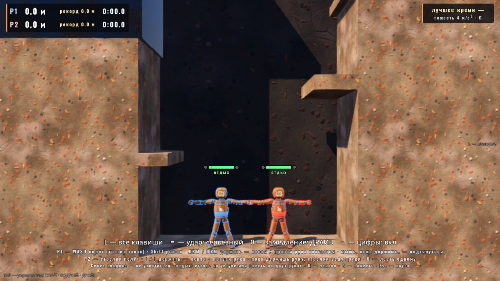
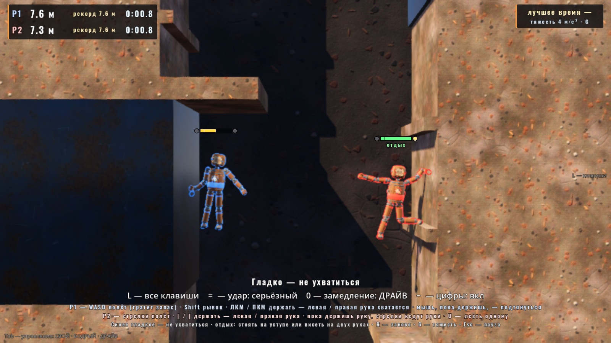
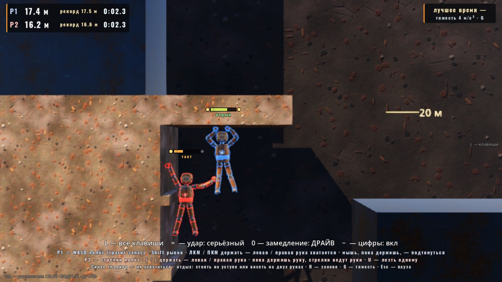
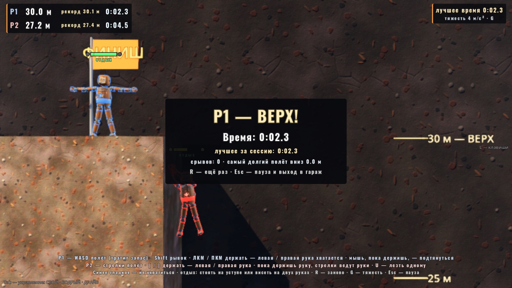

# «Подъём»: проба «стена» (06.10.2026)

Автор 06.10 (список режимов «как известные игры, но тут», MODES_PACK.md):

> 8. PEAK тоже.

План режима — `MODES_PACK.md` §8 «Подъём — как сделать похоже на PEAK». Это его **первый шаг**: проба «стена» — 30 м, хват двумя руками и
запас тяги. Цель — чтобы автор за 5 минут руками понял, интересно ли у нас лезть по стене, прежде чем делать режим целиком. Предметов,
травм, стоянок и этажей гравитации здесь нет (они — следующие шаги).



## Что в пробе

- **Стена 30 м** (`scenes/playground_climb.tscn`, стена — `scenes/climb/climb_wall.tscn` из сборщика `tools/build_climb_wall.gd`):
  шахта между двумя скалами, вид сбоку. Камень хватается рукой, **синие гладкие плиты — нет** (их обходят или перелетают).
  - левая скала (лицо x ≈ −3): камень 0–6 м с маленьким уступом (2.85 м); гладко 6–10.6; широкая полка 2.2 м (11.1 м); камень
    с выступами до 15.4; узкий уступ 0.5 м (15.45); камень до 19.4; **нависающий карниз** 19.4–20.2 (выступает в шахту на 3.6 м,
    низ и край — камень, верх — полка); над карнизом гладко 20.2–24 (перелёт с полки); камень 24–30; наверху плато и флаг «ФИНИШ»;
  - правая скала (лицо x ≈ +3): камень 0–4.6, уступ 1.2 м (5.0), камень 5–13 с выступами, гладко 13–17, выше — пусто (обход карниза).
  - отметки высоты каждые 5 м справа на дальней стене.
- **Запас тяги** (О4) — общий механизм куклы `ThrustStamina` (`scripts/core/thrust_stamina.gd`), в других режимах его нет (выключен
  по умолчанию): полёт тратит запас, рывок (Shift) — вдвое быстрее, на нуле тяги нет — только руки. Восполняется **только с опорой**:
  стоишь на уступе (нога / голень / бедро / торс касается статики снизу) — быстро, висишь **на двух руках** — медленно; **на одной
  руке запас тает**, а на нуле рука срывается (как в PEAK: силы кончились — падаешь). Полного бака хватает на ≈ 4.9 м подъёма.
- **Хват за стену** (О5) — в `ArmAssist` под флагом `wall_grip` (ставит только эта проба): две руки, ЛКМ — левая на экране (Hand_R),
  ПКМ — правая (Hand_L). Держишь кнопку — рука тянется к курсору и, коснувшись камня, хватается; держит без проскальзывания (сустав
  кисть → камень, точка хвата в системе камня); отпустил кнопку — отпустил стену. **Пока рука держит, курсор — куда тянется грудь**:
  потянул мышь вверх — подтянулся, в сторону — качнулся, над уступом — выжался на него.
- **Тяжесть шахты 4 м/с²** (купол — 2.0), клавиша **G** перебирает 2 / 4 / 6 — чтобы сравнить руками.
- **P2** — клавишей U или первым нажатием своих клавиш: стрелки — полёт, **[** — левая рука, **]** — правая. Пока клавиша руки зажата,
  стрелки ведут руки (а не полёт, запас не тратится): свободная рука — в сторону стрелок, без стрелок — к ближнему камню выше плеча;
  держащая — грудь в сторону стрелок.
- **HUD**: над куклой — полоска запаса, по бокам две метки рук (горит — держит), под ней слово опоры («отдых» / «тает» / «пусто»);
  слева сверху — высота ног, рекорд высоты, время (часы с первого отрыва от пола); справа — лучшее время за сессию и тяжесть; снизу —
  памятка; тосты «Сорвался: N м вниз», «Гладко — не ухватиться»; на плато — табличка «ВЕРХ!» со временем и срывами.
- Падение без травм: урона и отрыва деталей нет, у подножия запас восполняется — лезешь снова. R — все к подножию, часы с нуля.



## Клавиши

| | P1 | P2 |
|---|---|---|
| Полёт (тратит запас) | WASD | стрелки |
| Рывок (дороже) | Shift | правый Ctrl |
| Левая рука (на экране) | держать ЛКМ | держать **[** |
| Правая рука | держать ПКМ | держать **]** |
| Подтянуться, пока рука держит | мышь — куда тянуть грудь | стрелки при зажатой клавише руки |

Общие: **U** — P2 вошёл / ушёл, **R** — заново, **G** — тяжесть шахты 2 / 4 / 6 м/с², **Esc** — пауза (продолжить / заново / в гараж),
M / N — музыка / толпа, H — скин HUD. Меню: гараж → ВСЕ РЕЖИМЫ → «Подъём: проба стены».

Почему у P2 **[** и **]**: рядом со стрелками свободных клавиш нет — «/» фоторежим, «.» и «,» масштаб камеры, «;» запас из деталей,
«'» панель ВИД, правый Shift — тот же KEY_SHIFT, что рывок P1; цифрового блока у ноутбука нет. Геймпад P2 — как везде в ArmAssist
(стик отклонён — рука тянется; на стене это неудобно: держать стик, — не проверено).

## Ручки (`scripts/tuning.gd`, блок `CLIMB_*` в конце)

| Константа | Сейчас | Что значит |
|---|---|---|
| `CLIMB_GRAVITY` | 4.0 | м/с² в шахте (`CLIMB_GRAVITY_STEPS` 2 / 4 / 6 — клавиша G) |
| `CLIMB_STAMINA_FLY_PER_S` / `DASH_PER_S` | 70 / 140 | расход за секунду полной тяги / с рывком (бак 100) |
| `CLIMB_STAMINA_LEDGE_PER_S` | 45 | восполнение на уступе |
| `CLIMB_STAMINA_TWO_HANDS_PER_S` | 12 | восполнение на двух руках |
| `CLIMB_STAMINA_ONE_HAND_PER_S` | −5 | на одной руке тает |
| `CLIMB_STAMINA_REGEN_PAUSE_S`, `CLIMB_SUPPORT_HOLD_S` | 0.4, 0.15 | пауза после траты; опора засчитывается, если держится столько |
| `CLIMB_STAMINA_RESTART` | 12 | выдохся — тяга заперта, пока запас не вернётся до этого |
| `CLIMB_SLIP_AT_ZERO` | true | одна рука на нуле — срыв |
| `CLIMB_GRAB_DIST` / `NEAR_M` / `STALL_*` / `CATCH_SPEED` | 0.1 / 0.25 / 0.05 м за 0.15 с / 1.2 м/с | когда кисть хватается (касание + у цели, упёрлась или на лету) |
| `CLIMB_PULL_F` / `K` / `C` | 320 Н / 600 / 100 | подтягивание: предел силы на руку, пружина и демпфер груди к курсору |
| `CLIMB_PULL_REACH_FRAC` | 1.15 | насколько плечо может уйти от точки хвата (× досягаемость) — выжим на уступ |
| `CLIMB_KEY_REACH_EXTRA_M`, `CLIMB_KEY_UP_BIAS` | 0.4, 0.6 | руки P2 без стрелок: куда искать камень |
| `CLIMB_CAM_MIN/MAX_HALF_H`, `CLIMB_CAM_LOOK_UP` | 4.2 / 5.0, 1.2 | кадр 8.4–10 м по высоте, точка кадра на 1.2 м выше ЦМ |

## Решения пробы (отступления от плана — на суд автора)

1. **Тяжесть шахты 4, а не 2 м/с².** В поле купола (2.0) кукла без тяги оседает со скоростью 1 м/с: «упасть» нельзя, всегда успеваешь
   схватиться, запас ничего не решает. При 4 — падение ≈ 2 м/с (24 м за 12 с), полный бак — 4.9 м подъёма (цель плана 4–5 м). G в игре
   переключает 2 / 4 / 6 — сравнить.
2. **Подтягивание 320 Н на руку, а не 150.** План: «сила на кисть больше веса куклы». При тяжести 4 кукла 40 кг весит 160 Н: со 150–200 Н
   на одной руке кукла поднималась на 0.15 м в секунду и не вылезала на полку. 320 Н — одна рука уверенно, две — быстро.
3. **Пока рука держит, она — «верёвка»**: мышцы цепи кисть → торс 0, рука не сталкивается с этим камнем, лимит плеча снят (пока рука
   тянется или держит). Без этого выжим на уступ застревал (плечо упиралось в лимит −25° внутрь, предплечье цеплялось за край), а дальняя
   от стены рука не дотягивалась до неё через корпус. Тяга подтягивания — в грудь, а не в центр торса (иначе за 3–4 перехвата кукла
   переворачивалась вниз головой). Реакция помощи свободной руки, пока вторая держит стену, уходит в камень (не тянет тело вниз).
4. **Одна рука на нуле — срыв** (`CLIMB_SLIP_AT_ZERO`). Значит, с пустым баком можно только повиснуть на двух руках и ждать; без этого
   на одной руке можно висеть вечно.
5. **Кисть хватается не на первом касании**, а у цели, упёршись или на лету: иначе при перехвате вверх рука цеплялась у самого плеча.



## Проба

```
godot --headless --path godot --fixed-fps 60 res://tests/climb_probe.tscn -- "only=stamina+grip+wall,out=<json>"
```
Секции `stamina | grip | wall` (пусто — все три; `calib` — замеры при каждой тяжести, без проверок), JSON между `=== CLIMB PROBE ===` и
`=== OK / FAIL ===`, код выхода, счётчик SCRIPT ERROR (Logger). Последний прогон (worktree, сборка этой ветки) — **30 / 30 ok**:

| Что | Число |
|---|---|
| полёт вверх с пола, полный бак | пуст за 1.43 с, подъём **4.89 м**; рывок — пуст за 0.72 с (5.08 м) |
| бак пуст, ввод «вверх» держится | кукла падает, vy −2.06 м/с |
| без ThrustStamina (другие режимы) | `Doll.stamina = null`, за 3 с тяги +9.8 м (с запасом — 4.9) |
| в воздухе без опоры | запас не копится (0 за 1.2 с) |
| пол / уступ | 0 → 100 за 2.5 с |
| две руки | +48 за 4 с |
| одна рука | −50 за 10 с; на нуле — срыв «tired», снова хватает только после отпускания кнопки |
| хват за камень, 13 с на одной руке | кисть от точки хвата ≤ 0.01 м, ЦМ за 10 с ≤ 0.02 м |
| гладкая плита | не хватается (касание гладкого отмечено) |
| выжим на полку 11.1 одной рукой, курсором | ЦМ +1.25 м, кукла на полке (опора «уступ») |
| перехват руками без тяги по ровной скале | 8 из 8 перехватов за 6.5 с, **+1.13 м** (мало — см. вопросы) |
| руки P2 «[» / «]» | хватают и отпускают, стрелки при зажатой клавише не тратят запас; без стрелок рука сама к камню |
| рука без `wall_grip` (другие режимы) | стену не хватает |
| только полётом с пола | 4.9 м из 30; держать «вверх» 6 с — не выше 1.7 м (без опоры запас не копится) |
| сценарный подъём (полёт + хваты + отдых), 40 шагов | **финиш за 105.7 с**, из них ≈ 70 с — висеть на руках, пока копится запас |
| падение с 24 м | 11.8 с до подножия, кукла цела (14 деталей), срыв засчитан, внизу запас 100, снова к камню и хват |

Регресс (та же ветка): `arm_assist_probe` (30), `prop_heft_probe` (18), `puzzle_probe`, `sport_probe`, `squad_probe`,
`match_probe scene=ruins` — OK; `python3 godot/tools/i18n.py check` — 0 ошибок; `i18n_probe`, `i18n_scenes_probe`, `i18n_layout_probe`
(экран Подъёма вдвоём и табличка «ВЕРХ!» добавлены в `_pass()`) — OK.

Снимки (окно без кражи фокуса):
```
godot/tools/godot_nofocus.sh --path godot --resolution 1600x900 --fixed-fps 60 res://tests/climb_snapshot.tscn -- "out_dir=/abs/dir"
```
Стену пересобрать: `godot --headless --path godot res://tools/build_climb_wall.tscn`.



## Что смотреть руками (5 минут)

1. С пола: W — запас кончается на ~5 м, кукла падает. Значит, лезть надо руками и с отдыхом.
2. ЛКМ на камень у правой скалы — левая хватается; ПКМ рядом — обе держат, слово «отдых», полоска растёт. Отпустить одну — «тает».
3. Держа обе, вести мышь вверх — подтягиваешься; отпустить нижнюю, ткнуть выше — перехват. Удобно ли «курсор — куда тянется грудь»?
4. Полка 11.1 м: повиснуть на её краю, курсор вверх-наружу, потом над полкой — выжаться. Получается ли без полёта?
5. Карниз 19.4–20.2: под ним висеть на двух руках, перебраться к краю, обойти и вылезти наверх.
6. Сорваться (одна рука на нуле) — смешно или обидно? Как ощущается падение при G = 2 / 4 / 6?
7. Вдвоём (U): P2 на [ и ] со стрелками — можно ли так лезть?

## Что НЕ проверено

- **Руками (мышью) не играно** — всё выше проверено пробой со сценарным вводом (цели рук, ввод тяги) и снимками; удобство мыши и
  клавиатуры P2 — ждёт автора.
- Геймпад (стик держит руку на стене, пока отклонён) — не проверено.
- Производительность в окне не мерилась (одна-две куклы, статичная стена — ожидаю как в спорт-зале).
- Модульные куклы других сборок: проба — на «Человеке» (kit_human); у сборки без Hand_R / Hand_L будет одна рука или ни одной.
- Сценарный подъём — полётом от отдыха к отдыху; чисто ручной подъём на всю стену пробой не проверен (перехват по ровной скале медленный).

## Что дальше (MODES_PACK §8, шаг 2–3)

- Предметы (2 слота): крюк — точка хвата на гладком, верёвка вниз другу, батарейка — вернуть запас.
- Травмы: удар о камень быстрее порога — отрыв детали (механизм прочности суставов), без руки — не схватиться ею, −20 % к запасу за деталь.
- Стоянки: детали обратно, запас полный, точка возрождения.
- Этажи по гравитации (несколько зон тяжести): обычная, тяжёлая ×2, ветер вбок, лёгкая со льдом.
- Вдвоём: схватить друга за руку (`GRAB_DOLLS` уже есть — E у P1), нести голову выбитого до стоянки.
- Генерация горы — только если зайдёт.

## Открытые вопросы автору

1. Интересно ли так лезть: «подлетел — схватился — отдышался — дальше»? Или мало «лазания» руками?
2. Тяжесть шахты: 4 м/с² (сейчас), 2 (как в куполе) или 6? Скорость падения устраивает?
3. Сколько полёта на полном баке: сейчас ≈ 4.9 м. Больше — проще, меньше — больше рук.
4. Отдых на двух руках +12 / с (полный бак ≈ 8 с висения) — не скучно ли ждать? Может, медленно копить только на уступах, а на руках —
   не таять?
5. Срыв одной руки на нуле — оставить?
6. Курсор, пока рука держит, — «куда тянется грудь». Или наоборот (как в A Difficult Game About Climbing: мышь вниз — тело вверх)?
7. Перехват по ровной скале даёт ≈ 0.15 м за руку — нужна ли стена с частыми выступами («зацепками») вместо ровного камня?
8. Руки P2 — [ и ] — неудобно? Или P2 одной рукой (одна клавиша), или только геймпад?

## Файлы

Новые: `scripts/core/thrust_stamina.gd`, `scripts/climb/climb_match.gd`, `climb_key_hands.gd`, `climb_focus.gd`,
`scenes/climb/playground_climb.gd`, `climb_hud.gd`, `climb_wall.gd`, `climb_wall.tscn`, `scenes/playground_climb.tscn`,
`tools/build_climb_wall.gd/.tscn`, `tests/climb_probe.gd/.tscn`, `tests/climb_snapshot.gd/.tscn`, `docs/plan-demo/img/climb/`.

Общие (для слияния, всё новое — за флагами, выключенными по умолчанию):
- `scenes/doll/doll.gd` — поле `stamina: ThrustStamina = null` и 4 строки хука в тяге (`_physics_process`);
- `scripts/body/arm_assist.gd` — блок «хват за стену» (флаг `wall_grip`, по умолчанию false), сигналы `wall_grabbed` / `wall_released`,
  список тел цепи `_chain_bodies`; в `_apply_assist` реакция в торс не идёт, только если `wall_grip` и вторая рука держит стену;
- `scripts/tuning.gd` — блок `CLIMB_*` в конце;
- `scenes/menu/test_menu.gd` — пункт в конце новых режимов;
- `scripts/show/lower_thirds.gd` — `climb_match.gd` в `SKIP` (плашки бойцов «ИГРОК 1 · СЕРИЯ» не к месту и налезали на памятку);
- `locale/en.json` — 28 строк; `tests/i18n_layout_probe.gd` — экран Подъёма в `_pass()`.
`godot/README.md` (строка про пробу) не трогал — его правит другая сессия в основном чекауте.
