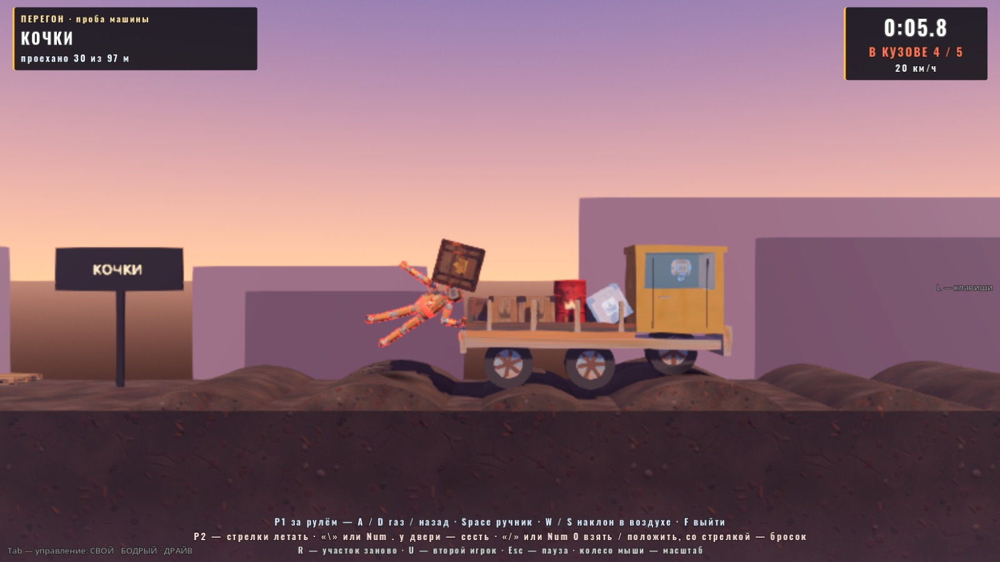
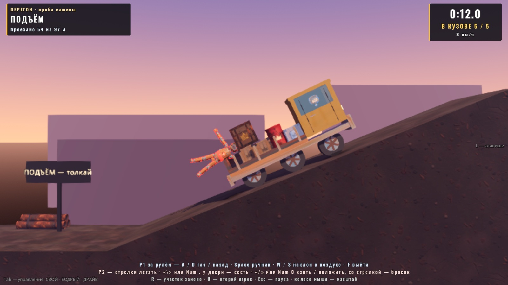
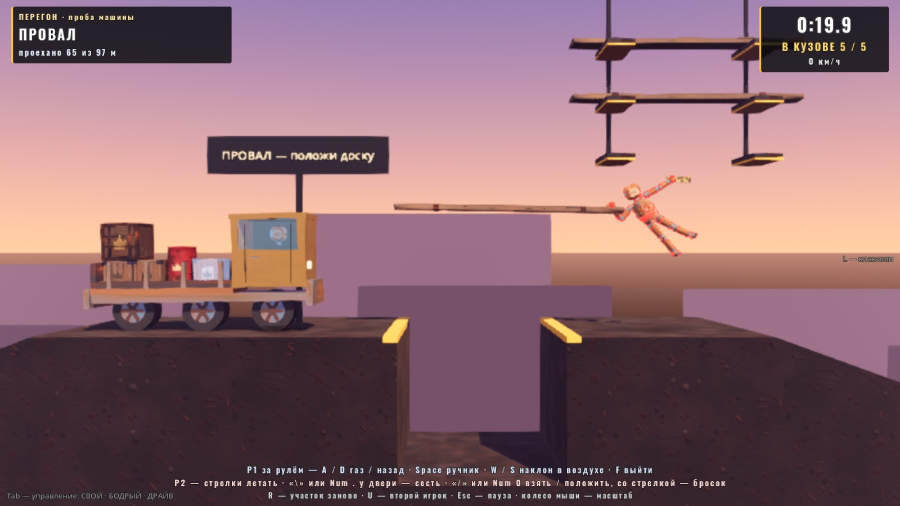
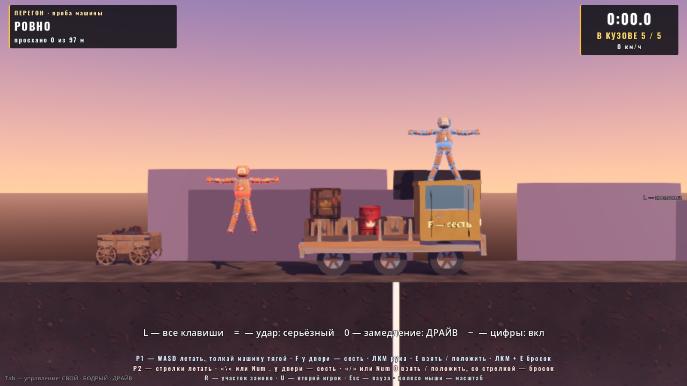

# «Перегон» — проба машины (06.10.2026)

Автор 06.10 (MODES_PACK.md, п. 7):

> RV There Yet — подумай, как добавить интересно похожее

План — `MODES_PACK.md` §7, шаг 1: **проба «машина»** на одном участке 100 м — езда, толкание, груз в кузове, переворот. Цель — чтобы
автор руками за 5 минут понял, весело ли возиться с машиной на нашей физике, до того как делать режим целиком. Запаса тяги, лебёдки,
длинной дороги и звёзд здесь нет (это шаги 2–3). Ветка `claude/convoy-car`, в main не влито.



## Как запустить

Гараж → «ВСЕ РЕЖИМЫ» → **«Перегон: проба машины»** (после «Головоломок вдвоём»). Сцена `scenes/playground_convoy.tscn`.

Начинаешь один (P1) у машины. Второй игрок входит первым нажатием своей клавиши (стрелки, правый Ctrl, Enter, «\», Num ., «/»,
Num 0, геймпад 2) или клавишей **U**; U ещё раз — P2 уходит.

| Клавиша | Что |
|---|---|
| **P1:** WASD, Shift, Space | летать, ускорение, раскрутка (как в бою); толкать машину — тягой, телом в борт |
| **P1:** F у двери кабины | сесть / выйти (у двери — подпись «F — сесть») |
| **P1 за рулём:** A / D | газ вперёд / назад |
| **P1 за рулём:** Space | ручник (держать) |
| **P1 за рулём:** W / S | наклон в воздухе (нос вверх / вниз), когда ни одно колесо не на земле |
| **P1:** ЛКМ (держать) + E | рука: взять / положить, ЛКМ + E — бросок (ловить выпавший груз, нести доску) |
| **P2:** стрелки, правый Ctrl, Enter | летать, ускорение, раскрутка |
| **P2:** «\» или Num . у двери | сесть / выйти; за рулём ← / → газ / назад, Enter — ручник, ↑ / ↓ — наклон в воздухе |
| **P2:** «/» или Num 0 | рука (как в «Головоломках»: к ближнему предмету в сторону стрелок; со стрелкой — бросок) |
| геймпад | Y — сесть / выйти; остальное как везде |
| R | участок заново (машина, весь груз и доски — на места, игроки — к машине, время с нуля) |
| U | P2 вошёл / ушёл |
| Esc | пауза: продолжить / заново / в гараж |
| Enter (после финиша) | заново |

E занята хватом руки, поэтому «сесть» — **F** (свободна во всех режимах, кроме спорт-зала, где это смена вида спорта; основной ряд,
не F-клавиша). У P2 — «\» и Num . рядом со стрелками: «/» и Num 0 уже рука P2, правый Shift — это рывок P1 (KEY_SHIFT без стороны),
«.» — масштаб камеры (HitJuice).

HUD: слева сверху — участок («КОЧКИ», «ПОДЪЁМ»…) и «проехано N из 97 м»; справа — время (с первого движения машины), «В КУЗОВЕ N / 5»
(меньше пяти — красным) и скорость в км/ч; по центру — «Перевернулась — кран через N с» / «Провал!»; снизу — памятка клавиш P1 и P2
по состоянию (снаружи / за рулём); финиш — табличка «ДОЕХАЛИ»: время и сколько груза довезли.

## Участок (сборщик `tools/build_convoy_probe.gd`)

Слева направо, верх дороги в метрах (x — от левой стены):

| x | Что |
|---|---|
| 2 | старт (линия на срезе земли), машина с грузом |
| 2…22 | ровно |
| 22…44 | поле кочек: 7 кочек 0.28–0.5 м |
| 44…50 | короткий разгон (5.4 м) |
| 50…63.6 | крутой подъём 22° на 5.5 м (табличка «ПОДЪЁМ — толкай») |
| 63.6…71 | площадка 7.4 м (табличка «ПРОВАЛ — положи доску») |
| 71…74.4 | **провал** 3.4 м, глубина 3 м (шире колёсной базы 3.0 м — без доски машина падает) |
| 74.4…78.6 | площадка; над ней — стеллаж с тремя досками (ярусы через 1.2 м, концы досок свисают) |
| 78.6…93.7 | спуск 20° |
| 99 | финиш (клетчатая полоса), дальше площадка до стены x 108 |

Земля — один многоугольник: коллизии — выпуклые куски (`Geometry2D.decompose_polygon_in_convex`), вид — призма; кочки —
цилиндры. Фон — небо заката Свалки (`scrap_env.tres`) и силуэты холмов без света. Груз и доски кладёт площадка при запуске — их
число и массы правятся в `Tuning`, без пересборки сцены.



## Машина (`scripts/convoy/convoy_car.gd`, `ConvoyCar`)

Своя физика, не `VehicleBody3D`:

- **Кузов** — `RigidBody3D` 300 кг, составная форма (рама с полом кузова, задний борт 0.56 м, кабина, бамперы), центр масс опущен.
  Длина 4.8 м, кабина спереди, кузов открытый 2.9 м. Ближний к камере борт низкий — груз виден.
- **Колёса** — три `RigidBody3D`-сферы r 0.45 м, 15 кг, на `Generic6DOFJoint3D` к кузову: по x и z колесо зажато, по y кузова ходит
  в пределах подвески (лимит сустава −0.2…+0.12 м), вокруг z крутится. **Пружина-демпфер подвески** — скриптом (6000 Н/м, 650 Н·с/м;
  машина проседает на 0.1 м). **Мотор** — угловой мотор сустава: цель — скорость вращения (8 м/с вперёд, 4 назад), предел — момент
  85 Н·м на колесо (все три ведущие, тяга 567 Н). Ручник — тот же мотор с целью 0 и пределом 400 Н·м.
- **Вес.** Мир NULL — g = 2 м/с² (кукла парит). Машине — свой вес ×3 (g ≈ 6: держит дорогу, не «лунная»), грузу ×1.75 (g ≈ 3.5:
  легче машины — на кочке машина проваливается вниз быстрее груза, и груз «всплывает» над кузовом — так он и вылетает).
- Всё в плоскости боя, как куклы (z зажата, повороты только вокруг z). Рука кузов и колёса не хватает (meta `no_grab`).

**Сесть / выйти.** ЦМ куклы ближе 2 м к двери кабины, место свободно — F. Кукла в кабине: управление выключено, все детали
заморожены (кинематика) без коллизий, видна только голова за стеклом; каждый тик детали переносятся за кабиной с упреждением на тик
(голова не отстаёт). Масса машине не добавляется, толчков нет. Вышла — над кабиной (по «верху» мира — и у перевёрнутой машины),
со скоростью машины, снова летает. **Без водителя машина всегда на ручнике.**

**Перевернулась** (верх кузова вбок или вниз и машина почти стоит) — через **4 с** её сам поднимает «кран NULL»: кузов без веса
поднимается на 2.6 м над землёй, поворачивается колёсами вниз и отпускается (на ~8 с от переворота до «стоит на колёсах»). Не вышло
за 3 с — ставится на колёса переносом. Выбрал **авто, а не клавишу**: проще (не надо помнить ещё клавишу), и честно — 4 с хватает,
чтобы попробовать перевернуть её обратно самим, толкая.

**Провал / с дороги.** Колесо машины в провале ниже дороги (или её ЦМ ниже кромки на 1 м) дольше 1.5 с — машина **на старт участка**
(x 2), что лежит в кузове — с ней. Куклы снаружи остаются где были (могли уже нести доску). Мост, если положен, остаётся.

## Груз и доски (`scripts/convoy/convoy_cargo.gd`, `ConvoyCargo`)

- **Груз** — 5 тел (`Tuning.CONVOY_CARGO`): 3 ящика 10 кг, бочка 12 кг (лёгкий класс PropHeft — рука приваривает и бросает), большой
  ящик 30 кг (средний — только тащить). Не ломаются (счёт не должен пропадать от удара). В кузове: нижний ряд от борта к кабине,
  что не влезло — сверху. «В кузове» — центр тела между задним бортом и кабиной и не выше 2.3 м над осью.
- **Доски** — 3 штуки 5 × 0.14 м, 8 кг, вес ×0.5 (g 1 — опускается медленно). Для руки доска всегда «средний» класс (не приваривается
  к кисти). **В руке доска держится ровно** (площадка, `_level_held`: момент к горизонтали до 150 Н·м, без реакции в куклу) — удержание
  угла самой руки (30 Н·м и относительно кисти) длинную доску, взятую за конец, не держало: на разгоне куклы она проворачивалась.
- **Мост.** Доска, отпущенная поперёк провала (оба конца над дорогой, наклон < 15°) и успокоившаяся на 0.25 с, «ложится в пазы»:
  ровно на дорогу и замораживается (тост «Доска легла поперёк — мост готов»). Иначе машина, наезжая колесом на торец, сталкивала
  лёгкую доску в провал. Мост держится до R. Допуск, куда положить: ±0.7 м по провалу.
- **Как взять доску:** подлететь к стеллажу **справа** (рука-хват у куклы — правая, на экране слева), взять свисающий конец нижней
  доски, потянуть вправо с кронштейнов, опуститься ниже стеллажа и нести к провалу; середину доски — над провалом, опустить, отпустить.



## Ручки (`scripts/tuning.gd`, блок `CONVOY_*` в конце)

| Ручка | Значение | Что |
|---|---|---|
| `CONVOY_CHASSIS_MASS` / `WHEEL_MASS` | 300 / 15 кг | кузов, колесо |
| `CONVOY_CAR_G_SCALE` / `CARGO_G_SCALE` | 3.0 / 1.75 | вес машины и груза (× g мира 2) |
| `CONVOY_WHEEL_RADIUS` / `WHEEL_X` / `WHEEL_FRICTION` | 0.45 м / −1.55, −0.05, 1.45 / 1.0 | колёса |
| `CONVOY_TRAVEL_DOWN` / `TRAVEL_UP` | 0.2 / 0.12 м | ход подвески |
| `CONVOY_SPRING_K` / `SPRING_C` / `SPRING_F_MAX` | 6000 Н/м / 650 Н·с/м / 6000 Н | пружина подвески |
| `CONVOY_DRIVE_TORQUE` | 85 Н·м на колесо | мотор (тяга 567 Н) |
| `CONVOY_MAX_SPEED` / `REVERSE_SPEED` | 8 / 4 м/с | предел скорости |
| `CONVOY_ROLL_TORQUE` / `BRAKE_TORQUE` | 4 / 400 Н·м | накат без газа, ручник |
| `CONVOY_AIR_TILT_TORQUE` / `AIR_TILT_MAX_W` | 1800 Н·м / 3 рад/с | наклон W / S в воздухе |
| `CONVOY_ENTER_RADIUS` / `EXIT_UP_M` | 2 / 2.6 м | сесть у двери, выйти над кабиной |
| `CONVOY_FLIP_UP_Y` / `FLIP_SPEED` / `UPRIGHT_S` | 0.3 / 1.2 м/с / 4 с | когда «перевернулась», через сколько кран |
| `CONVOY_CRANE_LIFT_M` / `CRANE_MAX_S` | 2.6 м / 3 с | кран |
| `CONVOY_CARGO` | 3 ящика 10, бочка 12, ящик 30 кг | груз |
| `CONVOY_PLANK_LEN` / `PLANK_MASS` / `PLANKS` / `PLANK_G_SCALE` | 5 м / 8 кг / 3 / 0.5 | доски |
| `CONVOY_PLANK_LEVEL_OMEGA` / `PLANK_LEVEL_TORQUE` | 8 рад/с / 150 Н·м | доска в руке держится ровно |
| `CONVOY_PIT_DROP_M` / `PIT_RESET_S` | 1 м / 1.5 с | провал → на старт |

Профиль участка (подъём 22°, провал 3.4 м, кочки) — константы сборщика `tools/build_convoy_probe.gd`; после правки:
`godot --headless --path godot res://tools/build_convoy_probe.tscn`.

## Проба `tests/convoy_probe.gd`

```
godot --headless --path godot --fixed-fps 60 res://tests/convoy_probe.tscn -- "only=car+cargo+course,out=<json>"
```

JSON между `=== CONVOY PROBE ===` и `=== OK / FAIL ===`, код выхода, счётчик SCRIPT ERROR. Весь прогон — ~8 с реального времени.
Последний прогон (ветка, 06.10): **27 проверок, все ok**; прогон детерминирован (два подряд — те же числа).

| Секция | Проверка | Число |
|---|---|---|
| car | на ручнике на ровном / на склоне 22° | сдвиг за 5 с 0.000 / 0.001 м |
| car | разгон 50 м с места | **8.97 с**, наибольшая скорость 8.03 м/с (29 км/ч) |
| car | ручник с 8 м/с | тормозной путь 6.2 м |
| car | задний ход | 4 с — 10.75 м, 4.0 м/с |
| car | кочки участка на полной (до 7.3 м/с) | оси целы, нет NaN, отклонение оси 0.006 м, колесо до 19 рад/с (предел 28), в воздухе 0.23 с, крен до 16° |
| car | падение с 3.5 м | оси целы, встала на 3 колеса |
| car | W / S в воздухе | ω +0.69 / −0.75 рад/с |
| car | сесть / выйти | дальше 2 м от двери — не садится; села — детали заморожены, без коллизий, видна голова; машина на ручнике с водителем сдвинулась на 6 мм; голова от места водителя на ходу ≤ 1 мм; вышла над кабиной и за 1 с поднялась тягой на 2.9 м |
| car | вверх колёсами | кран поставил на колёса через **8.1 с** от переворота (переносом — 0 раз) |
| cargo | ровно до 8 м/с + ручник с полной | в кузове 5 из 5 |
| cargo | кочки: полный газ (до 6.8 м/с) / газ 0.3 (до 3.5 м/с) | осталось **4 из 5** / 5 из 5 |
| cargo | рука: ящик с земли — в кузов | схватила, донесла, 4 → 5 |
| course | клавиши по-настоящему (`Input.parse_input_event`) | F далеко — «подлети к двери»; F у двери — села; D 2 с — 2.6 м; Space — стоит; F — вышла, машина на ручнике |
| course | подъём 22° без толкания с места / с разгона 5.4 м | не заехала (ЦМ до y 2.4 / 3.5 из 5.5) |
| course | одна кукла толкает / две | заехала за **10.3 с** / **6.7 с** |
| course | соло со старта на полном газу через кочки (для сведения) | **заехала** за 17.1 с, груза в кузове 4 из 5 |
| course | провал без доски | упала и вернулась на старт через 4.6 с |
| course | доска рукой со стеллажа | взяла за конец, вытянула, донесла, легла мостом (центр x 72.4 при провале 71…74.4) |
| course | с доской | проехала провал за 4.7 с, без сброса |
| course | весь участок сценарием (водитель + две куклы толкают на подъёме + третья кладёт доску рукой) | финиш за **35.5 с** по часам участка, груз довезли **4 из 5**, сбросов на старт 0 |

Ещё для сведения: на склоне 22° мотор один (без груза) с места **катится назад** (−4.1 м за 4 с) — на подъёме без толкания держать
ручником.

Снимки (окно, без кражи фокуса):

```
godot/tools/godot_nofocus.sh --path godot --resolution 1600x900 --fixed-fps 60 res://tests/convoy_snapshot.tscn -- "out_dir=/abs/dir"
```

Регресс после правок (все зелёные): `arm_assist_probe` (30), `prop_heft_probe` (18), `sport_probe`, `match_probe`, `i18n.py check`,
`i18n_probe`, `i18n_scenes_probe` (с этой сценой), `i18n_layout_probe` (с этой сценой: P2, P1 за рулём, табличка финиша).



## Что смотреть руками (5 минут)

1. Один: сесть (F), доехать до кочек на полном газу — сколько груза вылетит; второй раз — аккуратно. Весело ли ловить вылетевшее рукой
   и закидывать обратно (машина стоит на ручнике, пока тебя нет)?
2. Подъём: один — получается ли с разгона через кочки (проба: да, но с потерей груза); вдвоём — один за рулём, второй толкает.
3. Провал: остановиться перед ним (ручник), слетать за доской на стеллаж за провалом, положить поперёк. Не слишком ли муторно
   с длинной доской (её держит «выравнивание», но качается на пружине руки)?
4. Нарочно перевернуть на кочках или на спуске — ок ли «кран» через 4 с.
5. Чувство машины: скорость 29 км/ч, разгон ~1.6 м/с², пружины, наклон в воздухе — не вязко ли, не «лунно» ли.

## Что тронуто в общих файлах (для слияния)

| Файл | Что |
|---|---|
| `scripts/tuning.gd` | блок `CONVOY_*` в конце файла |
| `scenes/menu/test_menu.gd` | пункт «Перегон: проба машины» после «Головоломок вдвоём» |
| `locale/en.json` | 39 строк в конце |
| `tests/i18n_layout_probe.gd` | сцена перегона в `_pass()` (P2, P1 за рулём, предупреждение, табличка финиша) |
| `tests/i18n_scenes_probe.gd` | сцена перегона в списке (таблички участка, «ДОСКИ», подпись у двери) |
| `scripts/show/lower_thirds.gd` | `convoy_match.gd` в `SKIP` (плашки бойцов «ИГРОК 1 · СЕРИЯ 0–0» в начале — не для этой пробы) |

`doll.gd`, `arm_assist.gd`, `input_setup.gd`, `match.gd` **не тронуты**: `ConvoyMatch extends Match` (как `PuzzleMatch`: без отсчёта,
урона, отброса, толпы и СТАЗИСА), действия `p1_car` / `p2_car` создаёт площадка, рука P2 — `PuzzleKeyArm` из «Головоломок» (без правок),
кукла в кабине — через уже открытые `control_enabled` и `freeze` деталей.

Новые файлы: `scripts/convoy/` (`convoy_car`, `convoy_cargo`, `convoy_match`, `convoy_geo`), `scenes/convoy/` (`playground_convoy.gd`,
`convoy_hud.gd`, `convoy_car.tscn`), `scenes/playground_convoy.tscn`, `tools/build_convoy_probe.gd/.tscn`,
`tests/convoy_probe.gd/.tscn`, `tests/convoy_snapshot.gd/.tscn`, `docs/plan-demo/img/convoy/`.

## Что дальше (шаги 2–3 плана)

- **Запас тяги (О4)** — полёт тратит, заряжается только у машины (зарядка на кузове): тогда машина нужна, а не «толкай и лети вперёд».
- **Лебёдка** — крюк (хват за столб) и подтяжка машины на обрыв; здесь вместо обрыва — подъём «толкай».
- **Длинная дорога** — 300–500 м, 5 участков, контрольные пункты (перевернулась и не встала за 10 с — к пункту), звёзды за время и груз.
- Грязь (вязкость), камнепад, участок с гравитацией вбок, взрывная бочка в кузове.
- Звук мотора и подвески (сейчас у машины своего звука нет — только удары тел).
- Машина из мастерской (колёса, лебёдка, зарядка за Energy).

## Открытые вопросы автору

1. **Провал → на старт участка** (буквально по заданию). Это 70 м и подъём заново — не слишком ли больно? Вариант: к последнему
   контрольному пункту (перед подъёмом / перед провалом).
2. **Соло на подъёме** — только с разгона через кочки (теряя груз) или откатившись назад для разгона: толкать некому, без водителя машина
   на ручнике. Оставить (вдвоём легче — это и есть «кооп»), или дать «круиз» (газ держится, пока водитель вышел)?
3. **Кран через 4 с** сам — или клавишу «поставить» (и/или дольше, 10 с, как в плане)?
4. **Доска «ложится в пазы»** (замерзает мостом) — честно ли, или пусть лежит свободно и может съехать (тогда нужны пазы на кромках)?
5. **Доска держится в руке ровно** (выравнивание без реакции в куклу) — помогает или ощущается «магией»?
6. Груз вылетает умеренно (на полном газу через кочки — 1 из 5). Больше хаоса — легче груз (`CARGO_G_SCALE` 1.75 → 1.3) или выше кочки.
7. Подъём 22°: без толкания — нет, одна кукла — 10 с, две — 7 с. Круче / длиннее?

## Что не проверено

- **Руками не пройдено** — всё проверено пробой и снимками; «чувство» машины, переноска доски живыми руками, P2 с клавиатуры в этой
  сцене (рука `PuzzleKeyArm` проверена только пробой «Головоломок») и геймпад — ждут автора.
- Перф с окном не мерился (2 куклы, машина 4 тела, 8 пропсов — проблем не ждём).
- Визуальная интерполяция головы водителя на ходу (проба мерит физическое положение: 1 мм; в окне — на снимках голова на месте).

## Честное мнение

Езда на своей физике получилась живой: машина пружинит на кочках, кузов клюёт, ящики подпрыгивают и иногда улетают, подъём
действительно требует второго — один жмёт газ, второй упирается в борт. Самое «RV»-смешное — когда груз вылетает и его надо ловить,
пока машина стоит на ручнике. Самое слабое — доска: в 2D длинный предмет носится неуклюже, без помощников («ровно в руке», «ложится
в пазы») сценарий её стабильно ронял. Если автору не зайдёт — провал лучше заменить лебёдкой или мостом-рычагом.
