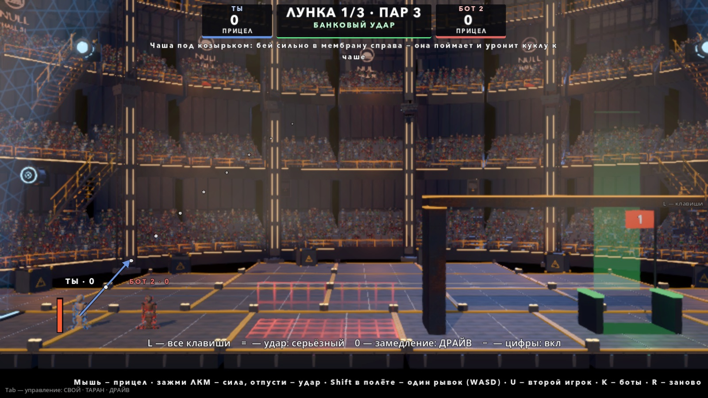
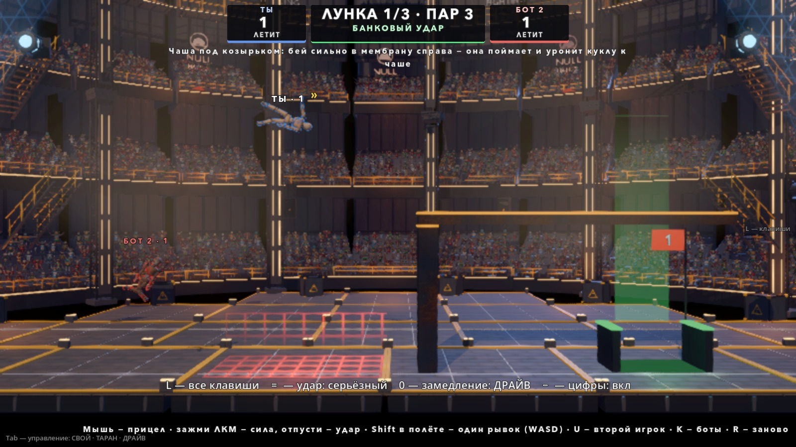
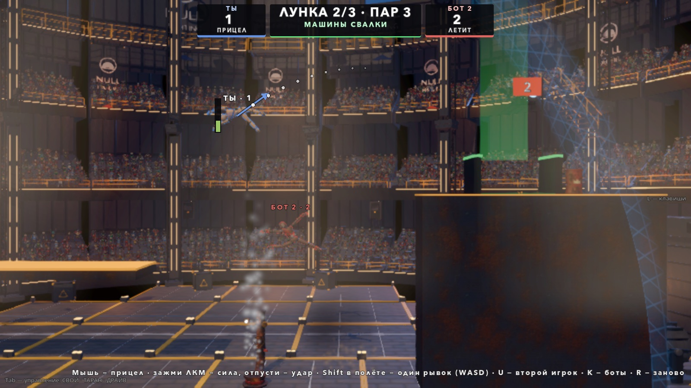
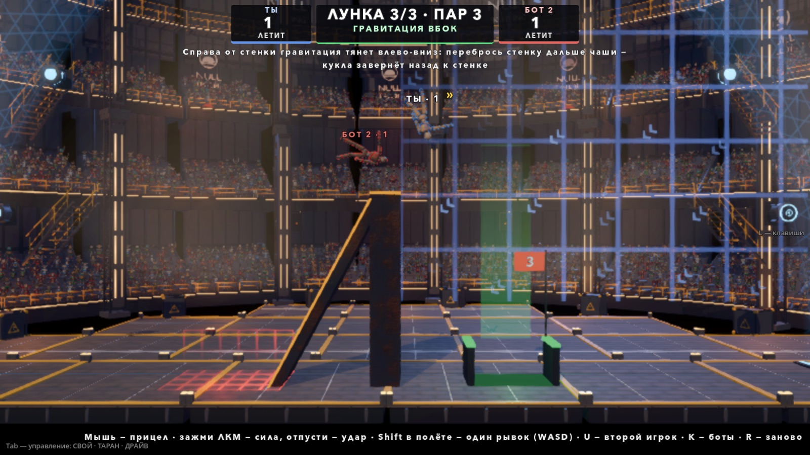
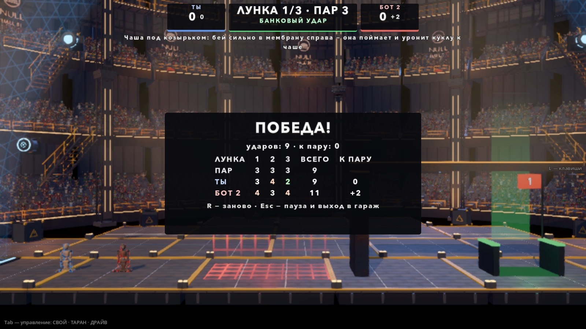

# Гольф: кукла — мяч (пробный режим, 06.10.2026)

Автор 06.10 (`MODES_PACK.md` §3, близко к тексту):

> гольф не понимаю, как это может быть прикольно тут, подумай

Ответ плана: обычный гольф (бита + мячик) у нас — медленный футбол; весело может быть, только если **мяч — сама кукла**. Эта проба —
чтобы за 5 минут руками понять, смешно или нет. Не смешно — режим выкидываем. Поэтому одна сцена, три лунки, а главное — удар и полёт.







## Как запустить

- В игре: гараж → **ВСЕ РЕЖИМЫ** → «Гольф: кукла — мяч (проба)» (сразу после строк гонки).
- Напрямую: `godot --path godot res://scenes/playground_golf.tscn`.

## Правила

- **Двое:** ты (P1) и бот (P2). U — P2 отдаётся второму человеку на стрелках (или второй просто жмёт свою клавишу — бот отдаёт
  управление сам, как в бомбе и гонке). Купол Old NULL Hall: его мембрана — борт поля (в гольфе она видна всегда). Поле купола на время
  гольфа сильнее обычного: 0.45 G вместо 0.20 G — иначе удар летит 8–10 с.
- **Кукла — мяч.** Всегда обмякшая (стан, мышц нет), без управления полётом — ни до удара, ни после. Урона нет. Лежит, где остановилась.
- **Удар.** P1: мышь — прицел (стрелка из ЦМ куклы, длина — сила, пунктир — начало полёта по той же формуле, что у бота); зажал ЛКМ —
  полоска силы ходит 0 → 1 → 0 за 2 с; отпустил — удар. P2: ← → крутят прицел, Enter держать — сила. Запуск — **одинаковая скорость
  всем деталям** (3…15 м/с) + кувырок вперёд 3 рад/с жёстким вращением: суставы не тянутся (проба: разрыв сустава ≤ 0.002 м).
- **Все бьют одновременно, без очереди.** Куклы сталкиваются в полёте и могут выбить друг друга из чаши.
- **Одна поправка в полёте:** Shift (P1) / Ctrl (P2) — мгновенно +4 м/с в сторону WASD / стрелок (без WASD у P1 — к курсору, без
  стрелок у P2 — вверх). Вторая за удар не сработает. Над куклой в полёте значок «»», пока поправка есть.
- **Конец удара:** ЦМ медленнее 0.4 м/с 0.8 с подряд, или через 8 с. У верха парового столба кукла висит и качается — там порог 1.3 м/с.
  Следующий удар — с места остановки.
- **Яма** (красная сетка на полу) — ЦМ в ней: +1 удар и кукла назад на место прошлого удара. Вылет за карту — так же.
- **Лунка** — чаша (ширина 2.6 м, глубина 1.3 м, зелёный обод, флажок с номером, столб света). Засчитано, если ЦМ пролежал в чаше
  **1 с подряд**; выбили раньше — счёт заново. В чаше «сетка»: скорость деталей гаснет (кукла с 6 м/с сверху не выпрыгивает).
  Засчитанная кукла уходит с поля до следующей лунки.
- **Прочность суставов (клавиша C):** в гольфе урона нет, поэтому сустав изнашивается от ударов: деталь сменила скорость за тик больше
  10 м/с — износ 4 HP за каждый м/с сверх. Потерял деталь за удар — **+1** (один раз за удар). На следующей лунке кукла целая.
- **Лимиты:** больше пар + 5 ударов — лунка закрыта для игрока (в карточку пар + 6); лунка идёт не дольше 4 минут.
- Пар — 3 на каждой лунке (среднее ботов 2.0–3.5, см. «Проба»). Итог — по сумме ударов, меньше — лучше. Между лунками — карточка 4 с.

## Лунки

Все три — на одном месте в куполе: поле лунки собирается кодом (`GolfCourse.build_hole`) из стальных плит с жёлтой кромкой, паровой
машины и бочек Свалки.

| # | Имя | Что | Как пройти (бот / сценарный удар) |
|---|---|---|---|
| 1 | Банковый удар | Чаша под козырьком справа, слева её закрывает стенка до козырька — прямой удар не проходит. Яма посередине — недолёт | Сильно вправо-вверх: мембрана справа ловит и роняет куклу в проход под козырьком; оттуда — короткий удар в чашу. Козырёк сверху — ловушка: оттуда скатиться вправо |
| 2 | Машины Свалки | Над стартом низкий потолок — только настильный удар. Паровой столб (всё время ACTIVE) поднимает куклу на 10 м к полке, на полке чаша. Бочки: у столба справа и на полке за чашей — деталь ближе 0.9 м, и через 0.15 с взрыв; новая бочка через 4 с | Настильно (20°) под потолком в основание столба → столб поднимает → с верха столба в чашу. Бочка за чашей отбрасывает перелёт назад к чаше |
| 3 | Гравитация вбок | Стенка 6.5 м со скатом слева (недолёт скатывается в яму). Справа от стенки выше 2.6 м — свой `NullField`: 0.5 G влево-вниз. Чаша справа у подножия стенки | Через стенку навесом дальше чаши — поле разворачивает куклу назад к стенке, она сползает к её подножию; оттуда короткий удар в чашу. Иногда — сразу в чашу |

## Управление

| Клавиша | Что |
|---|---|
| мышь, ЛКМ держать / отпустить | P1: прицел, сила, удар |
| Shift (в полёте) | P1: поправка — к WASD, без них — к курсору |
| ← →, Enter держать / отпустить, Ctrl | P2 (человек): прицел, сила и удар, поправка |
| U | P2: бот ↔ человек |
| K | уровень бота 1 → 2 → 3 |
| C | прочность суставов (общая клавиша HitJuice) |
| R | заново |
| Esc | пауза (продолжить / заново / в гараж) |
| M / N / H | музыка / толпа / скин HUD |

## HUD

Сверху — «ЛУНКА 1/3 · ПАР 3» и имя лунки, под ними 9 с — совет лунки. По бокам — плашки: имя, удары на лунке, сумма к пару по
сыгранным лункам, что делает (ПРИЦЕЛ / ЛЕТИТ / В ЛУНКЕ). Над куклами — имя и удары. Диктор: отсчёт, «ЛУНКА N», «ТЫ В ЛУНКЕ · БЁРДИ»
(С ОДНОГО УДАРА / ИГЛ / БЁРДИ / ПАР / БОГИ / ДАБЛ-БОГИ / +N), «ЯМА · +1», «ДЕТАЛЬ ПОТЕРЯНА · +1». Снизу — подсказка клавиш. Бот, пока
думает, показывает бледную стрелку своего удара.

Камера (группа `golf_focus`): лунка + люди, которые ещё играют лунку, + все, кто сейчас летит; людей на поле нет — все на поле. Нижняя
граница кадра опущена под пол купола (`arena_bounds` в сцене) — кукла на полу не прячется под подсказкой.

## Устройство

| Что | Где |
|---|---|
| Матч: удар, поправка, конец удара, ямы, чаша, штрафы, лунки, итоги | `godot/scripts/golf/golf_match.gd` (`GolfMatch extends Match`) |
| Удар: запуск, полоска силы, перенос куклы, баллистика с дампом (закрытая формула) и прицел в точку | `godot/scripts/golf/golf_shot.gd` (`GolfShot`) |
| Поле: три лунки (данные — `hole_data`), плиты, скат, ямы, зона гравитации, паровой столб, бочки, подсказки боту | `godot/scripts/golf/golf_course.gd` (`GolfCourse`) |
| Чаша, флажок, свет | `godot/scripts/golf/golf_cup.gd` (`GolfCup`) |
| Бот | `godot/scripts/golf/golf_brain.gd` (`GolfBrain`) |
| Площадка: куклы, ввод P1 / P2, камера, клавиши | `godot/scenes/golf/playground_golf.gd` (`GolfPlayground`), сцена `godot/scenes/playground_golf.tscn` |
| HUD | `godot/scenes/golf/golf_hud.gd` (`GolfHud`) |
| Числа | `godot/scripts/tuning.gd`, блок «ГОЛЬФ» в конце: `GOLF_*` |

Как сделано:
- Кукла-мяч — без правок `doll.gd`: `control_enabled = false`, `stun(1e6)` (мышц нет), `incoming_mult = 0`, `damp_override` всех деталей
  = `GOLF_DAMP` (обычный дамп 1.5–2.25 — кукла вязла бы в воздухе), `set_flight_cap(24 м/с)` (обычный предел полёта 4.5 м/с резал бы и
  удар, и взрыв бочки), `gravity_scale = 1` (ДРАЙВ режет гравитацию кукол).
- Толчки кукол друг о друга — как в бомбе: DollCombat толкает без урона, видно вспышку с пылью.
- Зона гравитации — второй `NullField` (без мембраны) с `priority = 10` поверх поля купола: правка `null_field.gd` не понадобилась.
- Бот целится без симуляции: закрытая формула полёта с линейным дампом (`GolfShot.point_at`), для каждого угла — скорость делением
  пополам, выбор угла по типу дуги («drop» — в чашу сверху, «low» — настильно, «high» — навесом). Знание лунки — подсказки
  `hints` в `hole_data`: из какой области куда бить (в мембрану, в столб, через стенку — рецепт угла и силы). Разброс угла и силы — по
  уровню (`GOLF_BOT_LEVELS`), поправку в полёте берёт с уровня 2 (рывок к цели, если по формуле падает мимо на 1.5–7 м).
- P2 на старте стоит на 2.6 м впереди P1, первый удар лунки бот бьёт на 1.2 с позже — удар человека навесом проходит над ним.

### Правки в общих файлах

- `scripts/tuning.gd` — блок «ГОЛЬФ» в конце файла.
- `scenes/menu/test_menu.gd` — одна строка в `ITEMS` после гонки.
- `locale/en.json` — 32 перевода гольфа после блока гонки в начале файла (после `"НОКАУТЫ"`).
- `tests/i18n_layout_probe.gd` — сцена гольфа и её карточка итогов в `_pass()`.
- `godot/README.md` — две строки (проба и снимки) после строк гонки.
- `match.gd`, `doll.gd`, `null_field.gd`, сцены арен — не тронуты (вызываются как есть: `Doll._wear_joint` для износа сустава,
  `NullField._mat` — копия материала мембраны с ярким контуром).

## Ручки Tuning (блок «ГОЛЬФ»)

| Константа | Сейчас | Что |
|---|---|---|
| `GOLF_FIELD_G` | 0.45 | поле купола на время гольфа, G — длина и высота полёта |
| `GOLF_SPEED_MIN` / `MAX` | 3 / 15 | скорость запуска при силе 0 / 1, м/с |
| `GOLF_SPIN` | 3.0 | кувырок при запуске, рад/с |
| `GOLF_POWER_PERIOD_S` | 2.0 | полоска силы туда-обратно |
| `GOLF_DAMP` | 0.25 | дамп деталей куклы-мяча (больше — полёт короче и «вязче») |
| `GOLF_NUDGE_DV` | 4.0 | поправка в полёте, м/с |
| `GOLF_REST_SPEED` / `REST_S` / `SHOT_MAX_S` | 0.4 / 0.8 / 8 | конец удара |
| `GOLF_HOVER_REST_SPEED` | 1.3 | конец удара у верха парового столба |
| `GOLF_CUP_W` / `DEPTH` / `HOLD_S` / `GRIP` | 2.6 / 1.3 / 1.0 / 3.0 | чаша: размер, сколько пролежать, «сетка» |
| `GOLF_PARS` | 3, 3, 3 | пар лунок |
| `GOLF_CAP_OVER_PAR` / `HOLE_MAX_S` | 5 / 240 | лимиты лунки |
| `GOLF_BREAK_DV` / `WEAR` | 10 / 4 | прочность суставов: порог удара детали и износ |
| `GOLF_BARREL_*` | 0.9 м / 0.15 с / 4 с | бочки: касание, фитиль, новая |
| `GOLF_SIDE_G` | 0.5 | зона «гравитация вбок» |
| `GOLF_BOT_*` | — | бот: думает, разброс по уровням, задержка первого удара |

Поле лунок (стены, чаши, ямы, столб, зона, подсказки боту) — `GolfCourse.hole_data`. После правки поля — перезаписать сценарные
удары пробы: `only=holes,record=1`.

## Проба

```bash
godot --headless --path godot --fixed-fps 60 res://tests/golf_probe.tscn                          # rules + holes + bots (3 зерна)
godot --headless --path godot --fixed-fps 60 res://tests/golf_probe.tscn -- "only=bots,seeds=11+22+33+44+55,trace=1"
godot --headless --path godot --fixed-fps 60 res://tests/golf_probe.tscn -- "only=bots,seeds=11+22+33,joints=1"   # с прочностью суставов
godot --headless --path godot --fixed-fps 60 res://tests/golf_probe.tscn -- "only=holes,record=1"  # записать сценарные удары заново
godot --headless --path godot --fixed-fps 60 res://tests/golf_probe.tscn -- "only=search,hole=2,deg=40+70+5,pw=0.8+1.0+0.05"   # перебор ударов
godot/tools/godot_nofocus.sh --path godot --resolution 1600x900 res://tests/golf_snapshot.tscn -- "out_dir=/abs/dir"   # кадры (окно)
```

Проба 06.10 (ветка `claude/golf` от main 1b8aa62, язык ru, headless, `--fixed-fps 60`): **25 из 25**, exit 0, ошибок скриптов и
движка 0.

- **rules** (оба — боты без мозга, удары даёт проба): у куклы урон ×0, управление выключено, стан, дамп 0.25; запуск на силе 1 —
  ЦМ 14.86 м/с, деталей 14/14, суставов 13/13, наибольший разрыв сустава 0.002 м; в полёте мышцы 0 и стан, ввод «вправо» не даёт
  ускорения (≤ 0.00 м/с²); поправка: первая — Δv 4.00 м/с, вторая — отказ; конец удара по скорости (кукла легла через 6.1 с в проходе
  под козырьком — банковый удар) и по таймеру (8.02 с при лимите 8); удары считаются, поправка пишется в журнал; яма: удар + штраф
  (2 → 4), возврат в 0.01 м от места удара; в чаше 0.7 с и выбили — не засчитано, счёт чаши 0; кукла с 6 м/с сверху осталась в чаше
  и засчитана; засчитано ровно через 1.00 с; все в чашах — лунка кончилась, итоги и карточка; прочность суставов: оторвало кисть
  в полёте — +1 один раз.
- **holes**: сценарные удары `[угол °, сила]` из старта — лунка 1 за 3 (48° × 0.99 → на козырёк, скатиться, 126° × 0.23 в чашу),
  лунка 2 за 2 (20° × 0.66 в столб пара, с верха столба 36° × 0.37 на полку в чашу), лунка 3 за 2 (52° × 0.93 через стенку — поле
  разворачивает к подножию, 58° × 0.17 в чашу). Поле вбок гнёт полёт: тот же удар 50° × 1.0 — дальше всего вправо 3.2 м с полем и
  9.8 м без него; лёг у стенки (x = 0.7) против x = 9.8.
- **bots** — двое ботов, матч из трёх лунок, каждый закрыл каждую лунку в чаше (не по лимиту), не больше пар + 3; дольше всего на месте
  (вне чаши) 2.4–5.2 с; матч 55–85 с игрового времени.

| Прогон | Лунка 1 | Лунка 2 | Лунка 3 | Штрафы |
|---|---|---|---|---|
| уровень 2, зёрна 11, 22, 33 | 4, 3 · 3, 3 · 2, 3 | 4, 3 · 4, 2 · 2, 3 | 4, 1 · 3, 3 · 2, 2 | 1 яма |
| уровень 2, зёрна 44, 55 | 3, 2 · 2, 3 | 2, 2 · 3, 2 | 2, 1 · 1, 2 | — |
| уровень 1, зёрна 11, 22 | 4, 4 · 5, 3 | 4, 4 · 3, 4 | 3, 2 · 4, 3 | — |
| уровень 3, зёрна 11, 22 | 2, 5 · 3, 4 | 2, 6 · 5, 2 | 1, 2 · 1, 2 | — |
| уровень 2 + прочность суставов (C), зёрна 11, 22, 33 | 2–6, один раз 9 (лимит) | 2–6 | 1–3 | 12 «деталь» за 3 матча |

Среднее ботов уровня 2 по 5 зёрнам: лунка 1 — 2.8, лунка 2 — 2.7, лунка 3 — 2.1 удара → пар 3 на всех трёх. Уровень 3 не точнее
уровня 2 (поправка в полёте иногда уводит). С прочностью суставов бот теряет деталь в среднем раз за две лунки — бывает лимит.

Регресс после работы (headless, ветка `claude/golf`): `match_probe`, `bomb_probe`, `sport_probe`, `squad_probe`, `menu_probe`,
`i18n_probe`, `i18n_scenes_probe`, `i18n_layout_probe` (сцена гольфа и карточка итогов на en и qps) — зелёные; `python3 godot/tools/i18n.py
check` — 0 ошибок. `race_probe` — **мигающая, красная и до моих правок**: на ветке в двух полных прогонах падали разные проверки меток
Свалки (`marks_scrap_los`: «UnderR1» видит 2 метки; `marks_scrap_free`: «UnderIsland» в статике), `only=marks` — зелёная; на чистом
main 1b8aa62 (отдельный worktree) полный прогон зелёный, а из двух `only=marks` один упал на `marks_scrap_starts` (старт 3 в статике).
Похоже, пропсы Свалки ложатся по-разному от прогона к прогону (машина под нагрузкой соседних проб) — гольф сцены гонки не трогает.

## Что смотреть руками в первую очередь

1. **Смешно ли сам удар.** Лунка 1, полная сила вправо-вверх: кукла кувыркается, бьётся о мембрану, падает в проход. Если это не
   смешно уже на первом ударе — режим не спасти лунками.
2. **Понятен ли прицел.** Стрелка + пунктир + полоска силы рядом с куклой; попадает ли рука в нужную силу на полоске 2 с.
3. **Поправка Shift** — помогает или о ней забываешь.
4. **Лунка 2:** ловит ли столб куклу с настильного удара, не скучно ли висеть у верха столба (конец удара там ~2–4 с).
5. **Лунка 3:** читается ли, что справа гравитация другая (синяя сетка и шевроны), и «вау» ли бумеранг.
6. **Прочность суставов (C):** потеря рук и ног на ударах — смешно или раздражает +1.
7. Удары двоих одновременно: мешают или это и есть веселье.

## Что открыто

- **Руками не проверено.** Весело ли — главный вопрос пробы; ощущение удара и мыши не проверял никто. Звук: удар — звук ускорения
  куклы, поправка — тот же, чаша и ямы — стандартные звуки боя; своих звуков гольфа нет.
- Числа подбирались пробой ботов, а не человеком: человеку пар 3 может оказаться трудным (бот знает рецепты лунок).
- Кукла между ударами лежит обмякшей кучей — видна плохо на дальнем плане; можно «ставить на ти» (поднимать стоя) — не делал.
- 5 лунок из плана — нет, только 3. Нет таблицы рекордов. Геймпад и мышь у P2 не проверены.
- Бочки — хаос, а не точный инструмент: куда отбросит, зависит от того, с какой стороны кукла.
