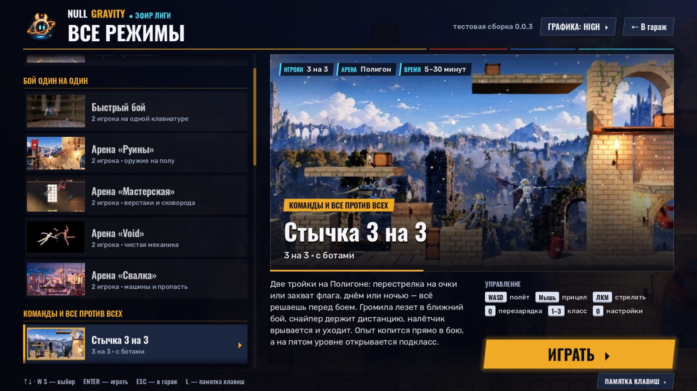
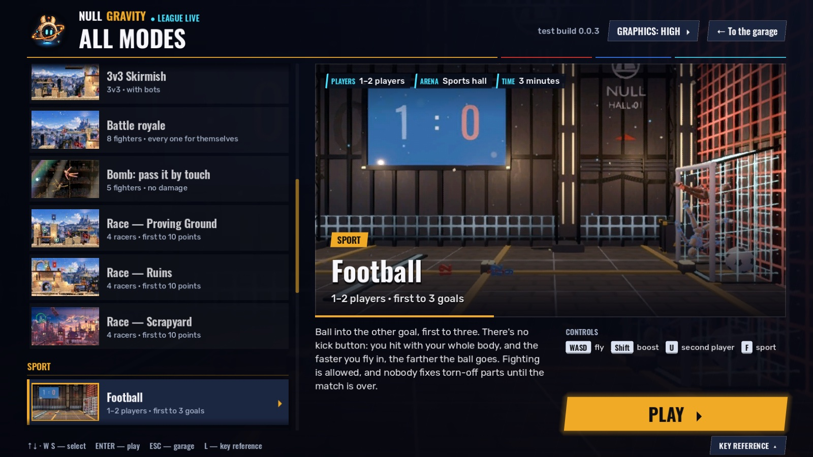

# Экран «ВСЕ РЕЖИМЫ» (06.10.2026)

Автор 06.10: «там, где все режимы, меню сделай, пожалуйста, нормальный экран + скролл + фотка + описание красивое».

Раньше «ВСЕ РЕЖИМЫ» был столбиком кнопок с подсказкой внизу. Теперь это экран выбора режима в стиле эфира Лиги: те же цвета и
шрифты, что у заставки Лиги и единого HUD (`ShowTokens`, `look/show.md`). Ветка `claude/modes-screen` от `claude/look-pass`.




## Что на экране

- **Слева — список карточек** с прокруткой, по группам: СЮЖЕТ, БОЙ ОДИН НА ОДИН, КОМАНДЫ И ВСЕ ПРОТИВ ВСЕХ, СПОРТ,
  ВДВОЁМ И PvE, МАСТЕРСКАЯ И ТЕЛО. В карточке миниатюра снимка, название и строка-тег («2 игрока на одной клавиатуре»,
  «5 бойцов · урона нет»…). У выбранной карточки янтарная полоса, янтарная рамка миниатюры и стрелка ▸.
- **Справа — панель режима:**
  - крупный снимок 16:9 во всю ширину панели; при смене режима — кроссфейд с лёгким наездом;
  - на снимке слева сверху — плашки фактов: ИГРОКИ, АРЕНА, ВРЕМЯ;
  - на снимке снизу — «нижняя треть»: группа на янтарной плашке, название крупно, тег;
  - под снимком — описание в 2–4 предложения;
  - справа от описания — блок «Управление»: чипы клавиш, только важные для режима;
  - ниже — большая кнопка ИГРАТЬ.
- **Фон** — тёмно-синий градиент эфира с косыми штрихами. Справа за панелью — размытый снимок выбранного режима
  (дальний мип, шейдер `modes_blur.gdshader`).
- **Шапка** — знак N0, NULL GRAVITY и «● ЭФИР ЛИГИ», «ВСЕ РЕЖИМЫ». Справа — версия сборки, ГРАФИКА (пресет `Gfx`,
  клик — следующий, как раньше) и «← В гараж». Под шапкой — полоса цветов Лиги.
- **Низ** — строка подсказки и кнопка ПАМЯТКА КЛАВИШ: открывает панель с прежней памяткой управления (четыре строки).

Ввод:

| Что | Как |
|---|---|
| выбор | ↑ ↓, W S, крестовина или левый стик геймпада; PageUp / PageDown — через 4; Home / End |
| прокрутка | колесо мыши (выбор не меняется); при выборе с клавиатуры список сам доезжает до карточки (и до заголовка группы) |
| запуск | Enter / Space / A; клик по уже выбранной карточке; двойной клик; кнопка ИГРАТЬ |
| выбор мышью | клик по другой карточке — только выбор |
| памятка клавиш | L или кнопка внизу; Esc закрывает её |
| назад | Esc / B — в гараж (`Flow.to_menu`), как раньше |

- Экран помнит последний выбранный режим до выхода из игры: вернулся из режима через гараж — открыт на нём же.
- Стычка по-прежнему сначала показывает экран настроек: перед запуском ставится `SquadSettings.ask = true`.
- Запуск идёт под лоадером (`Loading.change_scene`), в подписи лоадера — название режима.

## Где что

| Файл | Что |
|---|---|
| `godot/scenes/menu/test_menu.gd` | экран целиком: данные `GROUPS` и `MODES`, сборка интерфейса кодом, ввод, прокрутка, кроссфейд |
| `godot/scenes/menu/test_menu.tscn` | корень `Control` со скриптом (имя файла прежнее: на него ссылаются гараж и пробы) |
| `godot/scenes/menu/modes_blur.gdshader` | размытый фон: снимок с дальнего мипа |
| `godot/assets/ui/modes/<id>.jpg` | снимки режимов 960×540, JPEG, 30–105 КБ; в импорте — VRAM-сжатие и мипмапы |
| `godot/tests/modes_shots.tscn` | генератор снимков (окно) |
| `godot/tests/modes_screen_probe.tscn` | проба экрана (headless) |
| `godot/tests/modes_screen_snapshot.tscn` | кадр экрана для документов (окно) |
| `godot/locale/en.json` | английские строки экрана (в конце файла) |

Нет снимка у режима — на его месте заглушка: тёмно-синий фон со штрихами и знак N0 (`assets/ui/brand/null_gravity_badge_512.png`).
Экран от этого не падает.

## Как добавить режим

1. Строка в `MODES` (`test_menu.gd`):
   ```gdscript
   {"id": "relay", "group": "crowd", "scene": "res://scenes/playground_relay.tscn",
   	"title": "Перегон", "tag": "1–2 игрока · …",
   	"desc": "Два–четыре живых предложения: что делаешь и почему это смешно. Факты — из docs/plan-demo/<РЕЖИМ>.md.",
   	"players": "1–2 игрока", "arena": "Полигон", "time": "до 5 минут",
   	"keys": [["WASD", "полёт"], ["U", "второй игрок"]]},
   ```
   - `group` — id из `GROUPS`; новая группа — строка в `GROUPS`.
   - `players` / `arena` / `time` — пустая строка, если факта нет.
   - Все строки — ключи перевода. Английский — в конец `godot/locale/en.json`, потом `python3 godot/tools/i18n.py check`.
   - Старый формат строки `["подпись", "res://…tscn", "пояснение"]` тоже работает: режим попадёт в группу «ЕЩЁ», без тега
     и клавиш. Так ветка, написанная под прежний список, сливается без правок.
2. Снимок: рецепт в `RECIPES` у `tests/modes_shots.gd` (без рецепта — «подождать 4 с и снять»), потом генератор с `only=<id>`
   и импорт (ниже).
3. Пробы: `modes_screen_probe` и `menu_probe` подхватят режим сами (сцена есть, карточка, снимок или заглушка, запуск).

## Как перегенерировать снимки

```bash
# все режимы (≈ 3 мин, окно без кражи фокуса) → godot/assets/ui/modes/<id>.jpg
GODOT_BIN=/usr/local/bin/godot gtimeout 900 godot/tools/godot_nofocus.sh --path godot --resolution 1600x900 res://tests/modes_shots.tscn
# выборочно / в другую папку / другой размер
… res://tests/modes_shots.tscn -- "only=quick+bomb,out_dir=/abs/dir,w=960,q=0.82,max_kb=150,seed=3"
# импорт (у новых файлов один раз выставить в *.jpg.import: compress/mode=2, mipmaps/generate=true — и импортировать снова)
gtimeout 600 /usr/bin/arch -arm64 /usr/local/bin/godot --headless --path godot --import
```

Как снимает генератор:

- Ставит сцену режима ребёнком пробы. За людей играют боты:
  - дуэли (купол, арены, пресеты тела, кампания) — `RivalBrain` на обоих;
  - бомба, гонки, КБ, стычка, гольф — `p1_bot` и `focus_index = 0`, камера ведёт бота как игрока;
  - спорт — `SportBrain`;
  - PvE и СТАЗИС — `RivalBrain` против врагов;
  - головоломки — двое несут ящик 60 кг в комнате 3.
- Ждёт по рецепту. Дуэль снимается, когда бойцы сошлись ближе 2.4 м.
- Перед кадром:
  - выключает крит-кино, иначе в кадр попадает «рентген»;
  - прячет HUD — все `CanvasLayer` с `layer ≥ 0`;
  - прячет 3D-надписи с буквами: табло зала, подписи весов, имена над бойцами. Снимок один на все языки; цифры счёта
    остаются.
- Бомба и спорт снимаются своей камерой поближе: держатель бомбы с ближайшим соседом, мяч с ближайшим бойцом. Кадр
  остаётся в границах зала.
- Кадр 1600×900 уменьшается до 960×540 и пишется JPEG q 0.82. Если файл больше `max_kb`, качество снижается.
  Чёрный кадр (средняя яркость < 0.03) — FAIL.
- Бой физический, поэтому кадр от прогона к прогону разный. Удачный дубль можно снять в отдельную папку (`out_dir=`) и
  скопировать.

Чужие сохранения генератор не трогает:

- кампания — своя `user://_modes_shots.tres`, после прогона стирается;
- мастерская — без автосейва (`autosave_name = "_modes_shots"`, свой `prefs_path`);
- стычка — `SquadSettings.reset()`, без экрана настроек.

Кадры этого документа:

```bash
godot/tools/godot_nofocus.sh --path godot --resolution 1600x900 res://tests/modes_screen_snapshot.tscn -- "out=/abs/ru.png,lang=ru,sel=squad"
sips -s format jpeg -s formatOptions 84 /abs/ru.png --out docs/plan-demo/img/modes-screen-ru.jpg
```

## Вёрстка и языки

- Экран свёрстан под кадр 1920×1080. Растяжение `canvas_items`, поэтому 1280×720 и 2560×1440 выглядят так же (проверено
  кадрами окна).
- Снимок держит полную высоту 600 px, пока текст под ним помещается в 248 px. На ru и en это все 21 режим (проверяет
  проба). Если язык длиннее (qps), снимок уменьшается, а текст не вылезает: на qps — минус 4 px.
- Название карточки — до двух строк, тег — в одну строку с «…». Заголовки групп и описание переносятся.
- Экран добавлен в `tests/i18n_layout_probe.gd` (`_pass()`): `modes:squad` — выбрана стычка (самое длинное описание и шесть
  клавиш), `modes:memo` — открытая памятка.

## Проверки (06.10, все exit 0)

- `godot --headless --path godot --fixed-fps 60 res://tests/modes_screen_probe.tscn` — 11 проверок:
  - сцены всех режимов на месте, ни одна из 21 сцены прежнего списка не потерялась, старый формат строки понимается;
  - 21 карточка, у всех снимок;
  - ↓ S ↑ W меняют панель;
  - проход ↓ до конца и обратно — выбранная карточка каждый раз видна целиком; End / Home;
  - колесо прокручивает список, не меняя выбора;
  - первый клик выбирает, второй запускает;
  - Enter на стычке запускает её сцену и ставит `ask`; ИГРАТЬ на футболе;
  - кроссфейд снимка;
  - L / Esc / Esc;
  - память выбора;
  - вёрстка ru / en.
- `menu_probe` (5 проверок, переписан под новый экран: режимы → сцены, версия, каждая сцена открывается, пауза → гараж,
  Esc → гараж), `flow_probe`, `garage_menu_probe`.
- `python3 godot/tools/i18n.py check` — ошибок 0. Старые ключи прежнего списка из `en.json` убраны.
- `i18n_probe`, `i18n_scenes_probe` (под английским на экране нет кириллицы).
- `i18n_layout_probe`: `ok en`. На qps 25 бед — все в гараже, на экране режимов ни одной.
- `python3 godot/tools/texture_compress_pass.py --check` — 0. Он не трогает `assets/ui`, сжатие снимков выставлено
  в их `.import`.

## Не сделано / вопросы автору

1. **Снимки — живой бой ботов, не постановка.** Самые слабые:
   - гольф — весь купол, куклы мелкие;
   - СТАЗИС — выглядит как обычные PvE-волны: своего вида у режима пока нет, только метка HUD.

   Нужно ли для каждого режима поставить «открыточный» кадр руками?
2. **Описания** написаны голосом анонса и проверены по докам режимов. Их стоит прочитать автору, особенно шутки:
   - «сковорода бьёт обиднее всех»;
   - «Уборщик машет метлой».
3. **Имя файла** осталось `test_menu.*` (на него ссылаются гараж, `Flow`, пробы и доки). Переименовать в `modes_screen.*` —
   отдельным мелким шагом, если нужно.
4. **Надписи гаража у пункта ВСЕ РЕЖИМЫ** («Тестовая сборка · всё, что есть в демо, списком») не менял: гараж правят
   другие сессии.
