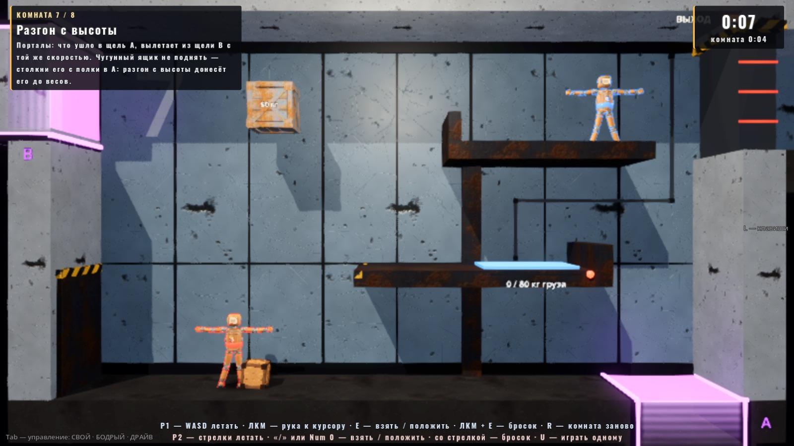
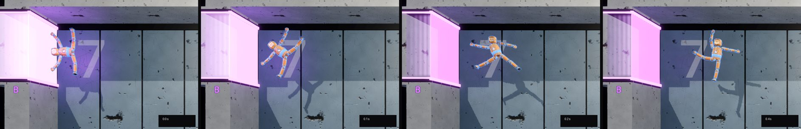
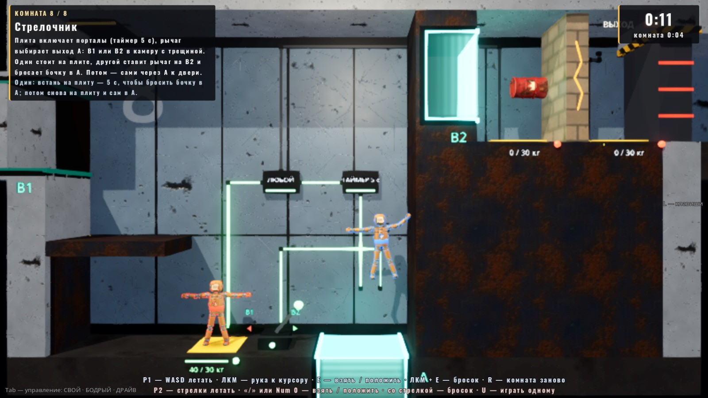
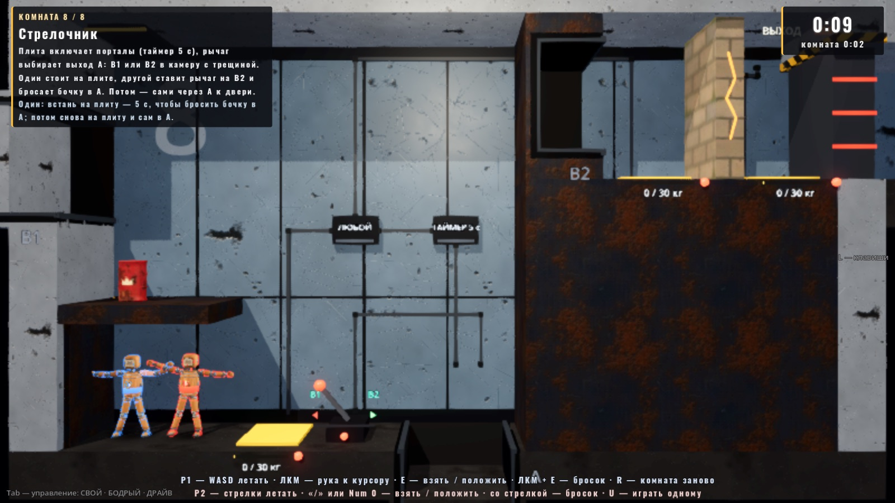

# Порталы (06.10.2026)

Автор 06.10:

> в логике если мы добавим порталы, как было в Portal, — это будет слишком на авторские права или нет?

Ответ: механика (вход в одну щель — выход из другой с той же скоростью) авторским правом не защищена; защищены имена, тексты,
персонажи и узнаваемая обёртка. Автор: «делаем».

**Граница, которую держим (обязательно):**
- в игре нигде нет «Portal», Aperture, GLaDOS, «портальной пушки», кубика-компаньона, торта и цитат оттуда. Слово «портал» —
  обычное, им пользуемся;
- пушки нет: порталы стоят парами на месте и включаются от логики головоломок (как дверь и лифт);
- вид свой: прямоугольная щель-карман с подсвеченной кромкой и скобой-рамкой, **один цвет на пару** (метки A / B), палитра не
  оранжево-синяя (фиолетовый, бирюзовый, малиновый — `Tuning.PORTAL_COLOURS`);
- вида «сквозь портал» нет: щель светится, на переходе вспышка.



## Ответы автора на вопросы (06.10, вторая волна)

1. Поворот куклы на выходе — «чтобы как в Portal было примерно» → **кукла встаёт головой вверх** за 0.3–0.4 с (ниже «выход «как в
   Portal»»).
2. Медленное падение кукол — «может, сделать ещё разную гравитацию в помощь? Возможно, разгонять чуть-чуть, но зависит от
   направления» → **разгон на выходе по направлению** (флаг пары `boost`) и **тяжёлая шахта** над щелью A в комнате 7; у второго
   игрока в комнате 7 своя роль.
3. Двусторонняя пара на трассе — «смотри сам, как лучше» → **на трассе пара односторонняя** (B — только выход), в головоломках —
   двусторонние, как были.



## Как устроено

Код — `godot/scripts/portal/`, сцена — `godot/scenes/portal/portal_pair.tscn` (корень + скрипт; проходы пара строит сама в `_ready`
по своим полям — как механизмы головоломок, сборщик пишет только поля).

| Класс | Что |
|---|---|
| `Portal` (`portal.gd`) | Один проход: середина щели на поверхности; локальная +Y — нормаль наружу, +X — вдоль щели, +Z — к камере. Строит карман (`StaticBody3D` "Pocket": дно на глубине `depth` и две щёки), датчик (`Area3D` "Sensor": карман + 0.6 м перед щелью), вид (скоба на лицевой грани, кромки, плёнка поперёк щели, свечение кармана со шейдером — полосы бегут внутрь, буква, лампа-вспышка). Вид: `ACTIVE` (горит), `IDLE` (пара под током, но этот выход не выбран — рамка тусклая), `OFF` (погас). |
| `PortalPair` (`portal_pair.gd`, `extends PuzzlePart`) | Пара A ↔ B (+ второй выход B2 у «стрелочника»), ток, перенос, пауза против пинг-понга, звук, история переносов. |

**Перенос** (каждый физический тик, пока пара под током; в обе стороны: A → выход и выход → A):
- **кукла** — когда её ЦМ ушёл за плоскость щели в пределах ширины (`Portal.behind`, кромка +0.1 м): **все детали разом** (и связки —
  они тоже в `Doll.parts`). Отображение `T = выход · поворот 180° вокруг Z · вход⁻¹`: глубина за входом становится высотой перед
  выходом, линейные и угловые скорости поворачиваются тем же поворотом — модуль скорости тот же, направление по нормали выхода.
  Это поворот, а не отражение: кукла остаётся лицом к камере. Пол → стена — кукла выходит повёрнутой на 90° (ногами вперёд),
  стена → стена «в одну сторону» — вверх ногами. Суставы не тянутся — кукла переносится как твёрдое целое;
- **выход «как в Portal»** (флаг пары `upright`, по умолчанию да; `PortalUpright`, `scripts/portal/portal_upright.gd`): сразу после
  переноса кукла за `PORTAL_UPRIGHT_S` (0.45 с) встаёт головой вверх относительно **местной** гравитации (гравитация тела из
  `PhysicsDirectBodyState3D.total_gravity` — с полями NullField: в комнате 4 с «низом» вбок и «верх» вбок). Каждый тик всей кукле —
  поворот вокруг её ЦМ со скоростью ошибка / `PORTAL_UPRIGHT_TAU` (0.09 с), не больше `PORTAL_UPRIGHT_W_MAX` (8 рад/с): прибавка Δω
  к угловой скорости деталей и Δω × (r − ЦМ) к линейной. Сумма импульсов прибавки — ноль: **скорость ЦМ не меняется**, полёт из щели
  тот же. Пропсы не доворачиваются (как в Portal);
- **что в руке** (решение — «везём с собой»): приваренное и на пружине (`ArmAssist`), оружие в кисти (`WeaponPickup`) едут вместе
  с куклой и остаются в руке. Если тот же предмет держит и другая кукла (ящик «вдвоём») или это деталь чужой куклы — рука отпускает
  (`release("portal")`), предмет остаётся. Держимый предмет сам по себе (его центр в кармане, а кукла снаружи) не переносится —
  его везёт держащий; отпустил — ушёл;
- **пропс** (`RigidBody3D`: ящики, бочки, обломки, свободное оружие) — по своему центру масс. Тело, которому нельзя вращаться
  (`axis_lock_angular_z`: «вдвоём», чугунный), переносит место и скорость, ориентацию — нет. Замороженное, на оси (рукоять рычага),
  держимое — не переносится;
- **выход**: всё перенесённое целиком перед плоскостью выхода (ближайшая точка коллизий ≥ `PORTAL_EXIT_AHEAD`); место занято
  статикой — ещё вперёд шагами `PORTAL_UNSTICK_STEP` (не больше `PORTAL_UNSTICK_TRIES`). Потом тело (кукла — целиком)
  `PORTAL_COOLDOWN_S` не переносится ни одной парой — пинг-понга нет;
- скорость «до шага» у детектора ударов (`DollCombat.prev_vel`) обновляется — первый контакт после выхода считается от новой скорости;
  интерполяция физики сброшена (`reset_physics_interpolation`) — без «проезда» через комнату;
- вспышка на обоих проходах, звук (готовые слои `SfxDirector`: `whoosh` на входе, `sub` на выходе; включение пары — `sub`,
  выключение — `creak`), сигнал `transferred`, запись в `history`.

Куклы в g = 2 с вязкостью ядра падают медленно (около 1 м/с), поэтому «разгон с высоты» заметен на пропсах: чугунный ящик (g × 4.9,
вязкость 0.2) с полки 6 м входит в щель на ~10 м/с. Куклам помогают:
- **разгон на выходе** (флаг пары `boost`, `PortalPair._boost`): скорость выхода = max(скорость входа × MULT, MIN) по нормали выхода
  относительно местной гравитации — **вверх** (нормаль ближе 45° к «верху») ×1.15, не меньше 8 м/с: вылет вверх подбрасывает
  (кукла с 8 м/с поднимается на 2.7 м за 2 с, с 10.6 — на 3.9); **вбок** ×1.08, не меньше 6 м/с; **вниз** — без разгона. Всем
  перенесённым телам — одна прибавка (внутреннее движение куклы то же). Если разгон выше потолка скорости управления (9 м/с), кукле на
  `PORTAL_FLING_S` (0.8 с) снимается этот потолок (`Doll.set_flight_cap`) — иначе её ядро срезалось бы до 9 м/с на следующем тике;
- **разная гравитация**: своё поле `NullField` над щелью (`PuzzleGravity` с новым `on_g` — сила поля при токе): в комнате 7 шахта над A
  тяжелеет ×3, когда на весах груз. Кукла с 5 м: падая сама — 1.05 → 2.85 м/с у щели, с тягой вниз — 5.5 → 6.3 м/с.

**Односторонняя пара** (флаг `one_way`): B (и B2) — только выход: влетевший в B не переносится и упирается в карман. Вид выхода другой:
без плёнки поперёк щели, кромка тусклее, полосы в кармане бегут наружу, три стрелки ▲ по нормали (`Portal.exit_only`).

## Как поставить пару на карту (API для трассы и других режимов)

1. Вырезать в поверхности проём шириной `width` (по умолчанию `Tuning.PORTAL_WIDTH` = 2.2 м) по центру прохода. За проёмом нужно
   место на `depth` + 0.2 м (`PORTAL_DEPTH` = 1.3): дно и щёки кармана портал ставит сам (щёки заходят в поверхность — перекрытие
   форм безвредно). Карман глубже поверхности — снаружи его можно закрыть утолщением (как `WallL_Bump` / `FloorDeep` в комнатах 7–8).
2. Перед щелью — свободно хотя бы на габарит куклы (~1 м): туда ставится вышедшее тело. Углы и стены вплотную к щели — плохо.
   Если тела скользят к щели вдоль стены (падают по ней), край щели не должен совпадать с гранью стены: Jolt цепляет шов двух
   коробок вровень и отбрасывает тело — пусть щель заходит под стену (комната 7: на 0.3 м). То же для плит вровень с полом/уступом.
3. Поставить пару (сцена или код):

```gdscript
var pair := (load("res://scenes/portal/portal_pair.tscn") as PackedScene).instantiate() as PortalPair
pair.a_position = Vector3(7.0, 0, 0)   # середина щели A на поверхности, в системе пары
pair.a_angle_deg = 0.0                 # 0 пол (нормаль вверх), 180 потолок, -90 стена слева (нормаль вправо), 90 стена справа
pair.b_position = Vector3(-8, 7.4, 0)
pair.b_angle_deg = -90.0
pair.width = 2.6                       # -1 — Tuning.PORTAL_WIDTH; depth — так же
pair.colour_index = 0                  # Tuning.PORTAL_COLOURS: 0 фиолетовый, 1 бирюзовый, 2 малиновый; label_a / label_b — буквы
pair.input = pair.get_path_to(plate)   # ток пары (что угодно с is_on()); пусто — всегда включена
# второй выход («стрелочник»): ток на switch_input — A ведёт в B2, нет тока — в B
pair.alt_enabled = true
pair.alt_position = Vector3(3.2, 7.3, 0)
pair.alt_angle_deg = -90.0
pair.switch_input = pair.get_path_to(lever)
pair.one_way = false                   # true — B только выход (трасса)
pair.boost = false                     # true — разгон на выходе по направлению (комната 7)
pair.upright = true                    # кукла встаёт головой вверх после выхода
parent.add_child(pair)
```

В сборщике сцены (`PackedScene.pack`) — то же через `node.set(...)`, как у механизмов головоломок (`_inst(..., PORTALS, ...)` в
`tools/build_puzzle_demo.gd`). Пара не зависит от площадки головоломок: нужен только `Tuning` (автозагрузка) и куклы класса `Doll`.

Публичное: `is_powered()`, `exit_of_a()`, `portals()`, `pair_colour()`, `transfers`, `history` (последние 64: `what`, `kind` doll/body,
`from`, `to`, `frame`, `c_in`, `v_in`, `v_out`, `shift`, `carried`), сигналы `transferred(what, from, to)` и `power_changed(on)`,
`transfer_doll(d, from, to)` / `transfer_body(b, from, to)` — перенести без касания (пробы, режимы), `reset_state()` (сброс комнаты),
статические `mapping(from, to)`, `doll_owner(body)`, `body_centre(body)`. У прохода (`Portal`): `normal()`, `tangent()`, `behind(p)`,
`height_of(p)`, `pocket_rect()` (карман в XY — для проверок «не вылетел за стены»), `set_lit(...)`, `flash()`.

## Комнаты 7 и 8 (демо «Головоломки вдвоём»)

Сборщик `tools/build_puzzle_demo.gd` (`_room7`, `_room8`), тексты — `PuzzleRoom.TEXTS`. Теперь в демо восемь комнат.

| # | Комната | Вдвоём | Один |
|---|---|---|---|
| 7 | **Разгон с высоты** | Чугунный ящик 90 кг на полке под потолком (слева у полки упор — на уступ напрямую не столкнуть). Столкнуть вправо: падает вдоль правой стены в щель A на полу (≈ 9.8 м/с), вылетает из щели B высоко в левой стене (пара с разгоном: вбок ×1.08) через всю комнату на уступ 3 м с грузовыми весами 80 кг почти во весь уступ (бортик ловит). Весы включают тяжёлую шахту над A (×3; до весов её нет — ящику не мешает). Дверь — ВСЕ (груз на весах, кукла на уступе: зона «кукла сюда» без плиты) → ТАЙМЕР 5 с. **Роль второго:** он сам «выстреливает» себя — вниз по шахте в A (~7.9 м/с с тягой), из B боком (×1.08 → 8.5 м/с), на уступ — и держит дверь, пока первый уходит. | так же после ящика: шахта → уступ, потом 5 с до двери |
| 8 | **Стрелочник** | Справа — запертая камера (уровень 5.6 м) за толстой стеной: проход B2, трещина, за ней плита-защёлка и дверь. Плита на полу (или карманная плита в камере) → ЛЮБОЙ → ТАЙМЕР 5 с → ток пары; рычаг выбирает выход щели A: B1 (левая стена, обратно в комнату) или B2. Один стоит на плите, второй ставит рычаг на B2 и бросает бочку в A — она вылетает из B2 на трещину и рвёт её; потом сами через A → B2 → на защёлку → дверь. Взрыв снаружи камеры трещину не достаёт (до неё ≥ 3.4 м при радиусе 3.2). | встать на плиту — 5 с, чтобы бросить бочку в A; потом снова на плиту и самому в A. Люк роняет новую бочку. Застрял в камере — плита в ней включает пару |




Порталы в обеих комнатах внутри комнаты — в обход дверей из комнаты не выйти (проба `bounds`: ЦМ в кармане портала — не побег).

## Ручки (`scripts/tuning.gd`, блок `PORTAL_*` в конце файла)

`PORTAL_WIDTH` 2.2, `PORTAL_DEPTH` 1.3, `PORTAL_JAMB` 0.2, `PORTAL_EDGE_SLACK` 0.1, `PORTAL_EXIT_AHEAD` 0.12, `PORTAL_UNSTICK_STEP` 0.15 ×
`PORTAL_UNSTICK_TRIES` 8, `PORTAL_COOLDOWN_S` 0.3, `PORTAL_COLOURS` (3 цвета), `PORTAL_IDLE_GLOW` 0.22, `PORTAL_FLASH_S` 0.35;
доворот — `PORTAL_UPRIGHT_S` 0.45, `_TAU` 0.09, `_W_MAX` 8 (при 14 рад/с разворот на 180° растягивал суставы до 0.08 м, при 8 — 0.035);
разгон — `PORTAL_BOOST_UP_MULT` 1.15 / `_UP_MIN` 8, `_SIDE_MULT` 1.08 / `_SIDE_MIN` 6, `_DOWN_MULT` 1.0 / `_DOWN_MIN` 0, `PORTAL_FLING_S`
0.8. Пороги плит, таймеры, шахта (×3), ширина щелей комнат 7–8 (2.6 м) — в сборщике; после правки пересобрать сцену:

```
godot --headless --path godot res://tools/build_puzzle_demo.tscn
```

## Проба `tests/portal_probe.gd`

```
godot --headless --path godot --fixed-fps 60 res://tests/portal_probe.tscn -- "only=doll|props|boost|rooms,trace=1,out=<json>"
```

JSON между `=== PORTAL PROBE ===` и `=== OK / FAIL ===`, exit 0/1, `errors_script` — счётчик SCRIPT ERROR (Logger). Наследник
`tests/puzzle_probe.gd` (помощники и сценарии комнат). Последний прогон (06.10, вторая волна): **75 проверок, все зелёные**, ошибок
скриптов 0; `puzzle_probe` целиком — 79, `only=rooms` — 10 прогонов (по 5 параллельно) без падений; `track_probe` — 42.

Вторая волна:
- **доворот** — через 0.5 с после выхода наклон торса к «верху»: пол → стена 90° → 1°, стена → стена в одну сторону 176° → 3°,
  стена → потолок 86° → 0° (порог 20°); та же кукла без доворота — |v ЦМ| через 0.5 с отличается на 0.7 / 2.8 / 2.1 % (порог 5 %);
  разрыв суставов при развороте ≤ 0.035 м;
- **разгон** (ящик 10 кг; вход 2.6 / 9.6 м/с): вверх 8.00 / 11.05, вбок 6.00 / 10.38, вниз 2.61 / 9.61 м/с (все — max(×MULT, MIN),
  к нормали выхода 0°); кукла вверх: 0.5 → 8.0 м/с (подъём 2.7 м за 2 с), 9.2 → 10.6 м/с — потолок снят, через тик 10.3 (подъём 3.9 м);
- **шахта** комнаты 7 (`shaft_speeds_up`) — числа выше; **односторонняя пара** — влёт в B: 0 переносов, кукла у кармана B, A → B как
  обычно, B «только выход»;
- **комната 7**: вдвоём 13.1 с, один 14.9 с (кукла входит в A на 7.9 м/с, из B — 8.5, зона «кукла сюда» — да, дверь — да);
  комната 8: 9.1 / 14.0 с.

- **doll** — пары пол → стена, стена → стена лицом друг к другу и в одну сторону, стена → потолок (подлёт в невесомости, вход
  строго по нормали) и пол → стена с падением при g: |v| через тик после переноса / до — 0.968–0.969 (потеря — вязкость куклы за
  тик), к нормали выхода 0.0° (с падением 1.9°), разрыв суставов 0.000 м, деталей в статике 0, ЦМ перед выходом 1.4–3.2 м; пинг-понг
  в паре лицом друг к другу — 1 перенос за 3 с; без тока — 0 переносов, проходы погасли, ток дали — кукла из кармана ушла;
  «стрелочник» — без тока A → B, с током → B2, невыбранный выход тусклый; лёгкий ящик (приварен) — едет с куклой, в руке, хват
  0.014 м; средний 35 кг (пружина) — едет, в руке, растяжение 0.11 → 0.17 м; ящик «вдвоём» — рука уходящей куклы отпускает
  (`portal`), ящик у второй, сдвиг 0.0 м;
- **props** — ящики 10 / 35 / 90 кг и взрывная бочка в тех же пяти парах (20 случаев): |v| 0.995, к нормали выхода ≤ 1.5°, в статике
  0; ящик в кармане — ровно 1 перенос; лёгкий ящик медленно в паре лицом друг к другу — 1; держимый в кармане — 0, отпустили —
  ушёл; замороженный — 0;
- **rooms** — комнаты 7 и 8 вдвоём и соло (дверь закрыта в начале → сценарий → дверь открыта → выход): 7 — 10.5 / 10.0 с (ящик
  входит в A на 9.8 м/с, ложится на весы 90 / 80 кг), 8 — 9.0 / 14.6 с (бочка через B2, трещина разбита, P1 в камере, защёлка).

Сценарий комнаты 8 ставит бочку на край полки и переносит куклу с бочкой к щели сдвигом: перенос груза рукой проверяет комната 6, а
держимая бочка от удара о рукоять рычага или край щели быстрее 2.5 м/с загорается и рвётся в руке — пробе нужен бросок в портал.

Снимки (окно, без кражи фокуса):

```
godot/tools/godot_nofocus.sh --path godot --resolution 1600x900 res://tests/puzzle_snapshot.tscn -- "out_dir=/abs/dir,rooms=7+8,action=0,portal=1,upright=1"
```

## Что тронуто в общих файлах (для слияния)

| Файл | Что |
|---|---|
| `scripts/tuning.gd` | блок `PORTAL_*` в конце файла |
| `locale/en.json` | 5 строк (комнаты 7–8) |
| `tests/i18n_layout_probe.gd` | площадка головоломок: кадр восьмой комнаты (самая длинная подсказка), итоги на 8 комнат |
| `scripts/puzzle/puzzle_room.gd` | `TEXTS` — комнаты 7 и 8 |
| `tools/build_puzzle_demo.gd`, `scenes/playground_puzzle.tscn` | `_cut`, `_room7`, `_room8`; сцена пересобрана (комнаты 1–6 те же) |
| `tests/puzzle_probe.gd` | восемь комнат, `_solve_7` / `_solve_8`, карманы порталов в `bounds`, рычаг (`_flip_lever`) — до 3 попыток |
| `tests/puzzle_snapshot.gd` | все комнаты, `portal=1`, `upright=1` (кадры доворота), кадр на паузе физики |
| `scripts/puzzle/puzzle_gravity.gd` | `on_g` — сила поля при токе (шахта), подпись «G ×3» |
| `scripts/puzzle/puzzle_doll_zone.gd`, `scenes/puzzle/doll_zone.tscn` | новое: место для куклы без плиты (ток, пока ЦМ куклы в зоне) |
| `tools/build_race_track.gd`, `scenes/arena/race_track.tscn` | пара развилки B — `one_way` (сцена пересобрана) |
| `tests/track_probe.gd` | `portal_b_one_way` в разделе `checks` |

`doll.gd`, `arm_assist.gd`, `match.gd`, `test_menu.gd`, `input_setup.gd` не тронуты. Общего кода с «Трассой», «Перегоном» и «Подъёмом»
нет; трасса может взять `PortalPair` как есть (раздел API).

## Что открыто

- **Руками не пройдено.** Всё проверено пробой и снимками; «чувство» (видно ли, куда ведёт щель; читается ли разгон; не путает ли
  кукла, вышедшая вверх ногами) — ждёт автора.
- Куклы летают сами (тяга больше g), поэтому уступ комнаты 7 можно взять и полётом — шахта и разгон дают быстрый и весёлый путь, но
  не единственный. Сделать его единственным можно запасом тяги (`ThrustStamina` из «Подъёма») только в этой комнате — вопрос автору.
- Комната 8 без поля в помощь и без разгона: её решение — бросок бочки в щель, разгон бочке не нужен, а кукла, выброшенная из B2 в
  камеру 2.4 м быстрее 6 м/с, врезалась бы в трещину. Если автор хочет и там — скажет.
- Трасса: пара односторонняя, разгона нет — короткий путь через пару и так в разы быстрее лёгкой ветки (боты уровня 3 берут его
  4 раза из 4).
- Разворот куклы при выходе — по флагу `upright` у пары (по умолчанию да: и в головоломках, и на трассе; на трассе выход A → B без
  поворота — кукла и так выходит головой вверх).
- Перф с окном не мерился (две пары, ~25 тел на комнату; перенос — десяток запросов форм раз в переход).
- Звук — готовые слои (`whoosh`, `sub`, `creak`), своего нет.
- **Нестабильные прогоны `puzzle_probe -- only=rooms` разобраны (06.10, после слияния в `claude/modes-pack`).** Прогон к прогону
  физика расходится (порядок задач Jolt под нагрузкой), поэтому раз в 5–10 прогонов попадались три разных падения:
  - *комната 5 соло, «успел выйти false»* — факт (печать пути и состояния куклы при неудаче): кукла жива, управляема, не в стане,
    не заморожена, но 10 с стоит на месте (скорость 0.00) у левой грани чугунного ящика на весах балкона — то лёжа, то вниз
    головой у шва лифта; путь к двери вёл её от ящика прямо к проёму (тяга вбок 0.95, вверх 0.29), трение о грань держало. Правка
    сценария (не повтор): столкнув ящик на весы, кукла сначала поднимается над ним (низ проёма + 2.8 м), как игрок. Общий путь
    к двери (`_exit_via_door`) не тронут: поднятие для всех высоких дверей ломало комнату 3 (кукла сверху сбивала ящики с весов);
  - *комната 7 вдвоём, ящик не на весах* — два разных шва вровень, которые Jolt цепляет углом (как стык лифта в комнате 5): ящик
    падает вплотную к правой стене, его грань (x 8.0) совпадала с краем щели A — на шве стены и щеки кармана его отбрасывало влево
    (−2 м/с), из B он выходил вниз и не долетал; и, долетев, вставал намертво на шве уступа и весов. Правка комнаты: щель A шире
    (2.6 м) и заходит под стену на 0.3 м; весы почти во весь уступ (5.3 м) и на 2 см ниже его верха;
  - *комната 8: «плиты под игроками у входа»* — раскинувшая руки кукла на входе доставала плиту. Правка: плита и рычаг на 0.4 м
    дальше от входа;
  - *комната 8 вдвоём, трещина цела после 3 бросков* — факт: брошенная в A бочка рванула, не пройдя щель, взрыв откинул P2 с плиты,
    таймер погас, дальше бочки летели в выключенную щель. Что она задевает — не установлено (вероятно, кромку щели: бочка в броске
    крутится). Правка: щели комнаты 8 тоже 2.6 м; в сценарии P2, откинутый с плиты, встаёт обратно (как игрок). Осталось: изредка
    (1 из ~25) первый бросок всё так же рвётся у щели — сценарий берёт следующую бочку из люка и проходит.
  Прогоны после правок (`only=rooms`): 10 (5 параллельно + 5 последовательно) и ещё 15 (по 5 параллельно) — все зелёные.
  При неудаче проба печатает путь куклы / ящика, состояние куклы и броски бочки (печать хода прогона не меняет).
- Не проверено, подозрение (не порталы): в сценарии комнаты 8 после того, как приваренная бочка рванула в руке и рука взяла новую,
  `ArmAssist` дважды показывал «приварено», а бочка оставалась на месте (растяжение 2.8–4.9 м без срыва). Отдельным повтором на
  чистом main не воспроизвёл (там рука после взрыва не хватала вовсе — кукла в стане); где искать — `arm_assist.gd`, `_make_weld` /
  `_apply_hold` после `_forget_held`.
