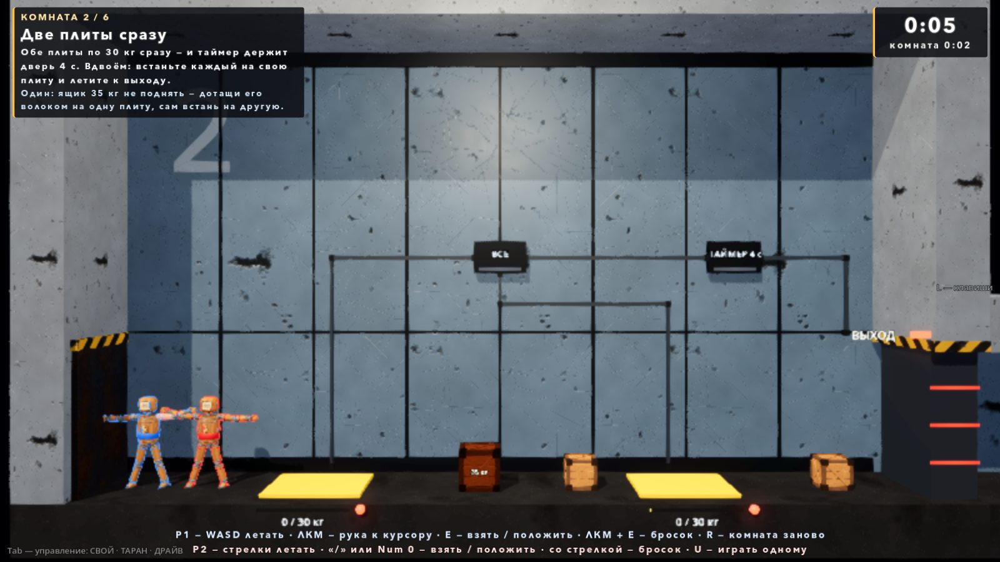
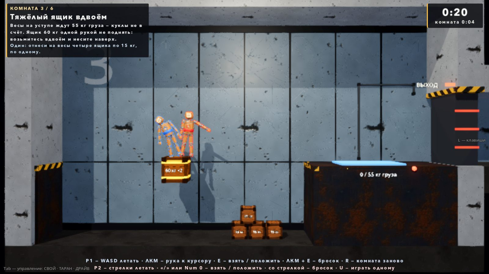
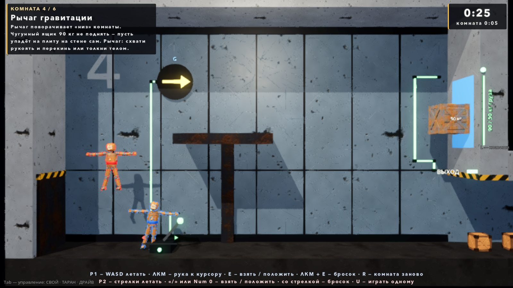

# Головоломки вдвоём — демо (06.10.2026)

Автор 06.10 (MODES_PACK.md, п. 6):

> физические головоломки: рычаги, двери, ящики на кнопки, вдвоём — посмотреть демо интересно

Куклы у нас летают, поэтому головоломки не про «допрыгнуть», а про **вес, двери, гравитацию и переноску**. План — `MODES_PACK.md` §6
(«О6 — механизмы»). Ветка `claude/puzzle-coop`, в main не влито.



## Как запустить

Гараж → «ВСЕ РЕЖИМЫ» → **«Головоломки вдвоём (демо)»** (после гонок). Сцена `scenes/playground_puzzle.tscn`.

Начинаешь один (P1). Второй игрок входит первым нажатием своей клавиши (стрелки, правый Ctrl, Enter, «/», Num 0, геймпад 2)
или клавишей **U**; U ещё раз — P2 уходит, снова соло.

| Клавиша | Что |
|---|---|
| **P1:** WASD, Shift, Space | летать, ускорение, раскрутка (как в бою) |
| **P1:** ЛКМ (держать) | рука тянется к курсору |
| **P1:** E | взять / положить; с зажатой ЛКМ — бросок к курсору |
| **P2:** стрелки, правый Ctrl, Enter | летать, ускорение, раскрутка |
| **P2:** «/» или Num 0 | рука тянется к ближнему предмету **в сторону стрелок** и хватает; с предметом: со стрелкой — бросок в её сторону, без стрелки — положить |
| **P2:** геймпад | как везде: правый стик — рука, RB — взять / бросить |
| R | комната заново (ящики, бочки, рычаг — на места, игроки — к входу) |
| [ / ] | предыдущая / следующая комната (для пробы) |
| U | P2 вошёл / ушёл |
| Esc | пауза: продолжить / заново (с первой комнаты) / в гараж |
| Enter (после финиша) | с начала |

HUD: слева сверху — «КОМНАТА 2 / 8», название, как решить вдвоём и строка «Один: …»; справа — общее время и время комнаты; снизу
первые 14 с комнаты — памятка клавиш P1 и P2; после последней (восьмой) — табличка «ДЕМО ПРОЙДЕНО» со временем каждой комнаты.

## Механизмы (`scripts/puzzle/`, сцены `scenes/puzzle/*.tscn`)

Все — узлы с `is_on()` («ток есть / нет»). Приёмник читает вход по NodePath каждый тик (опрос, без сигналов: порядок узлов и сброс
комнаты ничего не ломают). Вид каждый строит себе сам в `_ready` (меши, лампы, подписи); `.tscn` — корень + скрипт, расстановку и связи
пишет сборщик.

| Механизм | Класс | Как работает |
|---|---|---|
| **Плита** | `PuzzlePlate` | Датчик над плитой (1.3 м — ящики стопкой тоже давят): масса = Σ тел в датчике медленнее 3 м/с; кукла — вся (≈ 40 кг), если её деталь в датчике. Включается, когда масса ≥ порога 0.1 с, гаснет через 0.25 с. Полоска заполнения, лампа, подпись «32 / 30 кг». `count_dolls = false` — **грузовые весы** (синие): куклы не в счёт. `latch` — включилась навсегда. |
| **Рычаг** | `PuzzleLever` | Рукоять — RigidBody3D, вращается вокруг основания (линейные оси зажаты, центр масс в оси; суставов нет). ±40°, включён за +15°, выключен за −15°, между — прежнее; фиксатор доводит к краю (щелчок, 12 Н·м). Хватается рукой (класс «средний», не приваривается) и толкается телом. Гравитация на рукоять не действует. |
| **Дверь** | `PuzzleDoor` | Створка — AnimatableBody3D, уезжает вверх в стену (4 м/с), без тока опускается (3 м/с), **но не на тело в проёме** — ждёт. Лампа красная / зелёная, «ВЫХОД». |
| **Лифт** | `PuzzleLift` | Платформа — AnimatableBody3D, едет вверх, пока есть ток (1.3 м/с, ход 5 м), без тока — вниз, но не на тело под собой. Везёт 60 и 90 кг. |
| **Зона гравитации** | `PuzzleGravity` | Своё поле `NullField` на комнату (без мембраны); ток — «низ» поворачивается на `on_dir` за 1.2 с. На задней стене — круг со стрелкой «G», куда сейчас «низ». |
| **Логика** | `PuzzleLogic` | Коробка на задней стене: «ВСЕ» (И), «ЛЮБОЙ» (ИЛИ), «ТАЙМЕР N с» (держит ток N с после того, как входы погасли; на коробке — обратный отсчёт). Ставятся цепочкой. |
| **Кабель** | `PuzzleCable` | Ломаная по задней стене от источника к приёмнику, под током светится зелёным. |
| **Стена с трещиной** | `PuzzleCrackWall` | `Breakable`, замороженный намертво: телом и ударами не сдвинуть, ломает только взрыв (hp 40, взрыв у стены — ~50 урона). Трещина «ловит» бочку: влетела брошенной или быстрее 1.5 м/с — поджиг 0.05 с, взрыв у стены (без этого брошенная бочка долетала на ~2.9 м/с и то рвалась, то ложилась у стены целой). Куски лёгкие (4 кг), не замерзают и исчезают через 6 с — не перегораживают проход. |
| **Раздатчик** | `PuzzleDispenser` | Люк в потолке: целых взрывных бочек в комнате не осталось, а стена цела — через 3 с падает новая (комната не становится нерешаемой). |

### Ящики (`PuzzleCrate`, `Tuning.PUZZLE_CRATES`)

Не ломаются (в отличие от ящиков арен) и не замерзают якорем; вес = масса × g поля (2 м/с²) × свой множитель.

| Вид | Масса | Вес | Для руки |
|---|---|---|---|
| light | 10 кг | 20 Н | лёгкий: приваривается, бросается |
| box15 | 15 кг | 30 Н | лёгкий |
| medium | 35 кг | 175 Н | средний: одной рукой только волоком |
| **duo «×2»** | 60 кг | 210 Н | средний: **одной рукой не поднять (150 Н), двумя — да (300 Н)** |
| iron | 90 кг | 882 Н | не поднять ни руками, ни тягой двух кукол (2 × 400 Н); толкается по полу, едет на лифте, падает при гравитации вбок |

**«Вдвоём» — проверено числами (проба `parts`).** Голые числа ArmAssist не сходились: пружина хвата держит ≤ 150 Н, а тяга куклы
480 Н — вдвоём куклы улетали от ящика (6.2 против 1.5 м/с²), пружины рвались, ящик поднимался на 0.1–0.4 м и падал. Поэтому
`PuzzleCarry` (ребёнок куклы игрока, только в головоломках): пока рука держит средний / тяжёлый предмет — тяга × 0.55, а растянутая
дальше 0.35 м пружина работает как поводок (ЦМ куклы не уходит от груза быстрее 1.2 м/с, к 0.6 м — совсем); предел срыва у тяжёлых
ящиков головоломок 0.8 м (meta `hold_slip_m`). Итог: одна рука — ящик не поднят (0.00 м), не срывается; две — +1.6 м за 4 с; в комнате 3
двое заносят его на уступ 3 м за ~13 с.

Телом снизу одна кукла поднимает ящик 60 кг (4.3 м за 4 с, проба `duo.body_push_m`) — тяга 480 Н больше его веса. Это ещё
один путь для соло в комнате 3; руками — только вдвоём.

## Комнаты (8 подряд, `tools/build_puzzle_demo.gd`; 7–8 — с порталами, [PORTAL.md](PORTAL.md))

Каждая — закрытый короб 16 × 9 м (стены, пол, потолок), вход слева, выходная дверь справа; за дверью тамбур: ЦМ игрока в тамбуре —
следующая комната (оба игрока переносятся, что было в руке — отпускается). Камера стоит и показывает комнату целиком.

| # | Комната | Вдвоём | Один |
|---|---|---|---|
| 1 | **Ящик на плиту** | Ящик 10 кг с полки под потолком — на плиту (8 кг) → дверь. Встать самому мало: сошёл — дверь закрылась раньше, чем долетишь. | так же |
| 2 | **Две плиты сразу** | Плиты по 30 кг → «ВСЕ» → «ТАЙМЕР 4 с» → дверь: встать каждому на свою, потом успеть за 4 с. | ящик 35 кг волоком на одну, сам на другую |
| 3 | **Тяжёлый ящик вдвоём** | Грузовые весы 55 кг на уступе (3 м), дверь над уступом: ящик 60 кг поднять двумя руками и занести. | четыре ящика по 15 кг по одному (или телом снизу) |
| 4 | **Рычаг гравитации** | Рычаг поворачивает «низ» вправо: чугунный ящик 90 кг съезжает с полки и падает на грузовую плиту на правой стене → дверь внизу той же стены. | так же |
| 5 | **Лифт** | Чугунный ящик толкнуть телом по полу на лифт (платформа на 2 см ниже пола, наверху на 2 см выше балкона — ящик не цепляется за стык); плита под балконом → «ТАЙМЕР 8 с» → лифт: один стоит на плите, другой наверху сталкивает ящик на весы балкона → дверь над балконом. | ящик 35 кг с полки слева — волоком на плиту (лифт ждёт сколько нужно), или встать на плиту и успеть за 8 с |
| 6 | **Финал: трещина** | Взрывную бочку — броском в трещину; за стеной ниша с плитой → «ТАЙМЕР 6 с» → дверь вверху справа: успеть. | так же |
| 7 | **Разгон с высоты** (06.10, порталы) | Чугунный ящик столкнуть с полки в щель A на полу — из щели B в левой стене он вылетает с разгона на весы уступа. | так же |
| 8 | **Стрелочник** (06.10, порталы) | Один на плите (ток пары, таймер 5 с), второй ставит рычаг на B2 и бросает бочку в A — она вылетает в запертую камеру на трещину; потом сами через A к двери. | встать на плиту и успеть за 5 с, потом ещё раз |




Пробой по сценарию (без человека) комнаты проходятся за 3–20 с каждая (вдвоём: 7.4 / 3.2 / 18.7 / 9.8 / 19.6 / 12.1 с; 06.10 с порталами — 7: 9.8 с, 8: 9.1 с); руками — по замыслу ~10 минут на всё (с 7–8 — больше).
Порталы (компонент `PortalPair`, проба `tests/portal_probe.gd`, API для других карт, граница по авторским правам) — [PORTAL.md](PORTAL.md).

## Рука P2 с клавиатуры (`PuzzleKeyArm`)

У P2 мыши нет, а рука ArmAssist у P2 была только на геймпаде. `PuzzleKeyArm` — ребёнок куклы P2, ставит его **только площадка
головоломок**; рукой управляет через открытый вход ArmAssist для ботов и проб (`set_target_override` / `press_grab`), сам ArmAssist
не меняется. Клавиша — действие `p2_grab_kb`: «/» (рядом с правым Shift и стрелками) и Num 0. Правый Shift не подошёл: KEY_SHIFT в
`input_setup.gd` без стороны — это рывок P1, сработал бы и он.

- Пусто в руке, нажал — рука тянется к ближнему хватаемому в сторону зажатых стрелок (конус ±70°, без стрелок — к ближнему) в круге
  досягаемости + 0.6 м и хватает, как только достала (≤ 0.8 с). Рука-хват у куклы — правая, на экране она слева: предмет справа
  берётся через тело (~0.7 с), стрелка заодно подводит куклу.
- С предметом: стрелки — держишь его перед собой в их сторону; «/» со стрелкой — бросок, без стрелки — положить.
- Геймпад P2 отклонил стик или зажал RB — клавиатурная рука уступает, подпись над предметом снова «RB».
- Подпись над предметом у P2 — «/ — взять», «стрелки+/ — бросок» (хук `ArmAssist.hint_grab_key` / `hint_aim`).

## Ручки (`scripts/tuning.gd`, блок `PUZZLE_*` в конце)

`PUZZLE_CRATES` (массы, множители g, классы), `PUZZLE_CARRY_THRUST_MULT` 0.55, `PUZZLE_CRATE_SLIP_M` 0.8, `PUZZLE_CARRY_LEASH_FROM_M`
0.35 / `_TO_M` 0.6 / `_AWAY_MAX` 1.2, плита (`PUZZLE_PLATE_ON_S` 0.1, `_OFF_S` 0.25, `_REST_SPEED` 3, `_SENSOR_H` 1.3), рычаг (`PUZZLE_LEVER_*`:
±40°, 15°, 12 Н·м), дверь 4 / 3 м/с, лифт 1.3 м/с, переход гравитации 1.2 с, таймер по умолчанию 6 с, бочка из люка через 3 с, размеры
комнат, рука P2 (`PUZZLE_KEY_*`). Пороги плит и таймеры комнат — в сборщике (`tools/build_puzzle_demo.gd`, функции `_room1…_room6`);
после правки — пересобрать сцену:

```
godot --headless --path godot res://tools/build_puzzle_demo.tscn
```

## Проба `tests/puzzle_probe.gd`

```
godot --headless --path godot --fixed-fps 60 res://tests/puzzle_probe.tscn -- "only=parts|controls|rooms|bounds,room=1+2,trace=1,out=<json>"
```

JSON между `=== PUZZLE PROBE ===` и `=== OK / FAIL ===`, exit 0/1, `errors_script` — счётчик SCRIPT ERROR (Logger). Последний прогон
(06.10, коммит этой ветки): parts + controls + bounds — 43 проверки, rooms — 28, все зелёные, ошибок скриптов 0. Секции:

- **parts** — механизмы по отдельности: плита (пусто 0; ящик 10 кг — нет тока; 35 кг — есть; кукла 40 кг — есть; грузовые весы куклу
  не считают, ящик 60 кг — есть; выключение с задержкой); рычаг (толчок → +40°, ток; слабый толчок назад — остаётся; рука хватает рукоять
  и перекидывает; кукла толкает телом); дверь (открылась за 0.73 с, закрылась за 0.97 с, на ящик в проёме не опускается); лифт (наверху
  за 3.85 с, везёт 60 кг на 5.1 м и 90 кг на 5.0 м, без тока — вниз); гравитация (вниз → вправо за 1.2 с, ящик съехал на 3.7 м,
  обратно вниз); логика ВСЕ / ЛЮБОЙ (таблица 4 строки), ТАЙМЕР 2 с держит и гаснет; кабель светится; ящик «вдвоём» (см. выше).
- **controls** — рука P2: стрелка вправо + «/» → схватила правый ящик за 0.68 с; со стрелкой держит перед собой (+0.57 м от плеча);
  стрелка + «/» → бросок (направление (0.90, 0.45), 4.1 м/с); стрелка влево — берёт левый; без стрелки — кладёт без броска; стик геймпада —
  уступает; кукла P2 **без** узла: «/» ничего не делает, подписи прежние; на площадке гонки ни у кого нет PuzzleKeyArm / PuzzleCarry.
- **rooms** — настоящая площадка, сценарий в каждой комнате (рукой ArmAssist, тягой, где можно; ставит тела скриптом — где это
  не главное): у входа игроки не давят ни одну плиту (1.5 с); дверь закрыта в начале → решено → дверь открыта → кукла летит в тамбур →
  следующая комната, игроки у её входа; после восьмой — итоги. В комнате 5 чугунный ящик толкают телом по полу на лифт и наверху — на весы. Отдельно: двое заносят ящик 60 кг двумя руками на весы (комната 3); R возвращает ящик на место; раздатчик роняет бочку.
  Соло — комнаты 2, 3, 5 (ящик вместо второго; лифт с ящиком на плите не уезжает и через 10 с).
- **bounds** — в каждой комнате кукла 8 раз по 3 с летит в одну сторону с ускорением: ЦМ не выходит за стены (запас 0.4 м на толщину
  куклы), при закрытой двери в тамбур не попасть.

Снимки (окно, без кражи фокуса):

```
godot/tools/godot_nofocus.sh --path godot --resolution 1600x900 res://tests/puzzle_snapshot.tscn -- "out_dir=/abs/dir,rooms=1+2+3+4+5+6,action=1"
```

Ожидание в снимках — по физическим кадрам: если окно Godot закрыто другими окнами, macOS его притормаживает, и прогон идёт в разы
дольше (у меня один раз не уложился в 7 минут).

## Что тронуто в общих файлах (для слияния)

| Файл | Что |
|---|---|
| `scripts/body/arm_assist.gd` | `var hint_grab_key / hint_aim` (подпись клавиш над предметом; пусто — как было), `const SLIP_META` + 2 строки в `_apply_hold`: предел срыва из meta предмета (нет meta — 0.45 м, как было) |
| `scripts/tuning.gd` | блок `PUZZLE_*` в конце файла |
| `scenes/menu/test_menu.gd` | пункт «Головоломки вдвоём (демо)» после гонок |
| `locale/en.json` | 38 строк |
| `tests/i18n_layout_probe.gd` | сцена головоломок в `_pass()` (с P2 и итогами) |
| `tests/i18n_scenes_probe.gd` | сцена головоломок в списке (Label3D: кг, «ВЫХОД», логика) |

`input_setup.gd`, `match.gd`, `doll.gd`, `null_field.gd` не тронуты: `PuzzleMatch extends Match` (без отсчёта и часов, без урона —
`incoming_mult = 0`, без отброса — `knockback_mult() = 0`, без толпы), зона гравитации — свой `NullField`, тяга с грузом — через
`Doll.thrust_mult`.

## Что открыто

- **Руками не пройдено.** Всё проверено пробой и снимками; «чувство» — переноска вдвоём, рука P2 со стрелками, рычаг рукой — ждёт
  автора. Самое хрупкое — переноска ящика 60 кг вдвоём живыми руками (пружины рук мягкие, ящик тянется за куклами на ~0.4–0.7 м).
- Рука-хват у куклы — правая, на экране слева: предмет справа P2 берёт через тело (0.7 с). Может, P2 лучше хватать левой.
- Телом снизу один поднимает ящик 60 кг — в комнате 3 «вдвоём» не обязательно. Оставить (физика, ещё одно решение) или запретить?
- Перф с окном не мерился (2 куклы, ~20 тел на комнату — не ожидается проблем).
- Звук механизмов — из готовых слоёв SfxDirector (clank, scrape, creak, tick, sub), своих нет; музыка — боевая (M — выключить).
- Комнат 6, время демо руками не мерено (план ~10 мин).
