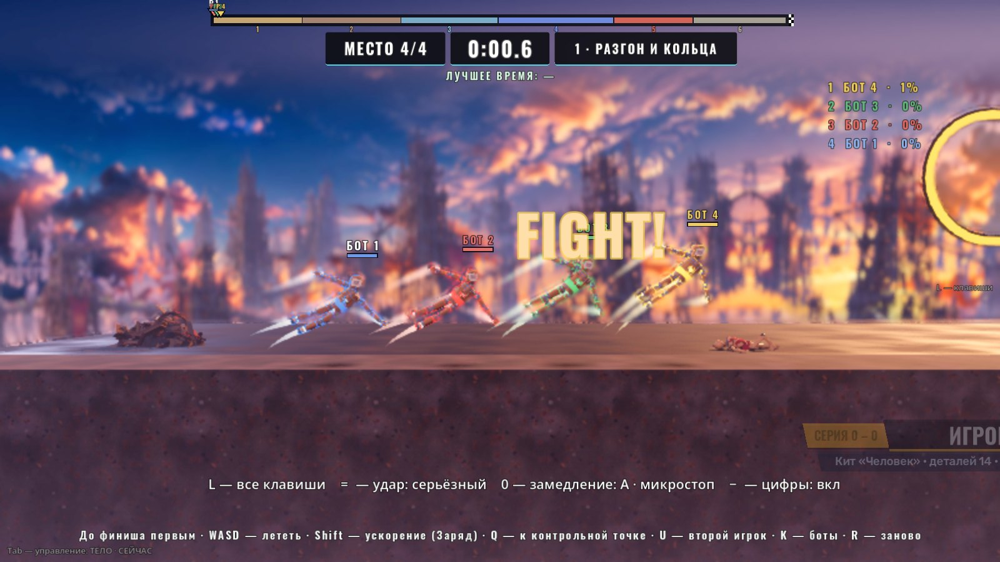
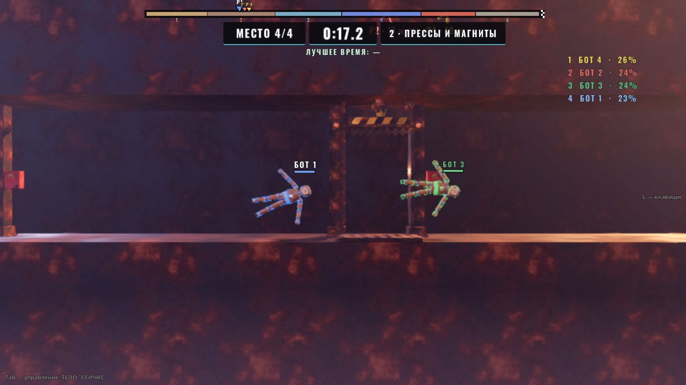
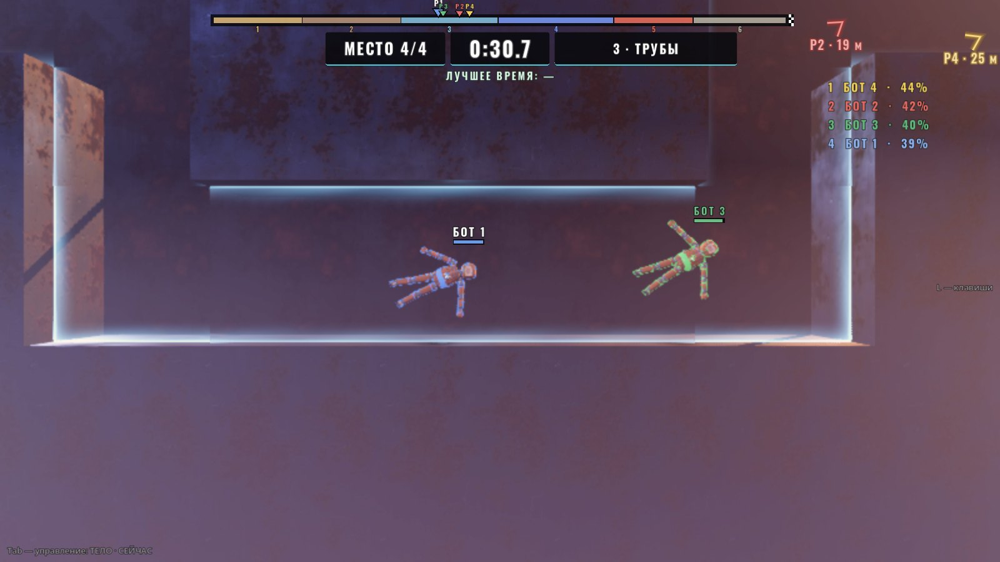
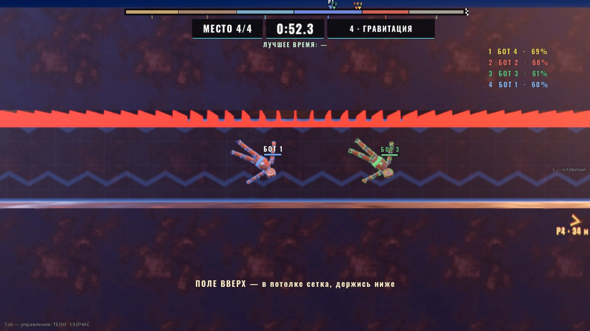
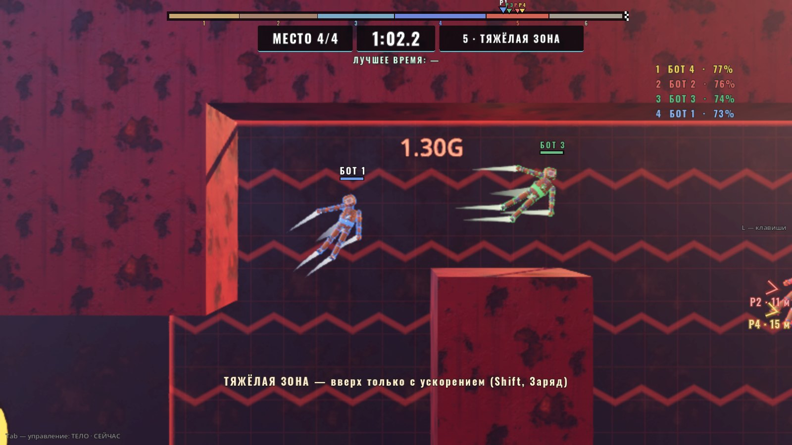
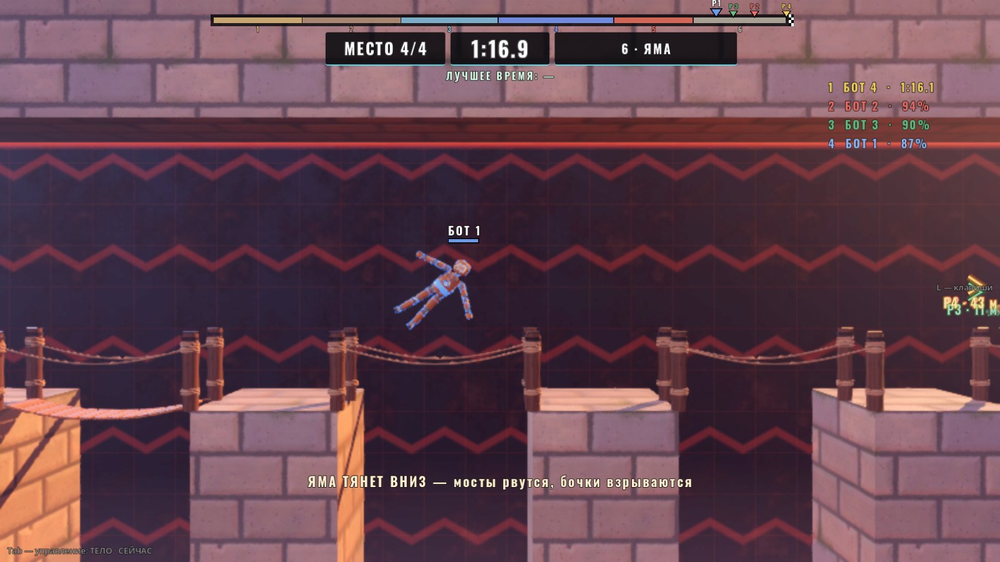
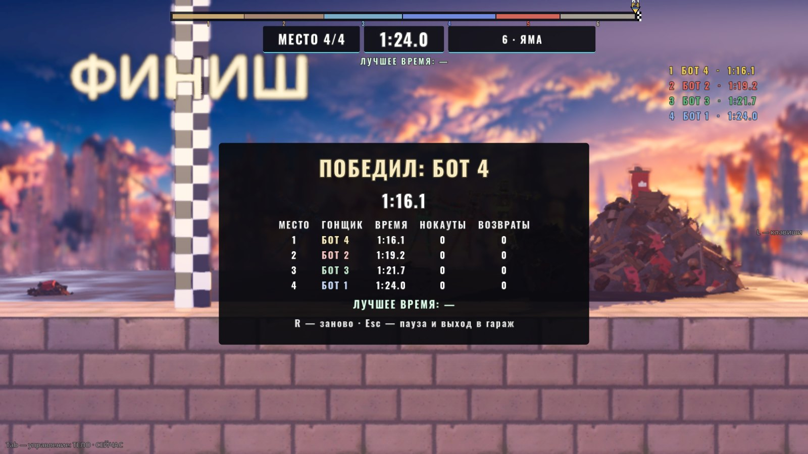

# Гонка: трасса (06.10.2026)

Автор 06.10:

> в гонке мы можем сделать длинную сложную карту с разными сложностями на ней?
>
> делаем

Режим без привязки к лору, как «Гонка: 10 точек» (`RACE.md`) — она остаётся как есть; трасса — отдельный вид гонки: длинная карта
старт → финиш вбок, шесть участков, сложность растёт к концу, на трёх участках развилки «длинный лёгкий путь / короткий трудный».
Ветка `claude/race-track` от `main` c51e751, в неё влит `main` c760e95 (новый экран «ВСЕ РЕЖИМЫ»).


| | |
|---|---|
|  |  |
|  |  |
|  |  |



## Как запустить

- В игре: гараж → **ВСЕ РЕЖИМЫ** → группа «КОМАНДЫ И ВСЕ ПРОТИВ ВСЕХ» → «Гонка: трасса» (карточка сразу после трёх гонок до 10 точек;
  снимок карточки — `assets/ui/modes/race_track.jpg`, генератор `tests/modes_shots.tscn -- "only=race_track"`).
- Напрямую: `godot --path godot res://scenes/playground_race_track.tscn`.

## Правила

- Четыре гонщика: ты (P1) и три бота; P2 — бот или второй игрок на стрелках (U), как в «Гонке: 10 точек». Старт — отсчёт, FIGHT!
- Кто первым пересёк линию финиша (x 404), тот победил. После первого финиша остальным даётся `TRACK_FINISH_WAIT_S` = 30 с, потом
  итоги; доехали все — итоги сразу. Лимит гонки 8 мин. Кто не доехал — места по пройденному пути.
- Место «кто впереди» считается по линии трассы (метры от старта); обе ветки развилки ложатся на один отрезок, поэтому места сравнимы,
  кто бы какой путь ни выбрал.
- Бить можно, урон обычный (как в «Гонке: 10 точек»: тряска и надписи — только если в ударе человек, крит-кино выключено). Доехавшего
  больше не бьют.
- **Контрольные точки** — в начале каждого участка (ворота с номером). KO, яма или сетка KO, «застрял» (продвинулся меньше 2 м за 8 с)
  или Q → через 2 с гонщик у своей последней точки (у каждого своё место за воротами), первые 1.5 с урон не проходит.
- **Кольца** (жёлтые, на разгоне и перед тяжёлой зоной): пролетел сквозь — +25 Заряда, каждое — раз на гонщика (после возврата на точку
  кольца за ней — снова).
- Лучшее время P1 (человек доехал) — в `user://race_track_best.cfg`, под часами и в итогах («НОВЫЙ РЕКОРД!»).

## Участки

Карта собирается сборщиком (`tools/build_race_track.gd`) как разрез «внутри свалки»: коридоры вырезаны в сплошной массе, у каждого участка
свой цвет. Числа ниже — из сборщика и `Tuning` (блок «ГОНКА: ТРАССА» в конце `scripts/tuning.gd`).

| № | x, м | Что | Чем трудно |
|---|---|---|---|
| 1 | −8…64 | **Разгон и кольца**: открытый зал 14 м, шесть колец на линии | ничем: разогнаться, собрать Заряд |
| 2 | 64…136 | **Прессы и магниты** (развилка A) | низом — три пресса Свалки в такт; верхом — два магнита на цепях тянут куклу к себе |
| 3 | 136…206 | **Трубы** (развилка B) | змейка труб 3.4 м или щель 2.6 м; стенки — мембраны: отбрасывают, а не бьют |
| 4 | 206…288 | **Гравитация** (развилка C) | зал со встречным полем вбок 0.45 G; короб с полем вверх 0.5 G и сеткой KO в потолке или тоннель низом |
| 5 | 288…342 | **Тяжёлая зона** | низкий вход, потом поле 1.30 G вниз: тяга куклы (12 м/с²) его не держит, стена до 7.5 м — подняться только с ускорением (Заряд) |
| 6 | 342…426 | **Яма** → финиш | 46 м над ямой по шести столбам и семи верёвочным мостам; поле 0.6 G вниз, потолок 6 м; мост рвётся, если на нём побыть 0.8 с; бочки на столбах рвутся, когда кто-то пролетает рядом (взрыв через 0.9 с — по тем, кто сзади, и по мостам); дно — KO |

Мосты встают заново через 7 с, бочки — через 8 с. Прессы: цикл 1.6 / 0.7 / 0.25 / 0.9 с (тихо / мигает / удар / подъём), фазы трёх
прессов сдвинуты. Магниты включены 2.6 с из 6.

## Развилки

| | Лёгкий (длинный) | Трудный (короткий) |
|---|---|---|
| A, прессы | верхом: шахта вверх, коридор 5 м с двумя магнитами, шахта вниз — 81 м | низом: коридор 4.4 м под тремя прессами — 71 м, ждать такта |
| B, трубы | змейка труб 3.4 м вниз-вверх (четыре поворота) — 91 м | **щель 2.6 м по прямой — 63 м; место под порталы** |
| C, гравитация | тоннель низом через две шахты — 61 м | короб 3.4 м с полем вверх, в потолке сетка KO — 46 м |

## Место под порталы (развилка B)

Сами порталы делает соседняя сессия (`scenes/portal/`, в main их ещё нет). Здесь — размеченное место и пока проходимая щель:

- `Portal/PortalSlotA` — x 145.6, y 7.0: вход, у начала щели. Нормаль −X (смотрит на подлетающих).
- `Portal/PortalSlotB` — x 200.4, y 7.0: выход, у конца щели. Нормаль +X (куда вылетают).
- Нормаль — локальная ось +X метки и мета `normal` (Vector3); мета `opening` — размер проёма (0.6 × 2.6 м), `fork` = "B".
- Короткий путь сейчас — щель y 5.7…8.3 со стенками-мембранами, проходима насквозь (проба `build`: «щель сквозная», бот — 12.4 с).
- После слияния «Порталов»: поставить пару порталов на метки (в сборщике, `_portal_slots`); щель можно закрыть (убрать из `AIR` строку
  `[146.0, 200.0, 5.7, 8.3, "back,pipe"]`) — тогда короткий путь только через портал. Линия ботов `B_hard` идёт по щели: если щель
  закрыть, ботам нужна точка «войти в портал» (или выбирать на B только лёгкий путь: `TRACK_BOT_LEVELS` / `force_choices`).

## Управление

P1 — как в бою: WASD летать, Shift ускорение (Заряд), Space + A/D раскрутка, ЛКМ — рука к курсору, E — хват.

| Клавиша | Что |
|---|---|
| Q | к своей контрольной точке (через 2 с) — если застрял или упал не туда |
| U | P2: бот ↔ второй игрок на стрелках (можно просто нажать стрелку) |
| K | уровень ботов 1 → 2 → 3 (по умолчанию 2) |
| R | заново |
| Esc | пауза (продолжить / заново / в гараж) |
| M / N / H | музыка / толпа / скин HUD |
| 1–9 | другие площадки |

## HUD

- Сверху — полоска трассы: шесть участков цветами карты, флажок финиша, метки всех гонщиков (P1…P4) по пройденному пути; «я» крупнее.
- Под ней: «МЕСТО 2/4», часы гонки, номер и имя участка; лучшее время.
- Справа — места сейчас: имя и доля пути (доехавшие — время финиша).
- Над гонщиками — имя и HP. Соперники за кадром — стрелки `OffscreenMarkers` с метрами.
- Диктор: «КОНТРОЛЬНАЯ ТОЧКА · N», «+ЗАРЯД», «ФИНИШ! МЕСТО N». Выбыл — «ВОЗВРАТ ЧЕРЕЗ N» и причина (KO, яма, застрял, Q).
- Ты в поле гравитации — строка снизу, что поле делает и что жать («ТЯЖЁЛАЯ ЗОНА — вверх только с ускорением (Shift, Заряд)» и т. п.).
- Итоги: кто победил, время, таблица мест (время финиша или доля пути, нокауты, возвраты), лучшее время.

## Камера

`DynamicCamera`, группа фокуса `track_focus` собирается площадкой: P1; P2-человек — пока ближе 14 м к P1 (дальше — стрелка, иначе
кадр разъехался бы на сотню метров); боты в кадр не тянут. Это правило `follow_mode = "humans"`, но в сцене стоит `follow_mode = "all"`
по группе фокуса: в неё ещё входит точка линии трассы в 6 м впереди P1 — кадр смотрит, куда лететь (в трубах — вдоль трубы, у ямы —
на мосты), а не держит куклу посередине над полом (режим "humans" такую точку отбросил бы). Масштаб 6–9 м полувысоты.

## Боты

`TrackBrain extends EnemyBrain` (без EnemyLook). Поиска пути нет — бот летит по линии `Route` карты (точки проложены в сборщике):

- **ветки** выбираются раз на гонку: уровень 1 — всегда лёгкие, 2 — каждая трудная с вероятностью 0.5 (зерно — имя куклы), 3 — всегда
  трудные;
- **полёт**: «морковка» на линии в 3.5 м впереди (в трубах 1.6–2.5 м), скорость не выше `cruise` и меты `v` точек (тормозит заранее);
  ввод = (нужное ускорение + против вязкости + против поля) / тяга. Сначала — держать вес против поля, остаток — на руление (иначе в
  яме и тяжёлой зоне бот тонул, упираясь в предел ввода);
- **ускорение**: на прямой (уровни 2–3), но не за 40 м до тяжёлой зоны (бережёт Заряд); у входа в зону ждёт Заряда 90; в зоне держит
  ускорение, пока нужно;
- **пресс**: до удара меньше 1.35 с — висит у точки перед прессом и ждёт;
- **застрял** (жмёт, а стоит 0.8 с) — рывок в самую открытую сторону с уклоном вперёд; не помогло — через 8 с возврат на точку (общее
  правило для всех);
- **толчок** (уровни 2–3): сосед рядом и чуть впереди, на просторе — наскок с ускорением.

## Ручки (`godot/scripts/tuning.gd`, блок «ГОНКА: ТРАССА»)

| Константа | Сейчас | Что |
|---|---|---|
| `TRACK_RESPAWN_S` / `TRACK_SPAWN_SHIELD_S` | 2 / 1.5 | возврат к точке / неуязвимость |
| `TRACK_STUCK_S` / `TRACK_STUCK_M` | 8 / 2 | «застрял»: меньше 2 м пути за 8 с |
| `TRACK_FINISH_WAIT_S` / `TRACK_TIME_LIMIT_S` | 30 / 480 | после первого финиша / лимит гонки |
| `TRACK_RING_R` / `TRACK_RING_CHARGE` | 1.45 / 25 | кольцо: радиус, Заряд |
| `TRACK_PRESS_CYCLE` | 1.6, 0.7, 0.25, 0.9 | цикл прессов, с |
| `TRACK_MAGNET_FORCE` / `_RADIUS` / `_CYCLE` | 260 Н / 6 м / 2, 0.8, 2.6, 0.6 | магнит тянет куклу целиком |
| `TRACK_MEMBRANE_SKIN` / `_K` / `_DAMP` | 0.55 м / 70 / 6 | стенки-мембраны труб |
| `TRACK_SIDE_G` / `TRACK_UP_G` | 0.45 / 0.5 | поля участка 4, G |
| `TRACK_HEAVY_G` | 1.3 | тяжёлая зона, G (тяга 12 м/с² ≈ 1.22 G; с ускорением 21.6 ≈ 2.2 G) |
| `TRACK_PIT_G` | 0.6 | поле ямы, G |
| `TRACK_BRIDGE_BREAK_S` / `_RESPAWN_S` | 0.8 / 7 | мост рвётся / встаёт |
| `TRACK_BARREL_FUSE_M` / `_FUSE_S` / `_RESPAWN_S` | 2.6 м / 0.9 / 8 | бочка: поджиг рядом, взрыв, новая |
| `TRACK_CAM_PAIR_M` | 14 | P2 в кадре вместе с P1 |
| `TRACK_BOT_LEVELS` | 1–3 | доля тяги, скорость, ускорение, вероятность трудной ветки, толчки |

Где стены, развилки, зоны, точки, линия ботов — константы сборщика (`AIR`, `SKY`, `ZONES`, `ROUTE`, `CHECKPOINTS`, …); после правки —
пересобрать карту и прогнать пробу `build` + `sections`.

## Устройство

| Что | Где |
|---|---|
| Сборщик карты | `godot/tools/build_race_track.gd` / `.tscn` → `godot/scenes/arena/race_track.tscn` |
| Карта: границы, старт, точки, линия, участки, финиш, метки порталов, зоны KO | `godot/scenes/arena/race_track.gd` (`TrackArena`) |
| Матч: прогресс по линии, точки, кольца, финиш, возвраты, места, итоги | `godot/scripts/race_track/track_match.gd` (`TrackMatch extends Match`) |
| Линия трассы: отрезки, развилки, проекция, точка впереди | `godot/scripts/race_track/track_route.gd` (`TrackRoute`) |
| Бот | `godot/scripts/race_track/track_brain.gd` (`TrackBrain extends EnemyBrain`) |
| Контрольная точка, кольцо, финиш | `track_checkpoint.gd`, `track_ring.gd`, `track_finish.gd` |
| Препятствия: мембраны, поля, сетка KO, магнит, мост, бочка | `track_membrane.gd` (+ `.gdshader`), `track_zone.gd` (+ `.gdshader`), `track_grid.gd`, `track_magnet_pull.gd`, `track_bridge_slot.gd`, `track_barrel_slot.gd` |
| Площадка: гонщики, P2, камера, клавиши, рекорд | `godot/scenes/race_track/playground_race_track.gd` (`TrackPlayground`) |
| HUD | `godot/scenes/race_track/track_hud.gd` (`TrackHud`) |
| Сцена | `godot/scenes/playground_race_track.tscn` |
| Пробы | `godot/tests/track_probe.gd`, `track_perf_probe.gd`, `track_snapshot.gd`; схема — `godot/tools/race_track_map.py` |

Машины Свалки (пресс, магнит), верёвочный мост, взрывная бочка, `NullField`, `RaceNav.ray`, `RacePlayground.make_racer`, `RaceHud.name_of /
fmt_time` — используются как есть, не тронуты. Магнит Свалки тянет только железо (кукла «Человек» не железная), поэтому на трассе куклу
тянет `TrackMagnetPull` по циклу самой машины.

### Правки в общих файлах

- `scripts/tuning.gd` — блок «ГОНКА: ТРАССА» в конце файла.
- `scenes/menu/test_menu.gd` — карточка `race_track` в `MODES` после `race_scrap` (экран «ВСЕ РЕЖИМЫ» из `main` c760e95).
- `tests/modes_shots.gd` — рецепт снимка `race_track` (P1 — бот, 12 с гонки); снимок `assets/ui/modes/race_track.jpg` (+ `.import`
  с теми же параметрами, что у остальных: VRAM, мипмапы).
- `locale/en.json` — 29 переводов после блока гонки (после строки «НОКАУТЫ»).
- `tests/i18n_layout_probe.gd` — экран трассы и её итоги в `_pass()` (рекорд пишется во временный файл).
- `godot/README.md` не тронут (его правит другая сессия) — команды проб трассы здесь, в «Проверках».
- `match.gd`, `doll.gd`, `null_field.gd`, машины Свалки, код «10 точек» — не тронуты.

## Проверки

```bash
godot --headless --path godot res://tools/build_race_track.tscn                                         # пересобрать карту
godot --headless --path godot --fixed-fps 60 res://tests/track_probe.tscn                                 # build + sections + checks + hazards + bots
godot --headless --path godot --fixed-fps 60 res://tests/track_probe.tscn -- "only=bots,levels=1+2+3,seeds=1+2+3+4+5"
godot --headless --path godot --fixed-fps 60 res://tests/track_probe.tscn -- "only=sections,sec=5,trace=1"   # один участок с печатью
godot/tools/godot_nofocus.sh --path godot --resolution 1920x1080 res://tests/track_perf_probe.tscn -- "seconds=90,min_fps=55"
godot/tools/godot_nofocus.sh --path godot --resolution 1600x900 res://tests/track_snapshot.tscn -- "out_dir=/abs/dir"
```

Проба 06.10 (ветка поверх `main` c51e751, язык ru, headless, `--fixed-fps 60`): **39 из 39**, exit 0, ошибок скриптов 0.

- **build** — от старта до финиша 404 м по x, линия 424 м; шесть участков подряд; шесть точек в начале участков; места старта и
  возврата свободны; метки порталов: A (145.6, 7.0) n −X, B (200.4, 7.0) n +X, щель между ними сквозная; развилки — лёгкая/трудная
  81/71, 91/63, 61/46 м; точки линии и отрезки — не в стене; семь колец на линии; 3 пресса, 2 магнита, 7 мостов, 6 бочек.
- **sections** (один бот уровня 2, остальные выключены; от точки участка до следующей): разгон 9.9 с; прессы: верхом 14.7 / низом
  13.4 с (ждал такта 1.1 с); трубы: змейкой 19.7 / щелью 12.4 с; гравитация: низом 18.4 / коробом 15.8 с; тяжёлая зона 15.2 с (у входа
  ждёт Заряда 90, на подъём тратит весь); яма 10.4 с. Возвратов 0, на месте дольше 2 с — никто.
- **checks** — яма → KO → через 2.03 с у своего места на CP5; KO ударом → 2.02 с, у CP2, нокаут засчитан ударившему; сетка KO короткого
  пути C → у CP3; «застрял» → через 8.0 с, у CP1; Q → 2.02 с; кольцо: Заряд 10 → 35.7, второй раз — не даёт; финиш: доехавший — место 1,
  итоги через 30.0 с, остальные — по пройденному пути.
- **hazards** — тяжёлое поле 1.30 G: прямо вверх без ускорения за 1.5 с −0.32 м, с ускорением за 1 с +2.62 м; встречное поле сносит
  без ввода на 3.46 м за 2 с; поле вверх уносит в сетку → KO; мембрана щели: вдавливание до 0.40 м, голова не выше 8.15 (стенка 8.3);
  магнит: на 0.58 м ближе к полюсу за 0.8 с (260 Н); пресс: −33 HP; мост под куклой рвётся и встаёт через 7.0 с; бочка: поджиг, взрыв,
  новая.

Гонки ботов (P1 тоже бот; `only=bots,levels=1+2+3,seeds=1+2+3+4+5` — 15 гонок, проба ждёт, пока доедут все): **61 из 61**.
Все доехали, вне границ — 0 тиков, места = порядок финиша.

| Уровень | Ветки | Победитель | Последний | Возвраты за 5 гонок | Дольше всего на месте | Ударов за гонку |
|---|---|---|---|---|---|---|
| 1 | всегда лёгкие | 100.6–101.1 с | 107.7 с | 0 | 2.1 с | 8 |
| 2 | трудная — с вероятностью 0.5 | 73.4–81.1 с | 86.7–101.0 с | 1 «застрял» (двое у входа в щель) | 6.3 с | 5–72 |
| 3 | всегда трудные | 69.3–71.9 с | 76.9–85.2 с | 2 KO ударом, 1 сетка KO в коробе, 1 «застрял» (у стены тяжёлой зоны без Заряда) | 8.0 с | 16–41 |

Уровень 1 одинаков на всех зёрнах (зерно выбирает только ветки, а у него ветки всегда лёгкие). Физика не вполне повторяема: та же гонка
второй раз даёт другие числа на несколько секунд (в первом прогоне матрицы на уровне 2 один бот после «застрял» отстал от победителя на
30+ с и не успел до итогов — поэтому проба ботов ждёт всех, а правило «30 с после первого» проверяется отдельно в `checks`).

Те же пробы после правок общих файлов — зелёные, ошибок скриптов 0: `race_probe` (51 из 51), `sport_probe`, `match_probe`, `bomb_probe`,
`menu_probe` (режимов 22), `modes_screen_probe` (после слияния `main`; описание карточки укорочено, чтобы снимок держал 600 px),
`i18n_probe`, `i18n_scenes_probe`, `i18n_layout_probe` (en — 0 проблем; qps — 25, все прежние, не трассы),
`python3 godot/tools/i18n.py check` — ошибок 0.

### Перф (окно 1920×1080, `track_perf_probe`, 100 с гонки ботов, камера ведёт P1-бота через все участки)

71.3 fps в среднем, одинаково на всех участках (71.0–71.4) — упор в вертикальную синхронизацию (vsync в настройках игры по умолчанию);
кадр p50 13.9 мс, p95 16.6, p99 21–22; дольше 33 мс — 2–3 кадра за 100 с, дольше 100 мс — ни одного; физика 3.3 мс на кадр (четыре
куклы, семь мостов на цепях, бочки, прессы, магниты). Порог 55 — выдержан. Машину в это время грузили пробы других сессий (load
average 5–6), масштаб 3D — 0.5 (пресет графики в настройках автора).

## Что не проверено и что решать автору

- **Руками не проверено.** Пробами доказано, что каждый участок и обе ветки каждой развилки проходимы ботом, правила возврата работают,
  гонка ботов доезжает до финиша на всех уровнях. Весело ли, читаются ли участки на бегу, не слишком ли тяжела тяжёлая зона для человека
  (подъём над стеной — весь Заряд) — только руками.
- **Тяжёлая зона — 1.30 G, а не 2 G.** «2G» буквально (19.6 м/с²) — с ускорением кукла поднимается на 2 м/с² (почти висит), полного
  Заряда на стену не хватало бы. 1.30 G: обычной тягой не подняться (тонет), с ускорением — да. Ручка `TRACK_HEAVY_G`; написать на зоне
  «2G» для вида — можно, но число будет неправдой.
- **Порталы.** Место размечено, щель пока открыта. После слияния — поставить порталы и решить: закрыть щель (короткий путь только через
  портал) или оставить оба.
- **Темп.** Боты: 69–108 с на трассу (победитель — 69–101 с по уровням). Человек, скорее всего, медленнее (2–3 мин?). Ручки — силы
  полей, циклы прессов, `cruise` ботов.
- **Развилка A**: лёгкий путь длиннее трудного всего на 10 м (81 / 71), но без прессов; у ботов уровня 2 обе ветки почти поровну по
  времени (14.7 / 13.4 с). Если хочется, чтобы трудный путь был заметно выгоднее, — короче цикл прессов или длиннее верхний путь.
- **Драк мало.** Боты толкаются только на просторе, нокаутов за гонку почти нет (как в «10 точках»).
- **Q** — возврат к точке через 2 с (как после KO); бывает, что быстрее долететь. **«Застрял» через 8 с** действует и на человека.
- P2 на стрелках без руки мышью; Q — только у P1. Геймпад не проверен. СТАЗИС, ДРАЙВ и «Запас из деталей» вместе с трассой не
  проверены отдельно (ДРАЙВ меняет тягу и g — боты летят быстрее, проба идёт с настройками по умолчанию).
- Вид — без художника: участки различаются цветом массы и задником, кучи хлама только в открытых залах; N0 трассу не комментирует, своей
  музыки нет.
