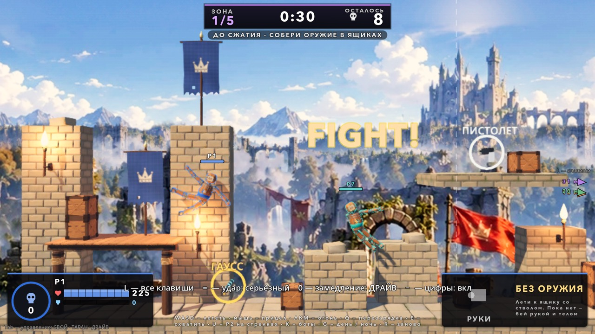
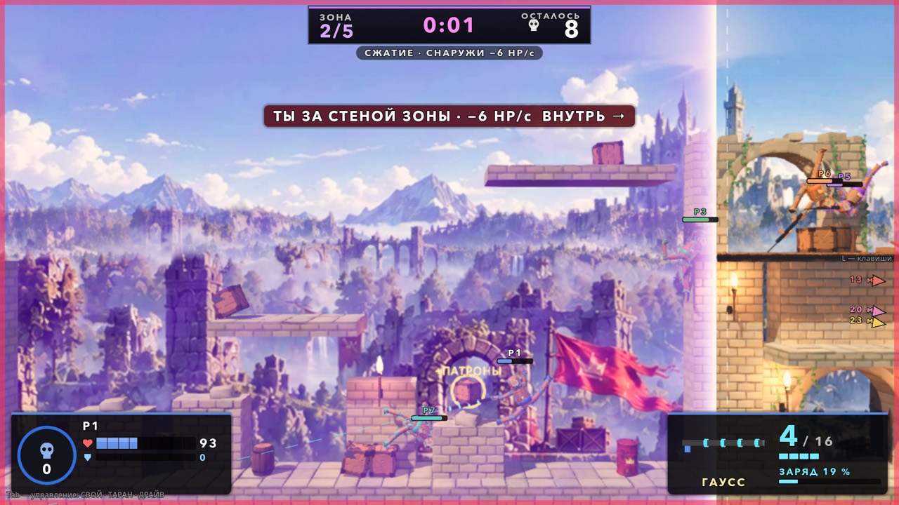
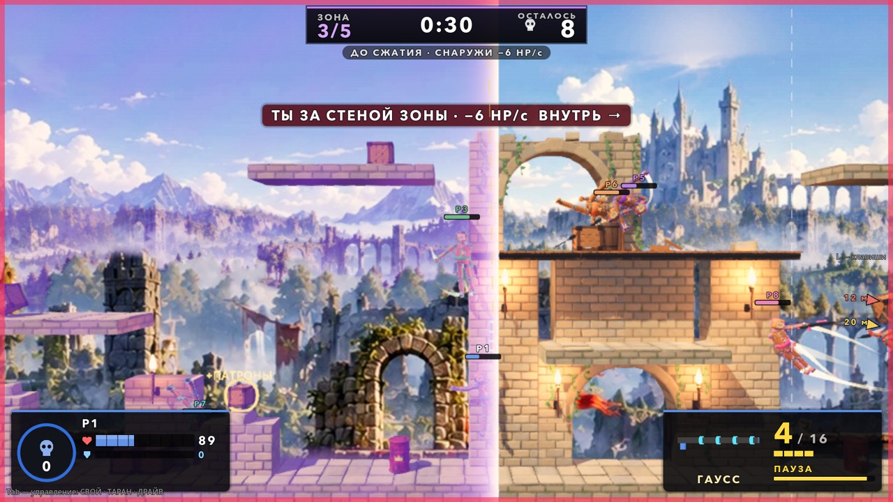
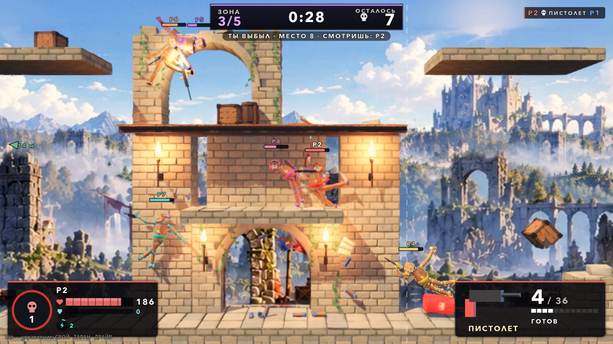
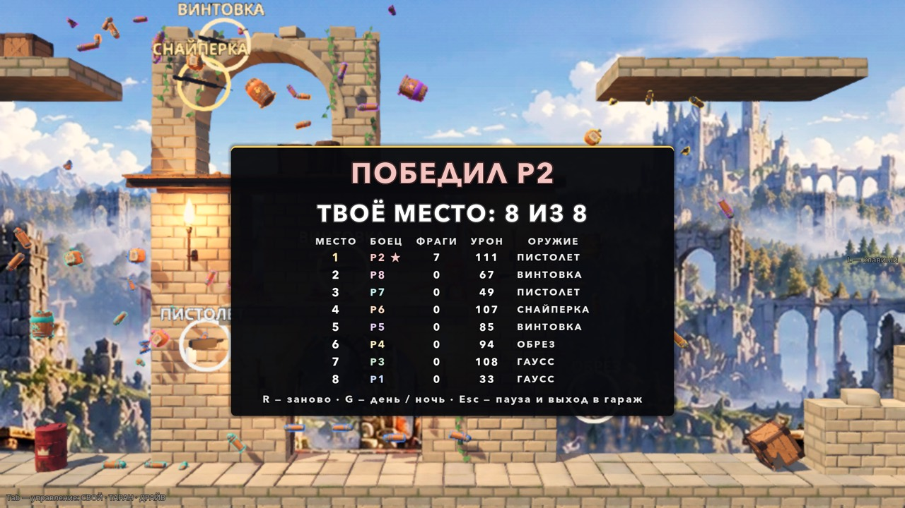
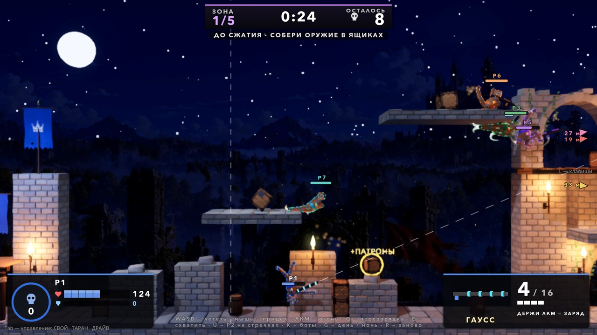

# Королевская битва: восемь на Полигоне (06.10.2026)

Автор 06.10 (MODES_PACK.md, §2): «королевская битва тоже можно»; на вопрос плана — «можно оружие из ящиков разное + бонусы типа
жизни и броню находить».

Режим без лора, как спорт-зал и стычка. Восемь бойцов на Полигоне (64 × 16 м), каждый сам за себя. Старт без оружия: стволы,
патроны, жизни, броня и бонусы — в ящиках. Зона сжимается двумя стенами поля, снаружи урон. Выбыл — выбыл. Последний живой побеждает.








## Как запустить

- В игре: гараж → **ВСЕ РЕЖИМЫ** → «Королевская битва: восемь на Полигоне» (после строк гонки).
- Напрямую: `godot --path godot res://scenes/playground_royale.tscn` (ночь — `playground_royale_night.tscn`, в бою — клавиша G).

## Правила

- **Восемь бойцов:** P1 (человек) + 7 ботов. P2 по умолчанию бот; **U** отдаёт его второму игроку на стрелках (или второй просто жмёт
  свою клавишу — бот отдаёт управление сам, как в бомбе и гонке). У каждого свой цвет (рубашка, обводка, накладки ствола, ореол
  трассера, метка и строка ленты): P1 синий, P2 красный, P3 зелёный, P4 жёлтый, P5 фиолетовый, P6 оранжевый, P7 бирюзовый, P8 розовый.
- **Классов нет** (решение 06.10): классы стычки — про роли в команде, в «каждый сам за себя» они сделали бы бой лотереей выбора. У
  всех «Человек», **150 HP**, без брони и без оружия. Оружие и всё остальное — только из ящиков. С ДРАЙВОМ (J) запас × 1.5, как везде.
- **Точки появления** — 8 по ширине карты (над палубами баз и на земле между укрытиями, не ближе 2 м к ящикам), на каждый бой порядок
  перемешивается.
- **Ящики** (оружие стычки + ящики и бонусы стычки):
  - на старте **12**: 7 стволов, патроны, 2 жизни, броня, бонус-кристалл (обзор / ярость / форсаж). Стволы — на точки через одну по
    ширине карты (у каждого куска карты свой), остальное — в промежутках;
  - стволы по весам: пистолет 2, обрез 1.6, автомат 1.6, дробовик 1.3, винтовка 1.3, снайперка 0.8, гаусс 0.5; снайперки и гаусса
    на старте — не больше одного каждого (гаусс бьёт сквозь стены по 64 HP: три гаусса на карте решали бой за 40 с);
  - ящик с оружием — сама модель ствола над кольцом цвета ранга (белый → золотой), над ней — название;
  - **подбор касанием**, как в стычке. Без ствола — берёшь. Тот же ствол — его патроны в запас. Ранг выше твоего (пистолет 1, обрез 2,
    автомат / дробовик / винтовка 3, снайперка 4, гаусс 5) или у твоего нет патронов совсем — меняешь, а твой остаётся ящиком на этом
    месте со своими патронами. Ранг ниже или равный — ящик лежит;
  - ящики стычки (патроны, жизни, броня, бонусы) — как в стычке; без ствола патроны не берутся; любой из них возвращает оторванные
    конечности;
  - **новые ящики — редко** (решение 06.10): раз в 40 с один (патроны 40 %, жизни 35 %, броня 25 %) на свободной точке внутри стен, к
    которым идёт зона, если на карте меньше 6 ящиков;
  - **выбыл со стволом** — он остаётся ящиком на месте выбывания с оставшимися патронами.
- **Урон пуль × 0.75** (стволы стычки рассчитаны на бой с возвратом через 4 с; с × 1 бой восьми ботов кончался за 35–60 с). Удары
  телом — как есть.
- **Зона** — на виде сбоку две стены поля, сходятся с краёв карты к случайному окну 12 м (центр — в ±18 м от середины):

  | Стадия | Пауза | Сжатие | Ширина в конце | Снаружи |
  |---|---|---|---|---|
  | 1 | 30 с | 20 с | 46 м | 3 HP/с |
  | 2 | 30 с | 20 с | 30 м | 6 HP/с |
  | 3 | 30 с | 20 с | 20 м | 10 HP/с |
  | 4 | 30 с | 20 с | 12 м | 10 HP/с |
  | схлопывание | 25 с | 25 с | 0 | 10 HP/с |

  - урон — со старта сжатия этой стадии (до первого сжатия снаружи никого), порциями раз в 0.25 с; **броня его не гасит и не тратится**;
  - «снаружи» — центр масс за стеной;
  - окна вложены: каждая стена идёт только внутрь;
  - **схлопывание** после четвёртой стадии — моё решение 06.10: двое в окне 12 м могли бы тянуть бой без конца, а так бой кончается
    не позже ~4:20 (плюс время выжить на 10 HP/с);
  - вид: полупрозрачное фиолетовое поле от стены наружу (штриховка ползёт, у стены — яркая кромка), рисуется поверх боя; куда пойдут
    стены — белый пунктир.
- **Без возрождения.** Выбыл — место = живых + 1; камера ведёт того, кто выбил (выбыл и он — его убийцу, иначе лидера по фрагам).
  Лента «кто — чем — кого» (зона — значок часов), диктор «ОСТАЛОСЬ N».
- **Последний живой побеждает.** Итоги: «ПОБЕДА!» / «ПОБЕДИЛ Pk» / «НИЧЬЯ» (последние выбыли в одном тике), твоё место и таблица
  мест (место, боец, фраги, урон, последний ствол). Места — по порядку выбывания (`Match.build_results`: выбывшие в одном тике делят
  место). Страховочный лимит боя — 7 мин (места живых по HP); до него зона схлопывается всегда.
- **Прочность суставов** включена, как в стычке (запас × 2). Оторвало руку со стволом — ствол сразу во второй руке.

### Рука с оружием (риск из стычки)

В стычке ствол в одной руке: у синих в левой, у красных в правой, и рука не достаёт целей с «чужой» стороны кадра. В битве враг с
любой стороны, поэтому **ствол перекладывается в руку стороны цели** (`RoyaleArm`):
- цель руки (у игрока — курсор, у бота — его цель) правее торса больше чем на 0.35 м — кисть Hand_L (кукла смотрит в камеру: её
  левая — справа на экране), левее — Hand_R; ближе — рука не меняется;
- переклад — 0.3 с без выстрела, следующий — не раньше чем через 0.6 с;
- проба: с перекладом ствол смотрит на цель с ошибкой 5.5° (худшая 8.1°) с обеих сторон; одной рукой, как в стычке, с дальней стороны
  — 61.6° (худшая 128.6°).

## Управление

| Клавиша | Что |
|---|---|
| WASD, Shift, Space + A/D | P1: полёт, ускорение (за Заряд), раскрутка — как в бою |
| мышь | прицел: рука тянется к курсору, ствол — в руке со стороны курсора |
| ЛКМ (или I) | огонь, пока зажата (гаусс — держи для заряда, отпусти — выстрел); без ствола рука просто бьёт |
| Q (или O) | перезарядка; пустой магазин перезаряжается сам |
| E | схватить / бросить (как в бою) |
| стрелки, правый Ctrl, Enter, Num 1, Num 2 | P2, если он человек: полёт, рывок, раскрутка, огонь, перезарядка; рука сама на ближнего соперника в дальности ствола (правый стик геймпада — вручную) |
| U | P2: бот ↔ человек |
| K | уровень ботов 1 → 2 → 3 |
| G | день ↔ ночь (сцена заново) |
| R | бой заново |
| Esc | пауза (продолжить / заново / в гараж) |
| M / N / H | музыка / толпа / скин HUD |

Камера: живые люди + ближний к каждому соперник (ближе 10 м × зум). Зум — ствол (винтовка × 1.2, снайперка и гаусс × 1.3) × бонус
«обзор».

## HUD

- Сверху — табло зоны: «ЗОНА n/5», таймер паузы или сжатия (во время сжатия — розовый), «ОСТАЛОСЬ N»; под ним — что сейчас («ДО
  СЖАТИЯ · СОБЕРИ ОРУЖИЕ В ЯЩИКАХ», «СЖАТИЕ · СНАРУЖИ −6 HP/с», «СХЛОПЫВАНИЕ…»), выбыл — «ТЫ ВЫБЫЛ · МЕСТО n · СМОТРИШЬ: Pk».
- Справа сверху — лента выбываний цветами бойцов.
- Над бойцами — имя, HP и броня, бонусы; соперники за кадром — стрелки к трём ближним с метрами; без ствола — стрелка к ближнему ящику
  с оружием.
- Слева снизу — карточка бойца (фраги в кольце его цвета, имя, место, HP с делениями, броня, бонусы); справа снизу — карточка ствола
  (картинка, магазин / запас, состояние) или «БЕЗ ОРУЖИЯ».
- Прицел у курсора — как в стычке (магазин, пауза, перезарядка, заряд гаусса, луч до стены); без ствола — кольцо с кулаком.
- Ты за стеной — красная рамка экрана и «ТЫ ЗА СТЕНОЙ ЗОНЫ · −N HP/с ВНУТРЬ →».
- HUD — наследник `SquadHud` (тот же вид), в два слоя: метки над бойцами, прицел и цифры — каждый кадр; табло, лента и карточки — 20 раз
  в секунду (весь HUD каждый кадр стоил ~4 мс в окне 1080p).

## Боты

`RoyaleBrain extends SquadBrain` (дистанция своего ствола, огонь, когда ствол на цели, гаусс копит заряд, перезарядка, застревание).
Своё:
- **цели** — все живые, кроме себя; своих на линии огня нет;
- **сбор**: первые 30 с (до первого сжатия) видит соперников только ближе 5 м — летит к ящикам, а не в драку; кто ранил (выстрелом
  или ударом от 4 HP, не касанием в толкотне) — виден где угодно 6 с;
- **зрение** потом — 8 м, с дальнобойным стволом до 12 м (текущая цель — до × 1.5). Без цели — **патруль** внутри будущей зоны: раз в
  ~7 с новая точка в ± 5 м и новая высота. Так встречи редкие, пока зона не сожмёт всех вместе;
- **ящики**: без ствола (или без патронов) — к ближнему стволу, где бы он ни был; со стволом — к стволу рангом выше ближе 14 м, к своему
  же за патронами, к жизням / броне / бонусу рядом; ящик, к которому соперник ближе на 4 м, — в последнюю очередь;
- **зона**: все цели движения — внутри стен «через 4 с» с запасом 2.5 м; за этими стенами — внутрь полной тягой (за настоящими — с
  рывком), стреляя по дороге; ящики за стенами не берёт;
- **обход**: прямой путь к цели закрыт (плита, настил башни) — летит через метки графа видимости `RaceNav` (те же 20 меток, что у гонки
  на Полигоне); без этого боты снизу бились в плиты под ящиками;
- **переход без толку** — 8 с в «advance» и не сдвинулся дальше 1.5 м (цель за краем коридора зоны или за стеной): цель бросается на
  10 с, точка патруля — новая;
- **без ствола и без ящика** — рукопашная: к цели с наскоком, рука — на цель.

## Устройство

| Что | Где |
|---|---|
| Матч: бойцы и цвета, урон, ящики и подбор, зона и её урон, выбывание, места, итоги | `godot/scripts/royale/royale_match.gd` (`RoyaleMatch extends SquadMatch`) |
| Зона: стадии, стены, вид поля | `godot/scripts/royale/royale_zone.gd` (`RoyaleZone`) |
| Ящик с оружием | `godot/scripts/royale/royale_crate.gd` (`RoyaleCrate extends SupplyCrate`) |
| Рука с перекладом ствола | `godot/scripts/royale/royale_arm.gd` (`RoyaleArm extends SquadArm`) |
| Бот | `godot/scripts/royale/royale_brain.gd` (`RoyaleBrain extends SquadBrain`) |
| Площадка: бойцы, ввод P1 и P2, камера и слежение, клавиши | `godot/scenes/royale/playground_royale.gd`, сцены `scenes/playground_royale.tscn`, `_night.tscn` |
| HUD | `godot/scenes/royale/royale_hud.gd` (`RoyaleHud extends SquadHud`) |
| Числа | `godot/scripts/tuning.gd`, блок «КОРОЛЕВСКАЯ БИТВА» в конце: `ROYALE_*` |

От стычки берётся почти всё: пули без тряски (`bullet_hit`), удары без тряски, броня, ящики и бонусы, суставы и возврат конечностей,
вертикальный корпус, звук выстрелов. Чтобы общий код стычки не путал «команды» с FFA:
- у каждого своя `Doll.team` («royale_N»), групп команд нет;
- класс стычки у всех один — без множителей (иначе места 4 и 5 были бы «громилами» и получали половину урона пуль — проба это поймала);
- опыта и уровней нет, вида класса нет.

### Правки в общих файлах (для слияния)

Все по умолчанию ничего не меняют в других режимах:
- `scripts/squad/squad_match.gd` — крючок `_match_on_doll_ko` (KO по правилам `Match` без счёта команд и возрождения; 5 строк перед
  `_is_human`);
- `scripts/squad/squad_brain.gd` — крючок `_is_friend(who)` в `_can_hit` (было `SquadMatch.team_of(who) == team`);
- `scripts/squad/squad_gun.gd` — `_owner_colour()`: накладки ствола и ореол трассера — `colour_of(doll)` матча, если он есть, иначе цвет
  команды (ключ кэша материала трассера — цвет, а не номер команды);
- `scripts/tuning.gd` — блок `ROYALE_*` в конце файла;
- `scenes/menu/test_menu.gd` — пункт после гонок;
- `locale/en.json` — 29 строк в конце;
- `tests/i18n_layout_probe.gd` — сцена битвы и её итоги в `_pass()`.

## Ручки (Tuning, `ROYALE_*`)

| Что | Ручка |
|---|---|
| бойцов, запас HP, урон пуль | `ROYALE_FIGHTERS` 8, `ROYALE_HP` 150, `ROYALE_BULLET_MULT` 0.75 |
| зона | `ROYALE_ZONE_STAGES`, `ROYALE_ZONE_FINAL`, `ROYALE_ZONE_WINDOW_M` 12, `ROYALE_ZONE_CENTER_MAX_X` 18, `ROYALE_ZONE_TICK_S` |
| ящики | `ROYALE_CRATES`, `ROYALE_WEAPONS` (вес, ранг, зум), `ROYALE_SUPPLY_EVERY_S` 40 / `_MAX` 6 / `_KINDS`, `ROYALE_DROP_ON_KO` |
| рука | `ROYALE_HAND_SWAP_S` 0.3, `ROYALE_HAND_SWAP_GAP_S` 0.6, `ROYALE_HAND_DEADBAND_M` 0.35 |
| боты: темп боя | `ROYALE_BOT_SEE_M` 8, `ROYALE_BOT_SEE_FAR_M` 12, `ROYALE_BOT_CALM_S` 30 / `_CALM_SEE_M` 5, `ROYALE_BOT_GRUDGE_S` 6 |
| боты: зона и ящики | `ROYALE_BOT_EDGE_M`, `ROYALE_BOT_LOOK_AHEAD_S`, `ROYALE_BOT_UPGRADE_M`, `ROYALE_BOT_YIELD_M` |
| прочее | `ROYALE_SPAWN`, `ROYALE_COLORS`, `ROYALE_JOINTS`, `ROYALE_TIME_LIMIT_S` 420, `ROYALE_FOCUS_M` 10 |

## Проверки

```bash
godot --headless --path godot --fixed-fps 60 res://tests/royale_probe.tscn                                  # zone + rules + aim + bots
godot --headless --path godot --fixed-fps 60 res://tests/royale_probe.tscn -- "only=bots,seeds=11+22+33+44,trace=1"
godot/tools/godot_nofocus.sh --path godot --resolution 1920x1080 res://tests/royale_perf_probe.tscn -- "seconds=60,min_fps=55"
godot/tools/godot_nofocus.sh --path godot --resolution 1920x1080 res://tests/royale_snapshot.tscn -- "out_dir=/abs/dir,night=0"
```

Проба 06.10 (`royale_probe`, зёрна 11, 22, 33, 44, 55, 66, уровень ботов 2): **80 из 80**, ошибок скриптов 0.
- **zone** (7, без площадки): до конца первой паузы стены на краях и урона нет; ширины стадий 46 → 30 → 20 → 12 → 0; стены только
  внутрь; урон 3 → 6 → 10 → 10 → 10; `edges_at` предсказывает стены через 10 с с ошибкой 0; окно в ±18 м и на разных зёрнах разное.
- **rules** (32, мозги выключены): восемь бойцов в восьми «командах», каждый бьёт каждого × 1; старт без оружия, 150 HP, без брони;
  ни одна деталь на старте не ближе 1.4 м к ящику; 12 ящиков (7 стволов от −24.5 до 24.5 м); пуля одинаково и по «громиле»-месту
  стычки (10 × 0.75 = 7.5); подбор: ствол, тот же — патроны, ниже рангом — лежит, выше — замена и старый ящиком (2/7 патронов), он не
  берётся обратно; жизни, броня, патроны, бонус; без ствола патроны лежат; рука: цель справа — Hand_L, слева — Hand_R, после переклада
  ствол молчит 0.28 с; зона: внутри 0 HP, снаружи 6.4 HP за 2 с при 3 HP/с, в броне — столько же, и броня цела; выбывший от зоны —
  «zone»; выбыл со стволом — автомат ящиком 5/20; лента и место; без возрождения; конец — последний живой, места
  {P3: 1, P6: 2, P5: 3, P4: 4, P2: 5, P1: 6, P7: 7, P8: 8} по порядку выбывания, итоги один раз; R — всё заново; U — P2 человек и
  снова бот.
- **aim** (4): ствол на точку в 8 м в десяти направлениях — с перекладом 5.5° (худший 8.1°) с обеих сторон, одной рукой с дальней
  стороны 61.6° (худший 128.6°); бот с пистолетом по цели слева — 44 попадания (ствол в Hand_R), справа — 34 (в Hand_L).
- **bots** (6 × 6):

  | Зерно | Бой | Стадия зоны в конце | Взяли ствол | Перекладов рук | Попаданий | Дольше всех на месте | Дольше всех снаружи зоны |
  |---|---|---|---|---|---|---|---|
  | 11 | 111 с | 3 | 7 из 8 | 29 | 210 | 9.4 с | 0 с |
  | 22 | 101 с | 3 | 7 | 30 | 295 | 16.4 с | 0 с |
  | 33 | 90 с | 2 | 7 | 35 | 89 | 9.3 с | 0 с |
  | 44 | 74 с | 2 | 7 | 29 | 197 | 9.0 с | 0 с |
  | 55 | 33 с | 1 | 6 | 44 | 258 | 9.9 с | 0 с |
  | 66 | 75 с | 2 | 8 | 44 | 185 | 9.3 с | 0 с |

  Каждый бой кончился одним живым (≤ 300 с), все в границах карты. Выбывали от пуль и ударов; от зоны — никто (боты в неё не
  заходят). Стволы выбывших ящиком — 5–7 за бой.

**Скорость** (`royale_perf_probe`, окно 1920 × 1080 через `godot_nofocus.sh`, бой ботов, конец боя — сразу заново; M2, пресет графики
по умолчанию — 3D в 0.5 от физических пикселей Retina; на машине параллельно шли пробы других сессий, загрузка в скобках):

| Прогон | Средний fps | Медиана кадра | 99 % | Худший | Кадров > 33 мс |
|---|---|---|---|---|---|
| день (загрузка 12) | 133 | 7.1 мс | 17.2 мс | 305 мс (одна загрузка в начале) | 1 |
| день, без авто-масштаба (11) | 112 | 8.2 мс | 20.3 мс | 301 мс | 2 |
| ночь (32) | 115 | 7.9 мс | 20.6 мс | 42 мс | 10 |
| стычка 3 на 3 в том же окне (27) | 102 | 9.4 мс | 18.5 мс | 302 мс | 2 |

Порог ≥ 55 fps держится с запасом, восемь бойцов не тяжелее шестерых стычки. Под тяжёлой чужой нагрузкой (load average 150–185) тот же
прогон давал 34–64 fps — и стычка тогда же 51 fps; цифры сравнимы только при одной загрузке, поэтому она в отчёте пробы. HUD каждый кадр
стоил ~4 мс — теперь табло, лента и карточки рисуются 20 раз в секунду (без HUD медиана была 11.3 мс против 16.3 мс с прежним HUD под
нагрузкой).

## Что не проверено и что решать автору

- **Руками не проверено.** Как ощущаются переклад ствола из руки в руку за курсором, бой без ствола рукой, стены зоны — только руками.
  P2 человеком проверен только переключателем U (ввод не нажимался); геймпад — не проверен.
- **Темп.** Бой восьми ботов идёт 33–111 с (обычно 75–110) и кончается на 1–3 стадии зоны, а в плане — «партия 3–4 минуты». Зона пока скорее
  подгоняет, чем решает: снаружи её боты не стоят (дольше всех подряд — 0 с), и от зоны в боях ботов никто не выбывал. Что пробовал:
  урон пуль × 1 → 35–60 с, × 0.5 → 53–116 с, но для человека бойцы — «губки» (пистолет — 33 попадания); оставил × 0.75 и замедлил
  встречи (зрение ботов, сбор, патруль). Если нужен бой длиннее — ручки `ROYALE_BOT_SEE_M`, `ROYALE_BOT_CALM_S`, `ROYALE_BULLET_MULT`,
  `ROYALE_HP`; или короче зона (`ROYALE_ZONE_STAGES`), чтобы она успевала к концу боя. Как с ботами играет человек — не проверено.
- **Решения, которые стоит подтвердить:** классов нет (один «Человек» на всех); схлопывание зоны после 4-й стадии; новые ящики — раз в
  40 с, только патроны / жизни / броня; ствол выбывшего — ящиком; замена ствола касанием только на ранг выше (без клавиши); оружие громилы
  (сковорода, молот, меч, топор с полётом) в ящики **не** положил — у него своя рука и полёт, переклад рук с ним не дружит; бонусы-кристаллы
  стычки в ящиках есть.
- **Карта.** Полигон 64 × 16 м — для пробы; план — своя карта побольше (сборщиком по образцу `build_proving_ground`). Обход ботов держится
  на 20 метках гонки — на другой карте их надо будет расставить.
- **Скорость.** Порог ≥ 55 fps держится, но на общей машине fps скачет в разы от чужих проб (в том же окне стычка шестерых давала 51 fps
  при загрузке ~150). Есть один провал 0.3–1 с в первые секунды боя (первый подбор / первые шейдеры) — в стычке такой же.
- **Мелочи:** в начале боя поверх карточек на секунды всплывает строка клавиш HitJuice («L — все клавиши …») — общая для всех режимов;
  гаусс во всех руках остаётся самым сильным стволом.
