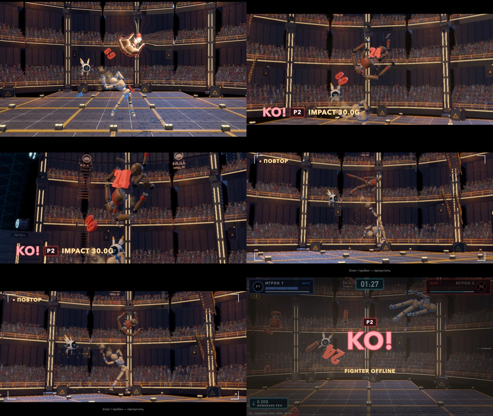
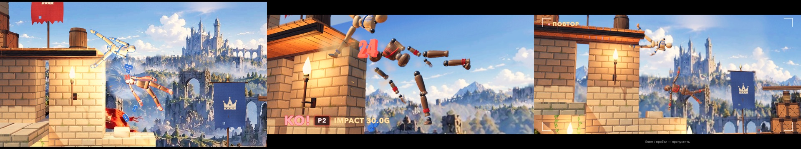
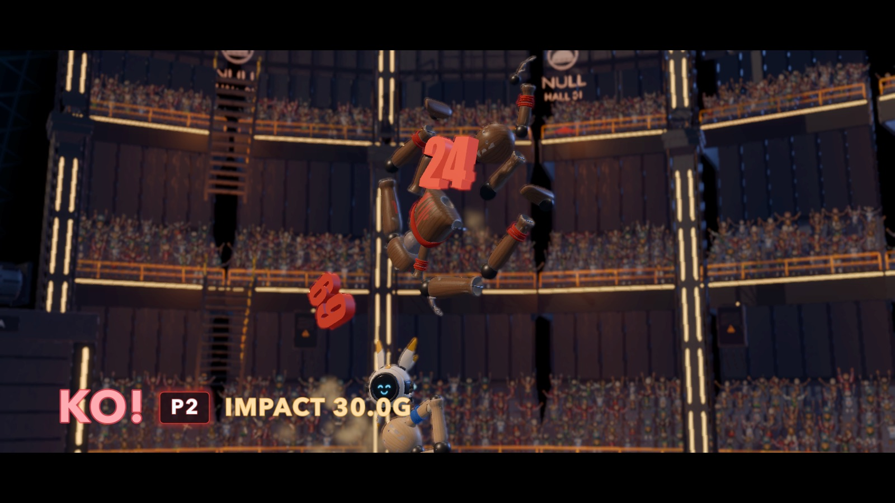
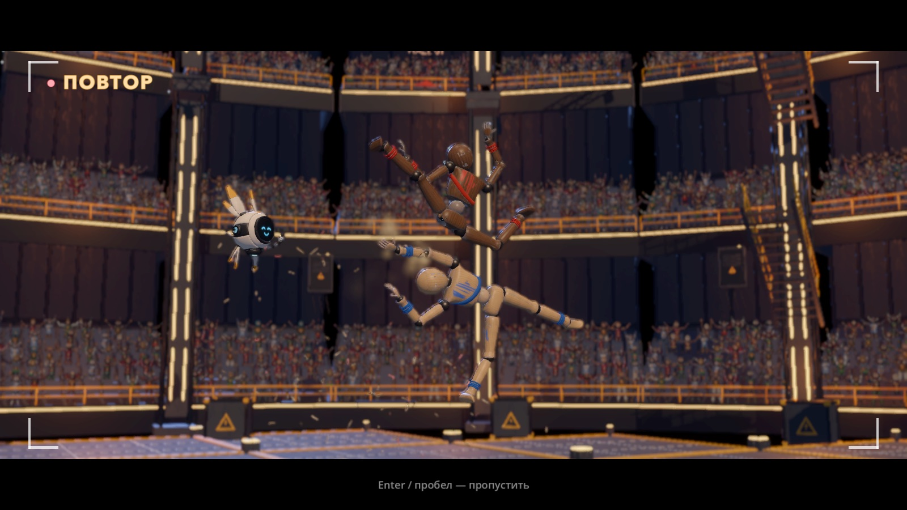
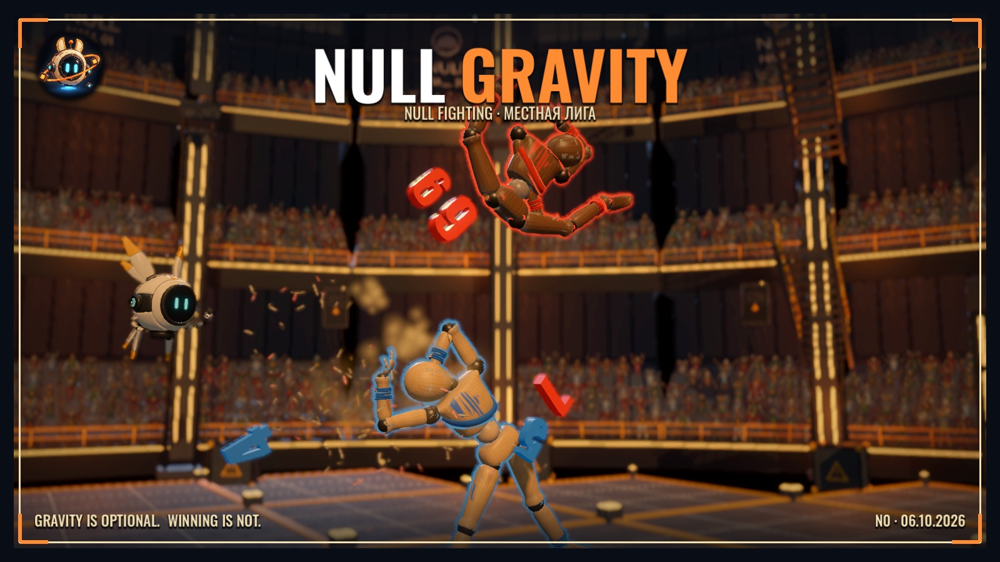
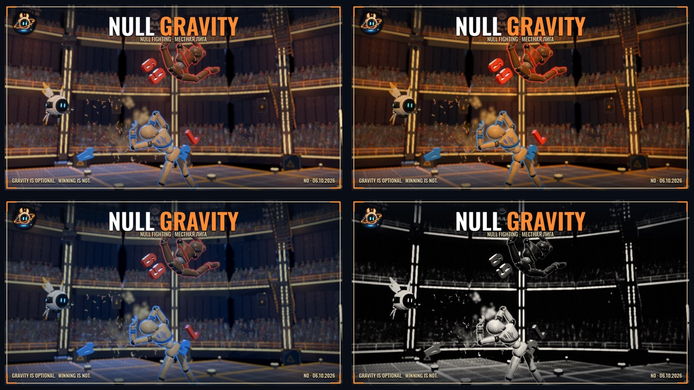

# look-cam — нокаут в 3D и фоторежим (06.10.2026)

Ветка `claude/look-cam` от `claude/look-pass`, пункты 5 и 7 плана `LOOK_PASS.md`. Всё — пункты панели «ВИД» (Э) в группе
**«Камера»**, по умолчанию включены; снятая галочка (или Shift+Э «как было») — ровно прежнее поведение.

| Пункт «ВИД» | id | Что делает |
|---|---|---|
| KO-камера: стоп-кадр и облёт | `cam_ko` | на последнем нокауте боя — стоп-кадр и облёт побеждённого по дуге, табло «KO! · P2 · IMPACT 30.0G» |
| Повтор нокаута перед карточкой KO | `cam_replay` | после облёта — замедленный повтор последних 1.4 с с другого ракурса, плашка «● ПОВТОР» |
| Фоторежим — клавиша / | `cam_photo` | клавиша **/** в любой 3D-сцене: пауза, свободная камера, фильтры, рамка-обложка NULL GRAVITY, снимок |

Клип всего кино в куполе (8 с, 1280×720): [`img/look/cam-ko.mp4`](../img/look/cam-ko.mp4) — бой, нокаут, табло и облёт, повтор,
щелчок назад, карточка KO, итоги.

## 1. KO-камера (облёт)

Когда: **последний нокаут** обычного боя — Быстрый бой в куполе, арены 1–4 (Руины, Мастерская, Void, Свалка), кампания. То есть
после KO живых ≤ 1. Наследники Match (PvE-волны, спорт-зал, стычка 3 на 3, бомба, гонка) кино не получают: там нокаутов за бой
десятки. Не играет на `ko_crit` — у сокрушительного удара своё кино (CritCinematic); на пресете эффектов «выкл» и при
`feel_enabled = false`; если камеру уже кто-то держит.

Таймлайн (реальные секунды; пауза Esc его останавливает):

| с | Что |
|---|---|
| 0 | **стоп-кадр**: время ×0.03 (Match.request_time_scale, тег `ko_cam`) — детали висят в воздухе; HUD прячет панели (set_cinematic), остальные экранные слои площадки (подсказки, панели L / Tab, стрелки за экраном, голосование, реплики N0) тоже; карточка KO откладывается на всё кино (defer_ko_card) |
| 0–0.12 | въезжает леттербокс (10 % сверху и снизу), табло нижней трети слева: **KO!** (плашка тревоги), тег побеждённого цветом игрока, **IMPACT xx.xG** (`HitJuice.impact_caption` — то же табло, что у крита). Плашки по скину HUD (`HudSkin`) |
| 0.14–1.64 | **облёт** 1.5 с (smootherstep): своя камера выходит из боковой плоскости и обходит побеждённого по дуге в сторону от победителя (тот уходит в глубину кадра), с подъёмом — у пола камера поднимается и смотрит сверху, в воздухе опускается и смотрит снизу; центр кадра к середине облёта переезжает на побеждённого; радиус × 0.66, fov × 0.85 (фон «подходит»); DOF на фоне (дальнее размытие с фокуса + 2.5 м, сила 0.035), если пресет графики его разрешает (не «низко») |
| конец | **щелчок назад**: вспышка 0.35 (× пресет вспышек), игровая камера, время отпущено с коротким замедлением ×0.35 → 1 за 0.7 с (тег `ko_cam_out`) — части разлетаются уже в обычном кадре; HUD, слои и карточка KO (1.2 с), затем итоги — как раньше |

Угол облёта по арене: **купол 50°** (круглый зал, трибуны со всех сторон), **Void 45°**, остальные **26°** — у 2.5D-арен задник
плоский, на 50° в Руинах был виден край панорамы. Таблица `KoCam.ORBIT_YAW_BY_ARENA`.

Длительность до карточки KO: облёт — 1.64 с; с повтором (§2) — около 4.5 с. В кампании итоги и экран исхода идут по своему
таймеру (3.5 с после конца боя), поэтому там только облёт, без повтора.

С соседними механиками:
- **крит-кино** (`ko_crit`) — KO-камера молчит, играет крит-кино как раньше;
- **стоп-кадры ДРАЙВА, замедления клавиши 0, slow-mo KO** — все через `_time_effects` Match, действует минимум: на время кино
  ×0.03 главнее; после щелчка назад они уже истекли (считают реальные секунды);
- **СТАЗИС** — к моменту кино фаза уже OVER, режим молчит (как в итогах);
- **пауза Esc** — кино стоит вместе с деревом; таймер отложенной карточки KO в паузе идёт, поэтому кино при выходе из паузы
  откладывает карточку на остаток своего плана;
- **R** посреди кино — прерывание: камера, время, HUD, слои, куклы — как до кино.

## 2. Мини-повтор

Запись: KoCam (ребёнок Match) каждые 1/60 с **игрового** времени, пока идёт бой, пишет мировые позы всех тел кукол (`Doll.parts`) в
кольцевой буфер на 2.2 с (≈ 130 кадров × ~30 тел — сотни КБ). Порог по игровому времени: в стоп-кадрах и СТАЗИСЕ буфер не
забивается кадрами-дублями. На KO буфер замораживается, последним кадром — поза, в которой мир сейчас стоит.

Проигрывание после облёта (≈ 2.9 с):
- настоящие куклы, следы эффектов (FxRoot директора, вспышки ImpactFx, цифры-обломки) прячутся; вместо кукол — **копии их мешей**
  (тот же меш и материалы, оверлей, параметры инстанса — краска), позы интерполируются между кадрами записи; физика не трогается
  вообще, мир всё это время стоит на ×0.03;
- окно — 1.4 с игрового времени до KO; скорость ×0.75, к удару падает до ×0.22 (за 0.42–0.12 с до KO), в конце 0.3 с держится
  кадр удара — ровно та поза, с которой мир продолжится после щелчка назад;
- камера — с другой стороны (на 30°, у 2.5D-арен на 0.6 угла облёта) и **снизу** (8°), ведёт середину между побеждённым и
  победителем, оба помещаются между полосами леттербокса, медленный наезд; DOF на фоне;
- плашка **● ПОВТОР** (точка мигает), уголки видоискателя, внизу «Enter / пробел — пропустить» (или клик).

Чего в повторе нет: послеобразов, лент и вспышек удара (они живут в реальном времени и уже отыграли), обводки бойцов
(DollOutline — не меш куклы), летящего оружия и пропсов (записываются только тела кукол). Дрон N0 висит, где был.

## 3. Фоторежим

Клавиша **/** (physical `KEY_SLASH`; в русской раскладке это «.» справа от «Ю»). Работает в любой 3D-сцене, кроме открытой паузы
Esc, лоадера и режимов, где «/» — клавиша игрока.

**Где «/» занята (с 11.10.2026, сборка 0.0.4).** Рука P2 с клавиатуры: головоломки и Перегон (`PuzzleKeyArm`, «/» ещё и вводит P2 в
игру) и перетягивание каната, пока P2 — человек (хват каната). Раньше фоторежим перехватывал «/» в `_input` раньше игры: P2 не мог
войти и схватить, игра вставала на паузу. Теперь такой режим ставит себя в группу `PhotoMode.KEY_TAKEN_GROUP` (`photo_key_taken`) —
LookCam клавишу не трогает. В перетягивании с ботом P2 «/» снова фоторежим. Проба `tests/photo_key_probe.tscn` (headless,
`--fixed-fps 60`) жмёт «/» через `Input.parse_input_event` в бою Void, головоломках, Перегоне и перетягивании. Новый режим с «/» у
игрока — в группу и случай в эту пробу.

- Дерево на паузу: бой, кино KO, частицы — всё стоит (можно войти и посреди облёта).
- Все слои экрана прячутся (HUD, подсказки, тосты, панели; экраны внутри SubViewport — телевизор гаража — это часть кадра, их не
  трогаем) и возвращаются на выходе.
- Камера с позы текущей: **мышь** (зажатая левая или правая) — вращение вокруг точки (ближайший к центру кадра боец), **колесо** —
  зум, **WASD / стрелки** — сдвиг (Shift — быстрее), **R** — к исходному кадру.
- **DOF**: фокус на ближайшем к центру кадра бойце каждый кадр; **B** — размытие фона вкл/выкл; пресет графики «низко» его не даёт.
- **F** или **1–4** — фильтр: как есть / **тёплый** (янтарь зала) / **холодный** (поле NULL) / **ч/б плакат** (S-кривая, ступени тона,
  зерно, бумага). Шейдер `assets/shaders/look/photo_filter.gdshader` поверх 3D-кадра.
- **C** — рамка-обложка: тёмное паспарту, кремовая линия, оранжевые уголки, знак N0, **NULL GRAVITY** (NULL — белый, GRAVITY —
  оранжевый, Oswald, `BRAND.md`), строка «NULL FIGHTING · МЕСТНАЯ ЛИГА», внизу слоган заставки и дата. Рамка поверх фильтра — в ч/б
  остаётся цветной.
- **Enter / пробел** — снимок в `user://photos/null_gravity_<дата>_<время>.png` (с фильтром и рамкой, без подсказки), тост с
  полным путём. На маке это `~/Library/Application Support/Godot/app_userdata/NULL GRAVITY/photos/`.
- **H** — подсказка; **Esc** или **/** — выход: пауза снята, слои и камера как были.

Кто первым ловит Esc: фоторежим ловит в `_input` и помечает обработанным — до `_unhandled_input` площадок (там пауза Flow); к тому
же дерево на паузе, и площадки ввода не получают. Проба проверяет, что пауза боя не открылась.

## 4. Как устроено

| Файл | Что |
|---|---|
| `scripts/look/look_cam.gd` | автозагрузка **LookCam** (`project.godot`, после Look): пункты «ВИД» (регистрируются, когда в дереве появился бой или нажата /), KoCam к каждому обычному Match (`node_added`), клавиша / |
| `scripts/look/ko_cam.gd` | `KoCam` — ребёнок Match: запись, облёт, повтор, щелчок назад, прерывание |
| `scripts/look/ko_cam_overlay.gd` | `KoCamOverlay` (слой 15): леттербокс, табло, плашка повтора, уголки, вспышка |
| `scripts/look/photo_mode.gd`, `photo_frame.gd` | `PhotoMode` (ребёнок LookCam, работает в паузе), `PhotoFrame` — рамка-обложка |
| `assets/shaders/look/photo_filter.gdshader` | фильтры фоторежима |
| `tests/look_cam_probe.tscn` | headless-проба (ниже) |
| `tests/look_cam_capture.tscn` | оконная съёмка: бой «наскоком», серия фоторежима, нокаут и серия KO-кино |

Общие файлы: `project.godot` (одна строка автозагрузки), `locale/en.json` (17 строк в конце), `tests/i18n_layout_probe.gd` (экраны
табло, повтора и фоторежима в проходе вёрстки). Match, DynamicCamera, HUD, KoCard **не правились**: всё через их готовые точки —
`request_time_scale` / `cancel_time_scale`, `capture_camera` / `release_camera`, `set_cinematic`, `defer_ko_card`, сигналы `ko`,
`hit_fx`, `phase_changed`.

KoCam не ставится в headless и в тестовых сценах (`res://tests/…`) — гейты и чужие пробы видят бой как раньше, кроме проб, которые
сами включают `LookCam.force`.

## 5. Проверки

`godot --headless --path godot --fixed-fps 60 res://tests/look_cam_probe.tscn` — exit 0, 53 проверки, SCRIPT ERROR ловит Logger (0):

| Случай | Что проверяется | Получилось |
|---|---|---|
| A облёт | на KO: кино стартовало, камера захвачена `ko_cam`, время ≤ 0.05, HUD в кино, карточка KO отложена | 0.030, карточка 2.83 с (план 1.64 + показ) |
| | камера вышла из боковой плоскости на 40–60° | 46.2° (Void, 45° + подъём) |
| | вернулась в игровую ≤ 3 с, тег снят, HUD и карточка вернулись, через 1 с время 1.0 | 1.65 с |
| B облёт + повтор | стадии hold → orbit → replay → back, копий мешей ≥ 10, куклы спрятаны и вернулись, итог ≤ 6.5 с и ≤ плана + 0.1 | 98 копий, 4.57 с (план 4.54) |
| C прерывание | R посреди облёта: камера, время, HUD, куклы — как до кино | ok |
| D выключено | пункты сняты или рубильник «как было» — кино нет, карточка KO сразу | ok |
| E где работает | только обычный Match (WaveDirector — нет), не последний нокаут (3 куклы) — без кино | ok |
| F фоторежим | пункт снят — / ничего; / — пауза, своя камера, HUD спрятан (7 слоёв), вращение, фокус, фильтр 3, рамка C; Esc — выход, пауза боя не открылась, всё вернулось; / — вход и выход | ok |

Гейты после правок (headless, KoCam там не ставится): `run_gate.sh` — doll_gate 0, feel_probe strict 0; `run_combat_gate.sh` — OK;
`run_hitfx_gate.sh` — OK (hit_tier, hitfx_core, hitfx × 3, crit_probe, sfx, juice — все 0); `flow_probe` OK, `stasis_probe` OK;
`look_probe` OK (пункты «Камера» регистрируются только с боем — проба Look видит лишь свои); `python3 godot/tools/i18n.py check` — 0 ошибок; `i18n_probe`, `i18n_scenes_probe`, `i18n_layout_probe` (en ok,
qps — 22 прежних предупреждения, новых от этих экранов нет).

Съёмка: `GODOT_BIN=/usr/local/bin/godot godot/tools/godot_nofocus.sh --path godot --resolution 1600x900 --fixed-fps 60
res://tests/look_cam_capture.tscn -- "tag=cam,seed=3"` → `godot/tests/look_shots/cam_*.png` (scene= — другая площадка, photo=0,
replay=0). На время съёмки выключается авто-масштаб графики (DynRes) — под чужой нагрузкой и `--fixed-fps` он снижал разрешение 3D
и кадры мылились; настройки игрока не пишутся. Клип: тот же запуск с `--resolution 1280x720 --fixed-fps 30` и `seq=<абс. папка>`
(кадры PNG подряд: секунда до нокаута и всё кино) → `ffmpeg -framerate 30 -i f_%04d.png -c:v libx264 -crf 27 -pix_fmt yuv420p`.
Movie Maker (`--write-movie`) для клипа не подошёл: в его AVI кадры кино записались застывшими (130 одинаковых кадров при верной
логике — по отладочной печати стадии и часы шли правильно), причину не разбирал.

## 6. Что не получилось / ограничения

- **Руины на 50°**: у 2.5D-арен задник — плоская панорама, на широком облёте виден её край. Сделано 26° для всех, кроме купола и
  Void. Свалку, Мастерскую и Полигон глазами на облёте не смотрел — угол взят тот же, что для Руин.
- **Повтор без обводки, лент и оружия** (см. §2). Полноценная запись боя на 180 с с предметами и сохранением (план 09, §17) — не
  делалась: здесь только 2.2 с поз кукол в памяти.
- **ko_crit** и любой не последний нокаут — без облёта (решение по умолчанию, вопрос 2).
- Таймер итогов HUD идёт и в паузе: если поставить паузу посреди кино надолго, итоги могут показаться раньше конца кино
  (не проверено руками, по устройству таймера).
- В кампании повтор выключен (её экран исхода по своему таймеру 3.5 с); облёт в кампании проверен только по устройству кода.

## 7. Вопросы автору

1. Нравится ли облёт и повтор; оставить оба по умолчанию? Сейчас до карточки KO ≈ 1.6 с (облёт) + 2.9 с (повтор). Повтор можно
   пропустить Enter / пробелом.
2. Облёт только на последнем нокауте и не на ko_crit — так и оставить? Или и на крите после его кино, и в стычке/PvE на «важных»
   нокаутах (последний враг волны, нокаут лидера)?
3. Клавиша фоторежима **/** — удобно? Альтернативы, свободные во всех режимах: **Z** (только Ctrl+Z в мастерской; рядом с WASD —
   легко задеть в бою), **\\**, **`/Ё**.
4. Сила DOF: в кино 0.035 (лёгкий), в фоторежиме 0.06 (заметное боке). Больше / меньше?
5. Рамка-обложка: текст «NULL FIGHTING · МЕСТНАЯ ЛИГА» и слоган — так? Добавить имя бойца в фокусе?
