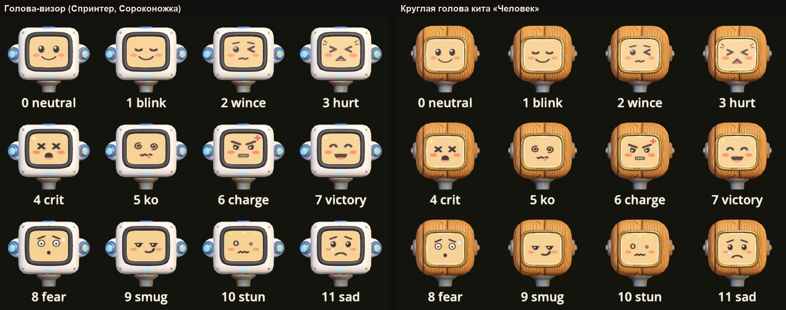
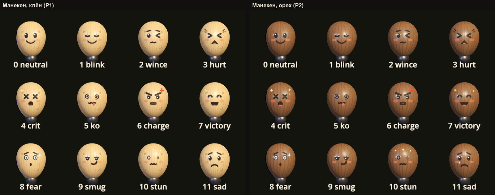
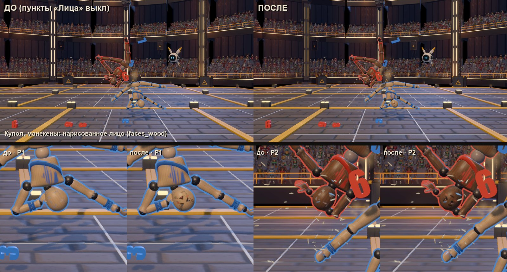
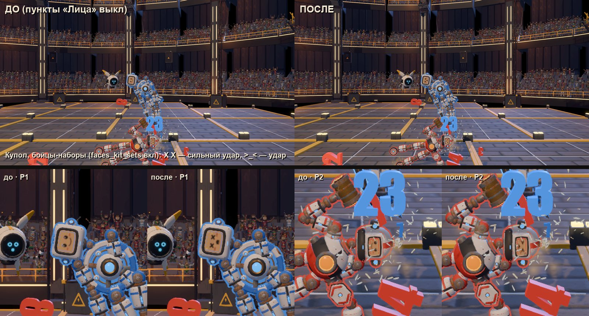
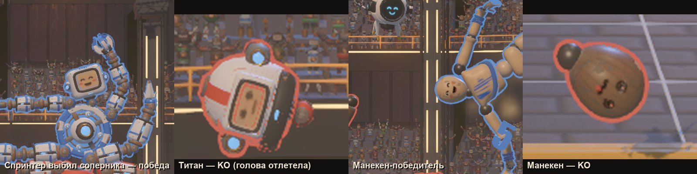

# Проход по картинке: лица бойцов (look-faces, 06.10.2026)

Ветка `claude/look-faces` от `claude/look-pass`. Замысел — `LOOK_PASS.md`, пункт 2: у бойцов появились лица, которые реагируют на бой.
Раньше выражений не было ни у кого, кроме дрона N0. У голов кита была одна нарисованная улыбка, у деревянного манекена лица не было совсем.



## Что сделано

| Что | Где |
|---|---|
| Атлас из 12 выражений, 4 × 3 ячейки по 256 px. Стиль тот же, что у лица кита (`kit/face_default.png`): тёплая бумага, белая кайма, чёрные глаза с бликом, румянец. Нейтральное выражение почти пиксель в пиксель совпадает со старым лицом | `godot/assets/textures/faces/face_expr_atlas.png` |
| Та же картинка без бумаги и каймы — рисунок «маркером по дереву», RGBA. Он крупнее и жирнее, чтобы читаться на голове манекена | `godot/assets/textures/faces/face_expr_ink.png` |
| Генератор обоих атласов (Pillow) и лист для глаз (`--sheet`) | `godot/tools/gen_face_atlas.py` |
| `FaceExpr` — узел-ребёнок куклы: находит лицо, меняет ячейку атласа, слушает бой, моргает | `godot/scripts/look/face_expr.gd` |
| `KitBodies` — бойцы кита вместо манекена (пункт 4), по умолчанию выключено | `godot/scripts/look/kit_bodies.gd` |
| Точка подключения — одна строка в конце `Doll._ready`: `FaceExpr.attach(self)` | `godot/scenes/doll/doll.gd` |
| Headless-проба | `godot/tests/look_faces_probe.tscn` |
| Лист выражений на настоящей голове (оконная проба) | `godot/tests/look_faces_sheet.tscn` |
| Новые аргументы снимков `look_capture` (новые ветки `match` и функции в конце файла): `look=`, `scale3d=`, `faces=`, `ko=` (подробно ниже) | `godot/tests/look_capture.gd` |

Файлы `glb`, `doll.tscn`, `match.gd`, `modular_doll.gd`, бой и материалы тела не правились. Подписи пунктов «ВИД» вызываются через `tr()`,
их английский перевод — в `godot/locale/en.json`.

## Пункты панели «ВИД» (группа «Лица»)

| id | Подпись | По умолчанию | Что делает выключение |
|---|---|---|---|
| `faces_expr` | Выражения на лицах бойцов (головы кита) | вкл | Возвращает на плашку тот override, что был до `FaceExpr`, — видно старое лицо `face_default` |
| `faces_wood` | Нарисованное лицо у деревянного манекена | вкл | Прячет наклейку-лицо и возвращает плашке «глазниц» исходный материал |
| `faces_kit_human` | Манекены → кит «Человек» (та же физика) | **выкл** | Возвращает манекены (кукла пересоздаётся) |
| `faces_kit_sets` | Манекены → бойцы-наборы: Спринтер и Титан (другая масса) | **выкл** | То же |

- Первые два пункта переключаются сразу, в обработчике `Look.changed`, поэтому снимки «до / после» снимаются на паузе.
- Два пункта подмены тел **не реагируют на общий рубильник Shift+Э**: «до / после» сравнивает один и тот же кадр, а подмена тела
  пересоздаёт кукол на точках спавна. Их включает и выключает только своя галочка.

## Выражения и что их вызывает

| # | id | Когда | Держится |
|---|---|---|---|
| 0 | neutral | покой | — |
| 1 | blink | моргание каждые 2–5 с (иногда двойное) | 0.12 с |
| 2 | wince | удар слабее 5 HP (`Doll.damaged`) | 0.3 с |
| 3 | hurt `>_<` | удар 5–20 HP | 0.3 + урон / 40, до 1.2 с |
| 4 | crit `X X` | удар от 20 HP; уровень `crit` / `ko_crit` в `Match.hit_fx` | до 1.2 с |
| 5 | ko (спирали, язык) | кукла не жива или развалилась | до конца |
| 6 | charge (злость, зубы, 💢) | держит Заряд: ускорение (`is_dashing`) или раскрутка (`is_spinning`) | пока держит |
| 7 | victory `^^` | выбил соперника (KO с атакующим), нанёс крит, выиграл матч (`Match.match_over`) | 1.2 с; победителю — до нового матча |
| 8 | fear (белые глаза, капля) | летит после удара (`is_flying`) быстрее 3.6 м/с | пока летит |
| 9 | smug (прищур, ухмылка) | сам попал на 5 HP и больше | 0.8 × время удара |
| 10 | stun | оглушён (`is_stunned`) | пока оглушён |
| 11 | sad | матч кончился, кукла жива, но проиграла | до нового матча |

- Пороги совпадают с `CONCEPT.md` §15 (FaceState) и с `Tuning`: `ANNOUNCE_MIN_DAMAGE` 5, `HIT_STOP_DAMAGE_1` 20.
- У вспышек есть приоритет: слабый удар не перебивает крестики сильного.
- Исход боя (KO, победа, проигрыш) важнее любых вспышек.

## Где у бойца лицо

- **Головы кита** — все `Kit_Head_*` с плашкой `FacePlate`: материал `Face` с картинкой `face_default.png`, UV 0..1. `FaceExpr` ставит
  на плашку копию этого материала с атласом, ячейку выбирает через `uv1_offset`, как у N0. Так получают выражения:
  - кит «Человек»;
  - Спринтер, Титан, Сороконожка, Мультитул, Химера;
  - классы стычки: `SquadLook` меняет голову на визор, рогатый шлем или банку. `FaceExpr` замечает новый меш на теле головы и находит
    плашку заново;
  - бойцы кампании, гонки и телевизора в гараже.
- **Не трогаются**:
  - голова с фото игрока (`BodyPaint.set_face` — другая картинка и triplanar);
  - визор-глаз лиги Аоэлюн (`LeagueLook` кладёт на плашку свою картинку);
  - кукла с внешним скином (`skin_scene`).
  - Если фото положили уже после `FaceExpr` (мастерская), выключение пункта фото не затирает.
- **Деревянный манекен** (`doll.tscn` / `doll_dark.tscn`, `wood_head`). Его плашка `Face.001` утоплена в «яйцо» головы, наружу видны
  только две «глазницы».
  - Поэтому `FaceExpr` строит свою наклейку `Face_Expr`: берёт треугольники яйца спереди и обрезает их по квадрату 18 см.
  - Рисунок — `face_expr_ink.png`, альфа к краю яйца спадает. Меш строится один раз на модель головы: обход яйца занимает ~24 мс
    в GDScript, дальше он берётся из кэша.
  - Глазницы под наклейкой закрашены ровным цветом дерева (средний цвет текстуры яйца), иначе получалось «четыре глаза».
  - Если на голове уже есть фото (наклейка `Sticker` мастерской), нарисованного лица нет.
  - Выглядит хорошо и на клёне, и на тёмном орехе, поэтому пункт **включён**.



## Снимки

Купол, обычный бой двух манекенов. Один кадр, слева «до», справа «после»; внизу крупно головы из того же кадра:



Купол, Спринтер против Титана (`faces_kit_sets` включён). Слева в том же кадре старое лицо, справа крестики от крита и `>_<` от удара:



Исход боя (`ko=12`): победителю — `^^`, у выбитого — спирали, в том числе на отлетевшей голове:



Как снять заново (оконные, только через `godot_nofocus.sh`):

```bash
# лист выражений: head=visor|pilot|round|wood|wood_dark, zoom=<i> — одна голова крупно, far=<k> — камера дальше
GODOT_BIN=/usr/local/bin/godot godot/tools/godot_nofocus.sh --path godot --resolution 1600x1000 res://tests/look_faces_sheet.tscn -- "head=visor"
# бой в куполе, до / после + крупно головы, KO на 12-й секунде, без HUD, 3D без мыла DynRes
GODOT_BIN=/usr/local/bin/godot godot/tools/godot_nofocus.sh --path godot --resolution 1600x900 res://tests/look_capture.tscn -- \
  "tag=wood,t=10;13,fight=1,seed=5,scale3d=1,ko=12,faces=260,hud=0"
# то же с бойцами-наборами
... -- "tag=sets,t=10;13,fight=1,seed=5,look=faces_kit_sets:1,scale3d=1,ko=12,faces=260,hud=0"
```

Новые аргументы `look_capture` пригодятся и соседям:

| Аргумент | Что делает |
|---|---|
| `look=<id>:1;<id>:0` | ставит галочки пунктов до загрузки сцены, `user://look.cfg` не пишется |
| `scale3d=1` | масштаб 3D корневого вьюпорта; DynRes на время снимка выключается полем `Gfx.auto_scale`, без записи в `gfx.cfg` |
| `faces=<px>` | рядом с кадром пишет `<кадр>_face<i>.png` — квадрат вокруг головы каждой куклы сцены (`dolls()`) |
| `ko=<t>` | в момент t первая кукла выбивает вторую |

## Бойцы-наборы по умолчанию (пункт 4)

Какие тела дерутся сейчас (разведка по коду):

| Режим | Игрок | Соперник | Где решается |
|---|---|---|---|
| Купол (`playground_null_hall`), быстрый бой из гаража | манекен `doll.tscn` | манекен `doll_dark.tscn` (второй человек на стрелках; K — чемпион лиги ботом) | сцена генерируется `tools/build_null_hall.gd`; `garage_menu.gd` грузит ту же сцену, чертёж мастерской **не используется** |
| Кампания | ModularDoll по чертежу игрока (старт — `kit_human`) | `kit_horned` → `kit_brawler` → `kit_devil` → `kit_king` (RivalBrain) | `campaign_league.gd` LADDER |
| Стычка 3 на 3 | `kit_human` + вид класса | 5 ботов `kit_human` | `playground_squad.gd` |
| Спорт | манекен | манекен-бот | сцены генерирует `tools/build_sport_hall.gd` |
| Бомба, PvE (игроки) | манекены | манекены / враги ModularDoll | `playground_bomb.gd`, `playground_pve.tscn` |
| Площадка тела | P1 — любой пресет (`]`), включая наборы | манекен | `playground_body.gd` |

Значит, лица кита в бою уже видны в кампании, стычке, гонке и телевизоре гаража. А в куполе и быстром бою — главном режиме — дерутся голые
манекены. Им теперь достаётся нарисованное лицо (`faces_wood`).

Подмена сделана дёшево (`KitBodies`):

- работает только там, где кукла — манекен, а бой ведёт обычный `Match`: купол, быстрый бой, Свалка, мастерская, площадка тела;
- кукла пересоздаётся `Match.respawn_doll` с другой сценой — так же делает `playground_body.set_preset`;
- KO и R пересоздают ту же сцену;
- выключение пункта возвращает манекен;
- пока идут итоги матча, подмена ждёт новый матч: иначе пересоздание обрывало итоги, `ResultsPanel` держит куклу через лямбду HUD.

Почему оба пункта **выключены**:

- **кит «Человек»** — по физике тот же манекен: формы, массы и суставы байт в байт (`BODY_KIT.md` §3.2, это проверяет `body_probe`).
  Но меняются:
  - вид главного режима;
  - различие «клён / орех» у P1 и P2 — остаётся только цвет игрока на поясах;
  - материал удара для искр и звука;
- **Спринтер и Титан** — это другой баланс:
  - масса 51.5 и 60 кг против 40 кг манекена;
  - тяга фиксирована (`fixed_thrust`), поэтому тяжёлый разгоняется медленнее (Мультитул 71 кг — примерно ×0.56);
  - другие формы, клинок и молот на руках;
  - на захвате снимков купола крит-кино шло почти каждый обмен.

Риски, если включать по умолчанию:

- сцены купола и спорта генерируются builder-ами: правка руками затрётся, менять надо в `tools/build_null_hall.gd` и
  `tools/build_sport_hall.gd` или в рантайме, как здесь;
- в кампании регламент держит бюджет 100: почти все наборы дороже, и `validate()` молча собирает «Человека» (кроме Спринтера, 96);
- нечеловеческие раскладки (Сороконожка, Мультитул) дают телам имена `<префикс>_<uid>`, а логика спорта и стычки ждёт имена человека.

## Проверки

| Проба | Итог |
|---|---|
| `tests/look_faces_probe.tscn` (headless) | **зелёная**, 35 проверок (вывод ниже) |
| `tests/run_gate.sh`: `doll_gate` + `feel_probe` strict | зелёная |
| `look_probe`, `body_probe` (29 пресетов с пересозданием — копия `FaceExpr` уходит сама), `paint_probe` (999 проверок), `match_probe`, `doll_hooks_probe` | зелёные. `paint_probe` при нагрузке 50–70 дважды подряд давал 2 красные проверки времени `spray` (среднее 2.05 и 3.5 мс при пороге 2.0); следующие два прогона на той же сборке — 999 / 999. Это порог по чистому CPU-циклу `PaintLayer.spray`, кукла и `FaceExpr` в нём не участвуют — плавает от нагрузки |
| `i18n.py check` | 0 ошибок; 17 предупреждений были и до правок |
| `i18n_probe`, `i18n_scenes_probe`, `i18n_layout_probe` | зелёные |

Что проверяет `look_faces_probe`:

- атлас стоит на плашке;
- в покое лицо нейтральное;
- моргание само приходит и уходит;
- удары 3 / 12 / 30 HP дают wince / hurt / crit, слабый удар не перебивает сильный;
- бьющий получает smug, держание — 0.3–1.2 с;
- Заряд даёт charge;
- выключение пункта возвращает исходный override и видно `face_default.png`, включение — снова атлас;
- KO даёт спирали, выбивший — victory, после KO удары лицо не меняют;
- фото не затирается ни выключением, ни включением;
- вид класса стычки (визор) получает атлас;
- манекен: наклейка есть (~1400 треугольников), удар меняет ячейку, пункт выключается и включается, фото-наклейка убирает лицо, тёмный
  орех тоже работает;
- визор лиги не тронут;
- выбор сцены подмены — только для манекена.

## Что не получилось и ограничения

- **На общем плане лицо — несколько пикселей.**
  - Голова в куполе занимает 35–60 px окна. На Retina 3D рисуется в физических пикселях (вдвое меньше), а DynRes под нагрузкой
    опускает масштаб ещё ниже.
  - Поэтому выражения выходных кадров — крупные, жирные формы: крестики, спирали, открытый рот, белые глаза. Рисунок на манекене
    крупнее и жирнее, чем на карточке.
  - Читаются они на среднем и ближнем плане, при наезде камеры на KO и крит, в крупных кадрах. На общем плане видно только «лицо
    поменялось».
  - Снимки выше сняты с `scale3d=1`.
- **Снимки на загруженной машине.** Пять агентов параллельно, игра шла медленнее реального времени. Крит-кино почти останавливает время,
  поэтому соседние моменты `t=` иногда дают один и тот же кадр. Аргумент `ko=` помогает дойти до исхода боя.
- **Визор лиги Аоэлюн без выражений**: там своя картинка-глаз. Можно сделать отдельный атлас «глаза» в том же генераторе.
- **Экран не светится.** Лицо кита — бумажная карточка, свечение экрана не добавлял: материалы бойцов (свечение, rim) — это
  направление look-frame.
- **Возможный конфликт при слиянии:** если look-frame тоже меняет override поверхностей лица, его правка сядет на копию материала
  `FaceExpr`, а не на исходный. `FaceExpr` копирует текущий материал плашки (`next_pass` сохраняется), но лучше проверить после слияния.
- **60 fps — не мерил** (не проверено). Новая нагрузка — один узел `_process` на куклу, одна копия материала на лицо и ~1400 полупрозрачных
  треугольников на голову манекена. Перф-пробу на загруженной машине не гонял.

## Вопросы автору

1. Лицо манекена (нарисованное «маркером») оставить включённым по умолчанию или манекену положено быть безликим, пока нет фото игрока?
2. Бойцы в куполе и быстром бою: оставить манекены, поставить кит «Человек» (та же физика, есть экран лица) или наборы (другой баланс)?
3. Сколько эмоций нужно: 12 — это много? Например, «попал» (smug) и «проиграл» (sad) можно убрать.
4. Нужны ли выражения визору-глазу лиги Аоэлюн?
