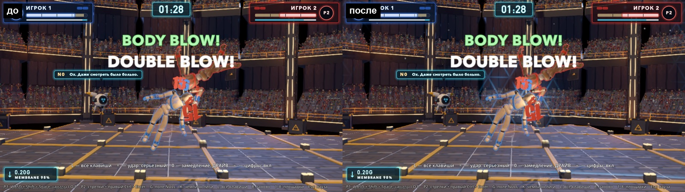
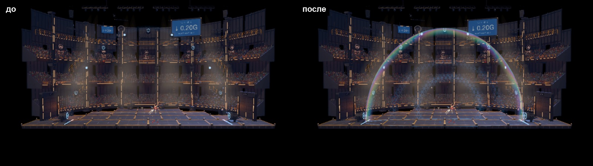
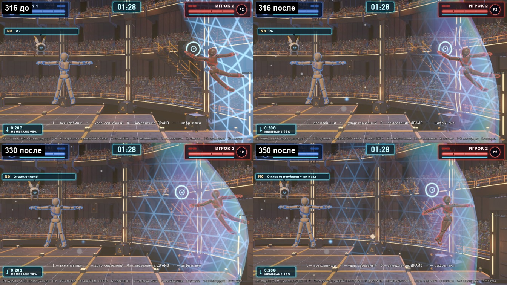
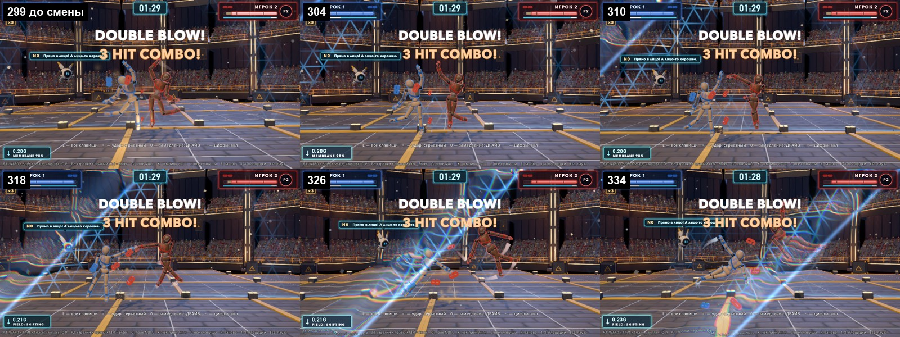
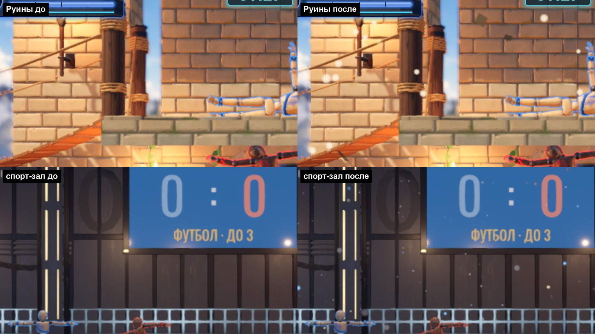

# Проход по картинке: поле NULL видно всегда (look-null, 06.10.2026)

Ветка `claude/look-null` от `claude/look-pass`. Замысел — `../LOOK_PASS.md`, п. 4: до прохода невесомость в кадре была видна только как
синяя сетка у самого края купола и цифра «↓ 0.20G» в углу. Теперь поле — объём с пылью и мусором, пузырь-мембрана с радужным краем и
преломлением, смена гравитации — событие на весь кадр.

## Что включить и как сравнить

В игре: **Э** — панель «ВИД», группа **«Поле NULL»**; **Shift+Э** — всё «как было» / «новый вид». Каждый пункт по умолчанию ВКЛ,
выключение сразу возвращает прежний вид (узлы прячутся, лента мембраны — с исходным материалом).

| Пункт (id) | Подпись в панели | Где | Что |
|---|---|---|---|
| `null_dust` | Пыль и мусор в объёме боя | купол, тренировочный зал, спорт-зал | 3 слоя GPUParticles3D: перед плоскостью боя (редкие крупные мягкие пятна), у плоскости, за ней (гуще всего). Пылинки, кувыркающиеся осколки с бликом, голубые мерцающие искры цвета NULL. Медленный дрейф по вектору гравитации поля (0.24 м/с при 0.20G), вихрь; в куполе — только внутри пузыря |
| `null_dust_plain` | Пыль на обычных аренах | Руины, Полигон | упрощённая: 2 слоя перед плоскостью боя (у Руин стены стоят в самой плоскости), тёплая пыль и солнечные блики вместо искр NULL, дрейф вниз с ветерком |
| `null_bubble` | Мембрана-пузырь: преломление, радужный край, рябь | купол | вместо ленты — полуэллипсоид 16 × 19 × 4 м: мыльно-радужная кромка (френель + полоса у контура), тонкий шов по полу, сетка только у бойца у мембраны / на кольцах волн / на фронте смены поля, круги ряби от точки сильного удара и удара о мембрану, прогиб к бойцу — как у ленты (механику NullField не трогал) |
| `null_refract` | Преломление фона через мембрану | купол | фон за кромкой пузыря и на кольцах волн сдвигается (screen texture). Отдельно — чтобы можно было сравнить цену |
| `null_shift` | Смена гравитации: волна по кадру | купол | клавиша G / голосование / любая `set_field`: волна-искажение по кадру в сторону новой гравитации (светлая кромка, развод каналов, рябь за фронтом), тот же фронт сеткой по пузырю, пыль толкает по новому вектору и она разворачивается вместе с полем, табло GRAVITY в зале и плашка поля в HUD мигают |
| `null_wake` | Кильватер поля за быстрым бойцом | купол, залы | боец быстрее 5 м/с увлекает за собой пыль и разводит её в стороны (полный — от 12 м/с) |

Волны пыли и ряби дают: удары `heavy` (0.55), `crit` / `ko_crit` (1.0), `ko` (0.85) из `Match.hit_fx`, удар о статику (`env_slam`,
от 7 м/с), удар о мембрану (`NullField.membrane_hit`). Лёгкие удары — нет: «пыль разлетается от сильных».

## Снимки «до / после» (один и тот же кадр, 1600×900)

Бой в куполе (кадр 420, `look_null_shots`, боты, seed 3): пыль, осколки и голубые искры в объёме, кольцо ряби от сильного удара по задней
стенке пузыря.


Купол целиком (неподвижная камера): лента «как было» почти не видна — пузырь с радужной кромкой и швом по полу.


Удар о мембрану (P2 брошен в правый бок купола на кадре 300): 316 до / после, 330 и 350 после — прогиб, сетка у бойца, рябь кругами.


Смена поля ↓0.20G → ↘0.35G (как клавиша G, кадр 300): 299 — до смены; 304–334 — волна идёт по кадру к правому нижнему углу (светлая
кромка, развод каналов, рябь), фронт сеткой по пузырю, плашка «FIELD: SHIFTING»; дальше пыль дрейфует по новому вектору.


Обычные арены: Руины (упрощённая пыль) и спорт-зал (пыль NULL), до / после.


## Числа

`tests/look_null_perf.tscn` (окно 1600×900 через nofocus, бой куклы-боты, vsync выкл, авто-масштаб Gfx на время пробы выкл, 20 блоков по
3 с «новый вид» / «как было» по очереди, медиана времени кадра по часам). Apple M2, 06.10 16:50, load 4–5 (соседние сессии затихли).

| Что переключается | Новый вид | Как было | Цена |
|---|---|---|---|
| весь «ВИД» (рубильник), 3D в полном разрешении окна (`scale=1`) | 4.76 мс (210 fps) | 4.31 мс (232 fps) | **+0.45 мс** (2 прогона: +0.45, +0.47) |
| то же + смена поля в начале каждого блока | 4.84 мс (207 fps) | 4.30 мс | +0.54 мс |
| весь «ВИД», масштаб Gfx как в игре (на этом экране 0.5) | 2.86 мс (350 fps) | 2.70 мс | +0.16 мс |
| только `null_bubble` (`scale=1`) | 4.75 мс | 4.31 мс | +0.44 мс |
| только `null_refract` (`scale=1`) | 4.89 мс | 4.66 мс | +0.23 мс |
| только `null_dust` (`scale=1`) | 4.78 мс | 4.72 мс | +0.06 мс |

p95 «нового вида» ≤ 6 мс — бой держит 60 fps с запасом в 3 раза. Под тяжёлой нагрузкой (load 130–250, днём) разброс между прогонами был
±1.5 мс — те числа в сравнение не беру.

Что оказалось дорогим и что сделано:
- **текстура глубины** в шейдере преломления (проверка «не брать в преломление то, что ближе плёнки») стоила **+2.2 мс** на кадр в Mobile
  (под нагрузкой, `scale=1`; без неё преломление −0.02 мс в том же прогоне) — убрана. Цена: у бойца, вжатого в мембрану, его отражение в
  плёнке смещено на ≤ 1 % кадра;
- пузырь сначала закрывал почти весь кадр двумя проходами (+1.9…2.9 мс под нагрузкой): теперь всегда рисуются только кромка (6 кусков
  по дуге — кусок вне кадра отсекается, копия экрана нужна, только когда кромка в кадре) и шов по полу; передняя половина и шов —
  шейдером без чтения экрана; середина задней стенки — только пока идут волны или смена поля; пиксели без кромки / волн / шва
  отбрасываются до дорогой части шейдера;
- пыль — 846 частиц в куполе (low ×0.4, medium ×0.7 по пресету Gfx), движение целиком в шейдере частиц.

## Файлы

- `godot/scripts/look/null_look.gd` (`NullLook`) — пункты «ВИД», волны, смена поля, кильватер, пузырь; ставится в `_ready` арены одной
  строкой `NullLook.attach(self, kind)`: купол (`null_hall.gd`), тренировочный зал, спорт-зал, Руины (Полигон — через `super._ready()`);
- `godot/scripts/look/null_dust.gd` (`NullDust`) — слои пыли; шейдеры `assets/shaders/null_dust_process.gdshader` (движение: частицы
  рождаются разом, дальше перерождаются сами — `preprocess` у GPUParticles3D здесь не работал) и `null_dust_draw.gdshader` (вид);
- `assets/shaders/null_bubble.gdshaderinc` (тело), `null_bubble.gdshader` (с преломлением), `null_bubble_glow.gdshader` (только свет);
  `null_shift_wave.gdshader` — волна по кадру (CanvasLayer 4, под стрелками и HUD, виден только во время волны);
- `scenes/arena/null_field.gd` — новый сигнал `field_changed(g, dir)` из `set_field` (механика не менялась);
- переводы — 7 строк в конце `godot/locale/en.json`;
- снимки: `godot/tests/look_null_shots.tscn` (кадры по номерам), `look_capture` — аргументы `edge=`, `slam=`, `shift=`, `cam=`.

## Пробы

```bash
godot --headless --path godot --fixed-fps 60 res://tests/look_null_probe.tscn        # 9 проверок, exit 0/1
godot/tools/godot_nofocus.sh --path godot --resolution 1600x900 --fixed-fps 60 res://tests/look_null_shots.tscn -- "tag=shift,fight=1,shift=300,frames=299;310;318,before=1"
godot/tools/godot_nofocus.sh --path godot --resolution 1600x900 res://tests/look_null_perf.tscn -- "block_s=3,blocks=20,scale=1"   # item=<id> — один пункт
```

- `look_null_probe` — **9/9 зелёная**: купол получил NullLook и пункты; пыль — 3 слоя, перед плоскостью 76 частиц, за ней 466; дрейф по
  гравитации поля (cos 1.000, 0.24 м/с); пузырь — куски полуэллипсоида, кромка с преломлением, передняя — только свет, середина в покое
  спрятана, пункт «преломление» переключает материал; смена поля — волна включилась, толчок пыли по новому вектору (cos 1.00), табло
  вспыхнуло (+2.16 по синему), плашка HUD толкнулась (×1.10), через 1.7 с дрейф повернулся (cos 1.000), волна погасла, табло и плашка как
  были; heavy и удар о мембрану — волна в пыли и на пузыре, light — нет; кильватер от быстрого бойца и пропадает при выкл; выкл — лента
  мембраны видна с исходным материалом (тот же ресурс, `null_membrane.gdshader`), смена поля без волны; рубильник — всё сразу; Руины —
  упрощённая пыль (1184 частицы), спорт-зал и тренировочный зал — пыль NULL.
- `null_field_probe` — 9/9 (как до правок). `i18n.py check` — 0 ошибок, `i18n_probe` и `i18n_scenes_probe` — OK. `i18n_layout_probe` не
  гонял: новые строки — только подписи в панели «ВИД» (её вёрстка — не моя, в `_pass()` пробы её нет).
- `look_null_shots` — оконная, кадры по номерам при `--fixed-fps 60` (серия события снимается ровно через N кадров); `look_capture`
  получил аргументы `edge=`, `slam=`, `shift=`, `cam=` (новые ветки match и функции в конце файла).

## Что не получилось / ограничения

- **Пыль не освещена** (unshaded): в лучах прожекторов она не вспыхивает. Освещённые частицы на Mobile — заметно дороже; можно
  сымитировать яркость по расстоянию до лучей, если нужно.
- **Волна смены поля в кадре** — экранная (фронт идёт по направлению новой гравитации на экране), фронт на пузыре пересчитан на плоскость
  боя приблизительно; в крупном плане крита они могут слегка расходиться.
- **Кильватер** — только в пыли (её мало у быстрого бойца — след видно в движении, на стоп-кадре слабо). Отдельного следа-искажения
  за бойцом нет.
- `null_hall_snapshot` (оконная) не гонял — она снимает старую ленту; при включённом «ВИДе» лента спрятана, пузырь вместо неё. Проверка
  «membrane_stretched_in_frame» смотрит на механику (растяжение), её вид не трогал.
- Замеры fps шумные (соседние сессии): разница между прогонами больше цены пунктов.

## Вопросы автору

1. Пузырь: оставляем радужную кромку такой яркой или приглушить? (`rim`, `film` в `null_bubble.gdshaderinc`.)
2. Сетка на кольцах волн по задней стенке после каждого сильного удара — не слишком часто? Можно оставить её только для крита / KO.
3. Волна смены поля — экранное искажение с разводом каналов; не слишком «глитч»? Можно убрать развод и оставить только светлую кромку.
4. Пыль на Руинах и Полигоне (солнечные пылинки) — нужна вообще или только в NULL-залах?
5. Преломление фона: без проверки глубины оно стоит ~0.2 мс — оставить отдельным пунктом или вшить в пузырь?
