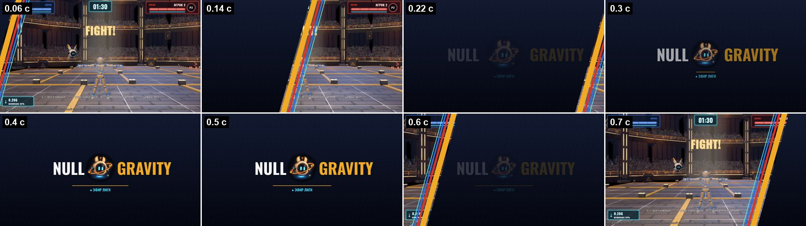
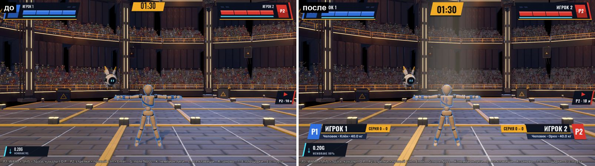
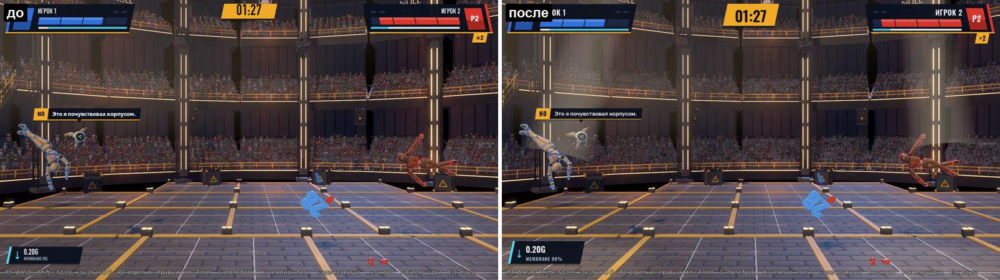
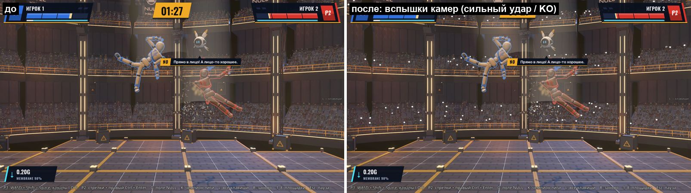
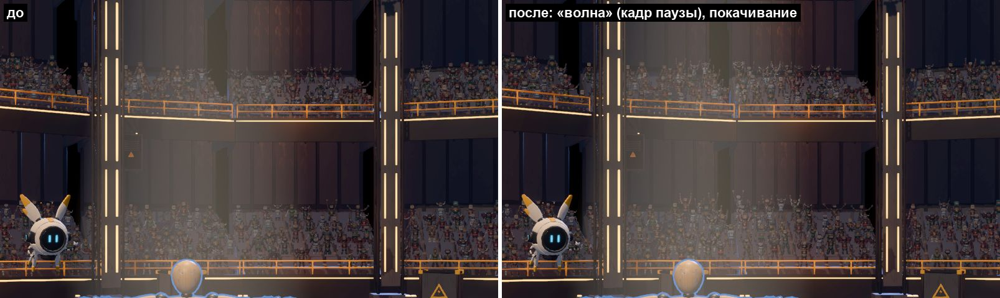
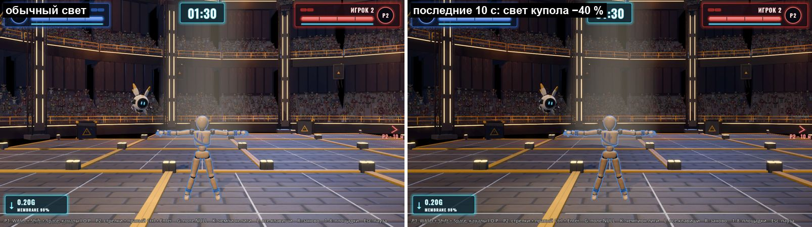
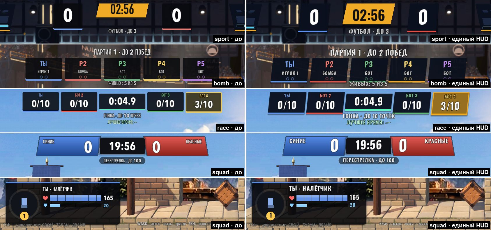

# Эфир Лиги (look-show), 06.10.2026

Направление `look-show` прохода по картинке (`../LOOK_PASS.md`, п. 6). Ветка `claude/look-show` от `claude/look-pass`.

Задача: игра подаётся как прямой эфир Лиги, который ведёт N0. Сделано:
- заставка между сценами;
- плашки бойцов перед боем;
- толпа, которая не спорит с бойцами;
- прожекторы ферм и свет финала;
- один стиль HUD вместо пяти.

Всё включено в игре. Каждая новинка — отдельный пункт панели «ВИД» (**Э**) в группе **«Эфир»**. По умолчанию все пункты включены; если пункт снять, вид сразу возвращается ровно к прежнему. **Shift+Э** переключает всё «до / после».

## Пункты панели «ВИД», группа «Эфир»

| Пункт (id) | Подпись | Что делает |
|---|---|---|
| `show_stinger` | Заставка Лиги между сценами | Вайп со знаком N0 и NULL GRAVITY поверх лоадера. |
| `show_plates` | Плашки бойцов в начале боя | «Нижние трети» P1 / P2 на отсчёте. |
| `show_crowd_dim` | Толпа приглушена | Толпа на 40 % темнее и на 25 % менее насыщенная. |
| `show_crowd_fx` | Толпа: вспышки камер, волна, покачивание | Вспышки фотокамер на сильном ударе и KO, «волна» на победе, лёгкое покачивание. |
| `show_spots` | Прожекторы ведут бойцов | Два прожектора ферм следят за P1 и P2, от фонаря виден луч. |
| `show_final_light` | Последние 10 с: свет купола гаснет | Общий свет −40 %, лучи и полосы ламп остаются. |
| `show_hud` | Единый HUD (шрифты и плашки режимов) | Два шрифта эфира во всех HUD; плашки HUD режимов — в стиле скина. |

## 1. Заставка-стингер Лиги



Слева въезжает тёмно-синяя шторка. На её косом крае — полосы цветов Лиги: янтарь, красные, синие, голубой NULL. Шторка закрывает экран за 0,28 с. В центре со щелчком появляются знак N0 и **NULL GRAVITY**: NULL белым, GRAVITY янтарём (как в `BRAND.md`), под ними «● ЭФИР ЛИГИ». После этого шторка уходит вправо и открывает кадр. Вся заставка идёт 0,8 с.

- **Когда лоадер закрывается** (новая сцена готова), играет полная заставка. Шторка закрывает экран как раз к концу гашения лоадера (0,28 с), поэтому склейку «лоадер → игра» не видно.
- **Когда лоадер появляется**, играет укороченная заставка: с закрытого экрана сразу знак и уход шторки (0,54 с). Получается ID канала перед экраном «подключение».

Устройство:
- Время берётся без масштаба: хит-стоп, замедление и пауза дерева заставку не тормозят. Шаг ограничен 1/20 с, поэтому рывок загрузки её не проматывает.
- Мышь заставка не ловит.
- Код — `godot/scripts/show/league_stinger.gd`.
- Точка подключения в `scripts/menu/loading.gd`:
  - два сигнала `opened` и `closing`;
  - ребёнок `LeagueShow`.

## 2. Плашки бойцов (нижние трети)



На отсчёте (`Match.Phase.COUNTDOWN`) снизу по краям въезжают плашки P1 (слева) и P2 (справа). Порядок появления:
1. блок цвета команды с «P1» выскакивает из-за края;
2. раскрывается имя;
3. раскрывается строка сборки;
4. щелчком появляется янтарная фишка счёта.

Плашки держатся 2,75 с и уезжают обратно до FIGHT!.

Что пишется на плашке:
- **Имя** — как на панели HUD: «ИГРОК 1»; в спорт-зале «БОТ»; в кампании имя игрока и титул соперника.
- **Сборка:**
  - у модульной куклы — чертёж и число деталей;
  - у манекена — «Человек · Клён / Орех»;
  - в обоих случаях — масса.
- **Фишка счёта:**
  - в кампании — запись лестницы;
  - в остальных боях — «СЕРИЯ 1 – 0» по коронам HUD за сессию.

Где плашки есть, а где нет:
- Есть в боях один на один: Быстрый бой, арены, кампания, спорт-зал.
- Нет у стычки, бомбы, гонки и PvE: у этих режимов своё вступление и больше двух бойцов.

Стиль — токены эфира (ниже) независимо от скина HUD. Плашки стоят выше индикатора поля.

Анимация шагает с ограниченным шагом. Первый кадр после загрузки сцены длится секунды, и обычный Tween проскочил бы всю анимацию разом — так и было на первом прогоне.

Код — `scripts/show/lower_thirds.gd`.

## 3. Толпа







Всё сделано в шейдере толпы `assets/shaders/crowd_sprite.gdshader`. Новые параметры `show_*` по умолчанию дают ровно прежний вид. Управляет ими `scripts/show/hall_show.gd` (ребёнок арены купола).

- **Приглушение:** яркость −40 %, насыщенность −25 %. Толпа читается как фон, бойцы — самое яркое в кадре.
- **Вспышки камер:**
  - у части зрителей на 1/14 с у лица загорается белая точка с HDR, поэтому её подхватывает glow;
  - сильный удар (от 8 HP) даёт вспышки пропорционально урону, KO и победа — максимум;
  - вспышки гаснут за ~0,6 с.
- **Волна на победе** (`match_over` с победителем) дважды проходит зал слева направо, по 2,4 с. В полосе волны зрители встают (подскок), поднимают руки и чуть светлеют. На стоп-кадре её видно плохо, в движении — хорошо.
- **Покачивание:** макушка спрайта ходит с фазой каждого зрителя; при азарте `cheer` сильнее. Раньше покачивания не было: зрители только меняли позы.

## 4. Свет: прожекторы ферм и финал



**Прожекторы.** Два прожектора зала (`Spot_1`, `Spot_2`, над левой и правой половиной) плавно, за ~0,2 с, ведут центр масс P1 и P2 с интерполяцией физики.

Что меняется у ведущих прожекторов:
- узкий конус 8° (было 22°);
- энергия 10 (было 6), затухание 0,6 (было 1,0);
- без теней: тень `Spot_2` выключается, это экономия.

Видимый луч — рисованный конус от фонаря к бойцу: аддитивный, яркая сердцевина, гаснет к бойцу (`scripts/show/show_beam.gdshader`). Объёмного тумана на Mobile нет, поэтому луч нарисован.

Первая версия луча была вдвое шире и с двумя стенками конуса. Получалось «молоко» поверх трибун, и я её сузил.

Во время выхода бойца (кампания) лампы зала гаснут, а ведущий прожектор остаётся на бойце.

**Свет финала.** Включается в последние 10 с боя и в Sudden Death (в спорте — золотой гол). За 1,2 с гаснут до 60 %:
- Key, Rim;
- 15 тёплых ламп, `Spot_0`, `Spot_3`;
- ambient и свет тумана окружения;
- толпа (у неё нет освещения, поэтому она гаснет отдельным множителем).

Что остаётся как было:
- ведущие прожекторы — их лучи становятся ярче в 1,8 раза;
- полосы ламп (эмиссия).

Средняя яркость кадра падает примерно на 17 %: основной свет в куполе дают эмиссия и туман. Со следующего боя свет возвращается.

Энергии запоминаются в момент, когда свет начинает гаснуть, и возвращаются, когда он вернулся. Поэтому выход бойца и пробы соседей, которые сами двигают лампы вне финала, не перебиваются. Окружение и материал толпы — ресурсы сцены (общие в кэше), и при выходе из купола они возвращаются как были.

## 5. Единый HUD



### Сколько HUD и чем отличались

| HUD | Шрифты | Плашки | Цвета |
|---|---|---|---|
| HUD боя: купол, арены, кампания (`scenes/ui/hud.gd` + скины `HudSkin`) | Системные по скину:<br>• трансляция — DIN Condensed, крупное — Avenir Next Condensed Heavy Italic;<br>• неон — Avenir Next с разрядкой;<br>• LED — DIN Condensed + точки | Скин:<br>• косые `BcStyle`;<br>• стекло;<br>• табло | `PLAYER_COLORS`, янтарь `Broadcast.AMBER`, голубой `FIELD` |
| Спорт (`SportHud`, поверх HUD боя) | `HudSkin` display | Свои `StyleBoxFlat`: тёмный прямоугольник, скругление 4, полоса снизу 6 px | цвет игрока +35 % светлее |
| Стычка (`SquadHud`) | `HudSkin` display на всём (в трансляции — курсив и в подписях) | Почти всё рисуется в `_draw`: косые градиентные плашки команд, скруглённые карточки | `SQUAD_COLORS` (= синие / красные игроков), своё «золото» (1, 0.8, 0.32) |
| Бомба (`BombHud`) | `HudSkin` display | Свои `StyleBoxFlat` со скруглением 4 и полосой снизу; у держателя бомбы — красная заливка | 5 цветов, оранжевый `COLOUR_BOMB` |
| Гонка (`RaceHud`) | `HudSkin` display | Свои `StyleBoxFlat`; у лидера — рамка целиком; часы с мятной полосой | `PLAYER_COLORS`, мятный цвет точки |
| PvE (`PveHud`) | Деревянная тема `hud_theme.tres` | Доски с рамкой | — |
| Гараж, лоадер, пауза, кампания в ТВ | Oswald / Rubik / JetBrains Mono (файлы проекта) | Эфир ТВ | `ACCENT` (1, 0.55, 0.2), янтарь лоадера (0.95, 0.75, 0.2) |

Сколько разных янтарей и голубых:
- **янтарей пять:** зал, лоадер, гараж, «золото» стычки, кольцо N0;
- **голубых четыре.**

Шрифтов в боевых HUD — три системных семейства, которых нет на машине без macOS: там всё падает в узкий Arial. В меню при этом свои Oswald и Rubik.

### Токены (`scripts/show/show_tokens.gd`, `ShowTokens`)

**Палитра:**
- голубой NULL (0.27, 0.89, 1.0);
- янтарь Лиги (0.94, 0.67, 0.15);
- синие `#2f6fde` и красные `#d9342b` — те же, что `PLAYER_COLORS` и `SQUAD_COLORS`;
- тёмно-синяя плашка, белый текст, приглушённый текст, красный тревоги;
- наклон плашек 12°.

**Два шрифта** — оба OFL, с кириллицей, уже лежат в `assets/fonts`:
- **Oswald** — имена, цифры, надписи (веса 600 / 700);
- **Rubik** — реплики и подписи.

### Что делает пункт `show_hud`

- **Шрифты.** `HudSkin.font()` и `HudSkin.theme()` отдают шрифты токенов. Это два коротких хука в `hud_skin.gd`, вёрстка не менялась.
  - Шрифты меняются во **всех** HUD: в бою, в режимах, у реплик N0, в голосовании.
  - Эффекты скинов остаются:
    - трансляция — наклон крупных надписей (синтетический курсив Oswald);
    - неон — разрядка и свечение;
    - LED — точки.
  - Переключение на лету идёт тем же сигналом, что смена скина на **H**.
- **Плашки HUD режимов** (спорт, бомба, гонка, стычка). Узел `HudUnify` (`scripts/show/hud_unify.gd`) перекрашивает их `StyleBoxFlat` на месте в грамматику текущего скина:
  - **трансляция** — косая тёмно-синяя плашка с полосой цвета снизу; у «горячей» плашки (держатель бомбы, лидер гонки) — рамка целиком;
  - **неон** — стекло со свечением цвета;
  - **LED** — табло.

  Цвет полосы берётся из палитры токенов по оттенку:
  - синий → синие;
  - красный → красные;
  - оранжевый → янтарь;
  - голубой → NULL;
  - зелёный, фиолетовый и мятный — как были.

  Если режим создаёт новые стили (смена скина, лидер, держатель), они подхватываются в том же кадре.

**Что без переделки вёрстки не сделать** (и не сделано):
- Плашки стычки рисуются в `_draw`. Скругления там — часть рисунка (полосы HP, деления, кольца), перекраска на месте их сломала бы. У стычки поменялись только шрифты.
- PvE-HUD на деревянной теме.

План, если автор выберет единый вид:
1. Вынести рисование плашек стычки в общий `ShowTokens.plate(rect, роль, цвет)` по образцу `BcStyle` (полоса, рамка, наклон, свечение по скину) — около 15 мест `_round(...)` в `squad_hud.gd`.
2. PvE-HUD перевести на `HudSkin.theme()`, как сделано у HUD боя.
3. Константы цветов режимов (`GOLD`, `COLOUR_BOMB`, мятный цвет точки) заменить токенами.

## Цена кадра

`tests/look_show_fps.tscn` (окно 1600×900 через `godot_nofocus.sh`, vsync выкл, авто-масштаб Gfx выкл без записи настроек, купол, куклы дерутся). Отрезки по 5 с «эфир выкл / вкл» (все пункты группы «Эфир») чередуются 3–4 раза, первая секунда отрезка не считается, медиана по часам:

| Прогон | load average | «Эфир» выкл: медиана / p95 | «Эфир» вкл: медиана / p95 | Разница медиан |
|---|---|---|---|---|
| 1 (3 × 5 с) | 94–142 | 16,16 мс (62 fps) / 33,65 мс | 12,06 мс (83 fps) / 28,36 мс | −4,10 мс |
| 2 (4 × 5 с) | 131–205 | 21,81 мс (46 fps) / 34,79 мс | 21,44 мс (47 fps) / 31,12 мс | −0,37 мс |
| 3 (4 × 5 с, `final=1` — свет финала во включённых отрезках) | 139–229 | 13,73 мс (73 fps) / 18,26 мс | 12,86 мс (78 fps) / 17,15 мс | −0,88 мс |

GPU-время (`viewport_get_measured_render_time_gpu`) на Metal возвращает 0, поэтому не снято.

Во время замеров машина была сильно загружена: load average 94–229, параллельно работали ещё 4 агента прохода и другие сессии. Абсолютные мс поэтому ничего не значат: между прогонами медиана плавает от 12 до 22 мс. Значит только сравнение внутри прогона, где отрезки чередуются.

Во всех трёх прогонах с «эфиром» кадр не дороже: медиана −0,4…−4 мс, p95 тоже ниже. Почему так, по устройству:
- добавились 2 прозрачных конуса лучей и ~20 строк шейдера толпы;
- два прожектора, которые и так были в сцене, теперь ведут бойцов;
- зато ушла тень одного SpotLight3D (`Spot_2`).

Замер на свободной машине не делал. Повторить так:

```
godot/tools/godot_nofocus.sh --path godot --resolution 1600x900 res://tests/look_show_fps.tscn -- "seg=5,rounds=4"
```

## Проверки

- `tests/look_show_probe.tscn` (headless, `--fixed-fps 60`) — 36 проверок, exit 0/1:
  - стингер: шторка закрывает и открывает экран, играет по сигналам лоадера, гаснет сама, выключенный пункт не играет;
  - купол: толпа (вкл / выкл), вспышки на сильном ударе и KO (слабый удар без вспышек), волна на победе;
  - прожекторы на P1 / P2 с точностью до 6°, при выключении — исходные трансформ, угол, тени, лучей нет;
  - свет финала ×0,60 (лампы, ambient, толпа), выключение и новый бой возвращают свет;
  - плашки: две на отсчёте, текст, место в кадре, выключение, уход;
  - единый HUD: шрифты Oswald / Rubik и обратно системные, плашки спорта и гонки перекрашены и возвращены.
  - `only=stinger|hall|plates|hud`.
- `tests/look_show_snapshot.tscn` (окно) — кадры «до / после»:
  - как `look_capture`;
  - плюс `final=1`, `flash=1`, `wave=0.4`, `iso=<id>` («до» = выключен только этот пункт), `skin=…`, серия заставки `stinger=0.1;0.2;…`.
- `tests/look_show_fps.tscn` (окно) — замер выше.
- Пробы вёрстки на всех языках — `i18n_layout_probe` теперь снимает купол с плашками бойцов в конечном положении (`_settle_show`).

Прогоны после правок (headless, все exit 0, если не сказано иное):
- `look_show_probe` — 36 / 36;
- `look_probe`, `hud_skin_probe` (шрифт имени = `HudSkin.font("plate")` и с токенами);
- `menu_probe`, `flow_probe`, `garage_menu_probe` — лоадер, гараж, пауза, выход в гараж с заставкой;
- `arena_events_probe` — выход бойца, свет зала гаснет и возвращается;
- `null_field_probe`, `campaign_probe` (лестница, настоящий бой), `match_probe`;
- `i18n_probe`, `i18n_scenes_probe`, `python3 godot/tools/i18n.py check` (ошибок 0).

`i18n_layout_probe`:
- **Первый прогон** (load average > 100) дал FAIL en: 5 «бед» в `campaign:ladder / win / loss`. Подписи сопоставились не с теми узлами: у русского и английского прохода разошёлся путь узлов.
- **Повтор** `langs=en` — `ok en`, exit 0.
- **Чистая база `a100e41`** в отдельном worktree — FAIL en с одной бедой `look:panel`: подсказка «Э — закрыть…» вылезает из панели «ВИД». Это красное ещё до моих правок, у look-pass. У меня этой беды нет: с семью пунктами «Эфира» панель стала шире.

Кампания в ТВ мои узлы не получает (матча там нет), поэтому считаю эти беды плавающими под нагрузкой. Не доказано.

Оконные:
- `hud_snapshot` на трёх скинах — `"ok": true`, кадры с Oswald / Rubik;
- `look_show_snapshot` — все кадры этого документа;
- `look_show_fps` — таблица выше.

## Точки подключения в общих файлах

- `scripts/menu/loading.gd`:
  - сигналы `opened` / `closing`;
  - в `_ready` — ребёнок `LeagueShow`.

  Своей автозагрузки нет: список автозагрузок общий у пяти веток прохода.
- `scripts/ui/hud_skin.gd`: в `font()` и `theme()` — по одному `if ShowTokens.unified`.
- `assets/shaders/crowd_sprite.gdshader`: новые параметры `show_*`, по умолчанию — прежний вид.
- `tests/i18n_layout_probe.gd`: `_settle_show` перед кадром купола.
- `locale/en.json`: 10 строк в конце.

`LeagueShow` (`scripts/show/league_show.gd`) сам находит по `SceneTree.node_added`:
- арену купола (по скрипту `null_hall.gd`) → `HallShow`;
- HUD режимов (по скриптам) → `HudUnify`;
- матч → `LowerThirds`.

Помощники грузятся лениво. Сцены не правились.

## Не сделано / риски

- **Стычка и PvE** — см. «Единый HUD»: у стычки только шрифты, PvE не трогал.
- **Пересечение с look-frame.** В `LOOK_PASS.md` у look-frame тоже есть «приглушить толпу и лампы». Толпу здесь гашу шейдером толпы (`show_crowd_dim`). Если look-frame гасит её цветокоррекцией, при слиянии нужно оставить один из двух.
- **Свет финала и окружение.** Свет финала трогает энергию ламп купола и ambient / свет тумана окружения — только пока идёт финал. Если look-frame правит те же поля окружения в тот же момент, последним пишет тот, кто возвращает. Не проверено вместе с их веткой.
- **Снимки других проб сразу после лоадера.** Заставка (0,8 с) поверх кадра попадёт в снимки проб, которые фотографируют в первые 0,8 с после закрытия лоадера. Такие пробы: выключить `show_stinger` или ждать 1 с. Сам я таких не нашёл. Не проверял все оконные пробы.

## Вопросы автору

1. **Шрифты HUD.** Oswald + Rubik (файлы проекта, кириллица) вместо системных DIN Condensed / Avenir Next — оставить? Затронуты все три скина: неон теряет круглый Avenir.
2. **Заставка.** Сейчас она играет на каждом лоадере, в том числе на старте игры: 0,5 с при появлении и 0,8 с при уходе. Не много ли? Можно оставить только при уходе.
3. **Плашки в кампании.** Там они идут сразу после выхода бойцов, у которого своя карточка. Оставить или убрать в кампании?
4. **Свет финала.** −40 % по ТЗ дают около −17 % яркости кадра: светят эмиссия ламп и туман. Нужно сильнее (гасить и полосы ламп)?
5. **Луч прожектора.** Сейчас мягкий. Сделать заметнее, как в телешоу, или убрать совсем и оставить только свет на бойце?
